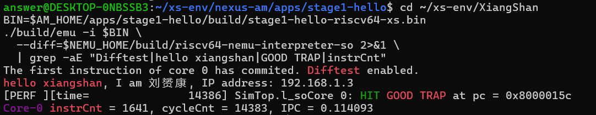

# 香山环境部署与验证操作日志

> CIE 香山赛道第一阶段 1.1 与 1.2

> 团队：一拍即合 姓名 ：刘赟康

# **阅读目录**

点击目录条目跳到对应章节。页脚的“目录”可返回此处。

**[第 1 章 阶段目标与验收标准](#第-1-章-阶段目标与验收标准) [[2](#第-1-章-阶段目标与验收标准)](#第-1-章-阶段目标与验收标准)**

> [1.1 阶段目标](#阶段目标) [[2](#阶段目标)](#阶段目标)
>
> [1.2 验收标准](#验收标准) [[2](#验收标准)](#验收标准)

**[第 2 章 软硬件基线](#第-2-章-软硬件基线) [[2](#第-2-章-软硬件基线)](#第-2-章-软硬件基线)**

> [2.1 主机与操作系统](#主机与操作系统) [[2](#主机与操作系统)](#主机与操作系统)
>
> [2.2 工具链与依赖](#工具链与依赖) [[3](#工具链与依赖)](#工具链与依赖)
>
> [2.3 目录布局](#目录布局) [[3](#目录布局)](#目录布局)
>
> [2.4 源码版本](#源码版本) [[3](#源码版本)](#源码版本)

**[第 3 章 部署过程](#第-3-章-部署过程) [[4](#第-3-章-部署过程)](#第-3-章-部署过程)**

> [3.1 获取 xs-env 骨架](#获取-xs-env-骨架) [[4](#获取-xs-env-骨架)](#获取-xs-env-骨架)
>
> [3.2 安装系统依赖与交叉工具链](#安装系统依赖与交叉工具链) [[4](#安装系统依赖与交叉工具链)](#安装系统依赖与交叉工具链)
>
> [3.3 编译 Verilator](#编译-verilator) [[4](#编译-verilator)](#编译-verilator)
>
> [3.4 拉取子仓库](#拉取子仓库) [[4](#拉取子仓库)](#拉取子仓库)
>
> [3.5 配置环境变量](#配置环境变量) [[5](#配置环境变量)](#配置环境变量)
>
> [3.6 编译 NEMU 参考模型](#编译-nemu-参考模型) [[5](#编译-nemu-参考模型)](#编译-nemu-参考模型)
>
> [3.7 编译 RTL 仿真器](#编译-rtl-仿真器) [[5](#编译-rtl-仿真器)](#编译-rtl-仿真器)
>
> [3.8 编写 hello 程序](#编写-hello-程序) [[6](#编写-hello-程序)](#编写-hello-程序)
>
> [3.9 编译并运行](#编译并运行) [[6](#编译并运行)](#编译并运行)

**[第 4 章 运行结果](#第-4-章-运行结果) [[7](#第-4-章-运行结果)](#第-4-章-运行结果)**

> [4.1 编译输出](#编译输出) [[7](#编译输出)](#编译输出)
>
> [4.2 仿真输出](#仿真输出) [[7](#仿真输出)](#仿真输出)
>
> [4.3 结果判读](#结果判读) [[8](#结果判读)](#结果判读)

**[第 5 章 遇到的问题与处理](#第-5-章-遇到的问题与处理) [[8](#第-5-章-遇到的问题与处理)](#第-5-章-遇到的问题与处理)**

> [5.1 重启终端后环境变量为空](#重启终端后环境变量为空) [[8](#重启终端后环境变量为空)](#重启终端后环境变量为空)
>
> [5.2 工具链前缀不匹配](#工具链前缀不匹配) [[8](#工具链前缀不匹配)](#工具链前缀不匹配)
>
> [5.3 裸机环境没有网络栈](#裸机环境没有网络栈) [[8](#裸机环境没有网络栈)](#裸机环境没有网络栈)

**[第 6 章 结论](#第-6-章-结论) [[8](#第-6-章-结论)](#第-6-章-结论)**

**[附录 A 复现命令汇总](#附录-a-复现命令汇总) [[9](#附录-a-复现命令汇总)](#附录-a-复现命令汇总)**

# **第 1 章 阶段目标与验收标准**

在 WSL2 上搭建 xs-env 后，交叉工具链编出了 RISC-V 裸机镜像。香山 RTL 仿真器加载镜像并打印了预期的 hello 字符串，Difftest 启动后运行到 GOOD TRAP。本日志记录环境配置、构建命令和各步检查结果，便于复现。

## **1.1 阶段目标**

> — 在本机搭起 xs-env 环境，包含 XiangShan RTL、NEMU 参考模型和 nexus-am 测试框架。
>
> — 交叉编译一个 hello 程序，输出 hello xiangshan, I am \<姓名\>, IP address: \<IP\>。
>
> — 在香山 RTL 仿真器上运行该程序，全程开启 difftest，与 NEMU 逐条比对。

## **1.2 验收标准**

按下表依次检查工具链、路径、构建产物和运行输出。前一项失败时，先排查该项再继续。

表 1 环境验收检查项

| 编号 | 检查项        | 通过条件                                    |
|------|---------------|---------------------------------------------|
| V1   | 交叉工具链    | riscv64-linux-gnu-gcc --version 输出版本号  |
| V2   | 环境变量      | 三个变量均指向 ~/xs-env 下的实际目录        |
| V3   | NEMU 参考模型 | 生成 build/riscv64-nemu-interpreter-so      |
| V4   | RTL 仿真器    | 生成 build/emu，可执行                      |
| V5   | 测试镜像      | 编译出 stage1-hello-riscv64-xs.bin          |
| V6   | 程序输出      | 打印 hello xiangshan, I am …, IP address: … |
| V7   | 协同比对      | 出现 Difftest enabled 与 HIT GOOD TRAP      |

# **第 2 章 软硬件基线**

以下配置来自本次部署，复现时可用来核对操作系统、工具版本和工程目录。

## **2.1 主机与操作系统**

表 2 主机与操作系统

| 项目     | 配置                                      |
|----------|-------------------------------------------|
| 运行方式 | WSL2（Windows Subsystem for Linux 2）     |
| 内核     | 6.18.33.2-microsoft-standard-WSL2，x86_64 |
| 发行版   | Ubuntu 22.04.5 LTS                        |
| CPU 核心 | 24                                        |
| 内存     | 15 GiB                                    |
| 磁盘     | 1007 GiB，占用 19 GiB                     |

## **2.2 工具链与依赖**

交叉工具链由 xs-env 的依赖脚本统一安装，Verilator 从源码编译，其余为 Ubuntu 软件源提供的版本。

表 3 工具链及构建依赖

| 组件                  | 版本        | 用途                                  |
|-----------------------|-------------|---------------------------------------|
| riscv64-linux-gnu-gcc | 11.4.0      | 交叉编译测试程序                      |
| riscv64-linux-gnu-ld  | GNU ld 2.38 | 链接裸机镜像                          |
| Verilator             | 5.048       | 把 Chisel 生成的 Verilog 编译成仿真器 |
| Java                  | 21.0.12 LTS | 运行 Chisel 与 mill                   |
| Python                | 3.10.12     | 构建脚本与辅助工具                    |
| GNU Make              | 4.3         | 驱动各工程构建                        |

## **2.3 目录布局**

XiangShan、NEMU 和 nexus-am 都放在 ~/xs-env 下，通过环境变量定位。迁移目录后，需要同步更新这三个变量。

表 4 工程目录与占用空间

| 路径               | 内容                           | 体积   |
|--------------------|--------------------------------|--------|
| ~/xs-env/XiangShan | 香山 RTL、Chisel 源码与仿真器  | 11 GB  |
| ~/xs-env/NEMU      | 参考模型，提供 difftest 动态库 | 77 MB  |
| ~/xs-env/nexus-am  | 裸机测试框架与应用目录         | 16 MB  |
| ~/xs-env/verilator | Verilator 源码与构建产物       | 626 MB |

## **2.4 源码版本**

xs-env 同时管理顶层工程和子模块。下表列出复现时要核对的工程，具体提交号以 xs-env 的版本记录文件和各仓库的 git rev-parse HEAD 输出为准。

表 5 复现时核对的工程与子模块

| 工程        | 说明         |
|-------------|--------------|
| XiangShan   | 顶层         |
| NEMU        | 参考模型     |
| nexus-am    | 测试框架     |
| yunsuan     | 向量乘法单元 |
| rocket-chip | 外设与总线   |
| coupledL2   | 二级缓存     |
| difftest    | 比对框架     |
| utility     | 公共库       |

后续阶段在 NEMU 与 XiangShan 的工作区应用指令扩展补丁，基线提交号保持不变。

# **第 3 章 部署过程**

先克隆 xs-env 并安装工具，再拉取子模块、设置环境变量。确认路径后，分别构建 NEMU 参考库和香山仿真器。

## **3.1 获取 xs-env 骨架**

xs-env 是香山官方提供的环境仓库，把 XiangShan、NEMU、nexus-am 和 Verilator 作为子模块统一管理，并提供依赖安装与环境变量脚本。

命令 1 克隆环境仓库

> git clone https://github.com/OpenXiangShan/xs-env.git ~/xs-env  
> cd ~/xs-env  
> ls

克隆后核对 setup.sh、setup-tools.sh、install-verilator.sh、update-submodule.sh 和 env.sh 是否都在目录中。

## **3.2 安装系统依赖与交叉工具链**

setup-tools.sh 用 apt 安装构建依赖和 riscv64 交叉工具链，需要 root 权限。安装时间取决于软件源速度。

命令 2 安装依赖

> sudo ./setup-tools.sh  
> riscv64-linux-gnu-gcc --version \| head -1  
> riscv64-linux-gnu-ld --version \| head -1

本次 GCC 和 GNU ld 分别为 11.4.0 和 2.38。复现时保留版本输出，便于判断工具链变动是否影响了构建。

## **3.3 编译 Verilator**

Chisel 生成香山 RTL，Verilator 再把 RTL 转成 C++ 仿真模型。本次用脚本从源码构建 Verilator，以支持工程使用的语法。

命令 3 编译仿真器工具

> ./install-verilator.sh  
> verilator --version

本次版本输出为 Verilator 5.048 2026-04-26 rev v5.048。

## **3.4 拉取子仓库**

update-submodule.sh 按 xs-env 记录的提交拉取子模块。

命令 4 拉取子模块

> ./update-submodule.sh  
> ls -d XiangShan NEMU nexus-am

确认 XiangShan、NEMU 和 nexus-am 三个子模块目录均存在。本次目录体积分别约为 11 GB、77 MB 和 16 MB。复现时按第 2.4 节核对提交。

## **3.5 配置环境变量**

AM_HOME 指向测试框架，NOOP_HOME 指向香山工程，NEMU_HOME 指向参考模型工程。把三个变量写进 .bashrc 后，新开的 Bash 终端会加载这些设置。

命令 5 写入 .bashrc

> cat \>\> ~/.bashrc \<\<'EOF'  
> \# xs-env (XiangShan / NEMU / nexus-am)  
> export AM_HOME=\$HOME/xs-env/nexus-am  
> export NEMU_HOME=\$HOME/xs-env/NEMU  
> export NOOP_HOME=\$HOME/xs-env/XiangShan  
> EOF  
> source ~/.bashrc  
> echo \$AM_HOME \$NEMU_HOME \$NOOP_HOME

三个变量应分别指向 /home/\<用户\>/xs-env/nexus-am、/home/\<用户\>/xs-env/NEMU 和 /home/\<用户\>/xs-env/XiangShan。本机的设置位于 .bashrc 第 121 至 124 行。

## **3.6 编译 NEMU 参考模型**

Difftest 在运行时加载 NEMU 动态库，用参考模型执行与 RTL 对应的指令并比对架构状态。下面先构建参考库，供第 3.9 节运行仿真时加载。

命令 6 构建参考模型

> make -C \$NEMU_HOME -j1  
> ls -lh \$NEMU_HOME/build/riscv64-nemu-interpreter-so

本次生成的 riscv64-nemu-interpreter-so 大小为 529 KB。构建参考库需要启用 RVV 和共享库支持。

## **3.7 编译 RTL 仿真器**

构建先生成 RTL，再由 Verilator 和 C++ 工具链生成仿真器。单核构建通常需要半小时以上。本次用 EMU_TRACE=0 关闭波形追踪，需要波形时再用相应配置构建。

命令 7 构建 RTL 仿真器

> make -C \$NOOP_HOME emu \\  
> CONFIG=MinimalConfig NUM_CORES=1 \\  
> JVM_XMX=4G EMU_TRACE=0 NO_DIFF=0 -j1  
> ls -lh \$NOOP_HOME/build/emu

本次生成约 264 MB 的 build/emu。NUM_CORES=1 固定为单核配置，便于复现相同条件下的周期记录。本机内存为 15 GiB，JVM_XMX=4G 可完成此次构建。

## **3.8 编写 hello 程序**

测试放在 nexus-am 的 apps 目录。本用例运行的裸机环境无法查询主机 IP，因此在 identity.h 中把姓名和部署主机 IP 定义为字符串宏。

代码 1 identity.h

> \#ifndef \_\_IDENTITY_H\_\_  
> \#define \_\_IDENTITY_H\_\_  
>   
> \#define TEAM_ID "刘赟康"  
> \#define HOST_IP "192.168.1.3"  
>   
> \#endif

代码 2 main.c

> \#include \<am.h\>  
> \#include \<klib.h\>  
> \#include "identity.h"  
>   
> int main(const char \*args) {  
> (void)args;  
> printf("hello xiangshan, I am %s, IP address: %s\n", TEAM_ID, HOST_IP);  
> return 0;  
> }

代码 3 Makefile

> NAME = stage1-hello  
> SRCS = main.c  
> include \$(AM_HOME)/Makefile.app

## **3.9 编译并运行**

用 ARCH=riscv64-xs 选择香山目标，并显式传入 riscv64-linux-gnu- 前缀。运行仿真器时，-i 指向测试镜像，--diff 指向参考库。

命令 8 编译并运行

> cd \$AM_HOME/apps/stage1-hello  
> make clean ARCH=riscv64-xs CROSS_COMPILE=riscv64-linux-gnu-  
> make ARCH=riscv64-xs CROSS_COMPILE=riscv64-linux-gnu-  
>   
> cd \$NOOP_HOME  
> BIN=\$AM_HOME/apps/stage1-hello/build/stage1-hello-riscv64-xs.bin  
> ./build/emu -i \$BIN \\  
> --diff=\$NEMU_HOME/build/riscv64-nemu-interpreter-so

# **第 4 章 运行结果**

以下终端记录采集于 2026 年 11 月 8 日 12 时。摘录省去了颜色控制字符、退出时的 PERF 采样输出和主机耗时统计。

## **4.1 编译输出**

输出 1 stage1-hello 编译

> \# Building stage1-hello \[riscv64-xs\] with AM_HOME {/home/answer/xs-env/nexus-am}  
> rm -rf /home/answer/xs-env/nexus-am/apps/stage1-hello/build/  
> \# Building stage1-hello \[riscv64-xs\] with AM_HOME {/home/answer/xs-env/nexus-am}  
> + CC main.c  
> \# Building lib-am \[riscv64-xs\]  
> + AS src/nemu/common/mainargs.S  
> + AR -\> build/am-riscv64-xs.a  
> \# Building lib-klib \[riscv64-xs\]  
> \# Creating binary image \[riscv64-xs\]  
> + LD -\> build/stage1-hello-riscv64-xs.elf  
> + OBJCOPY -\> build/stage1-hello-riscv64-xs.bin

本次编译未报告告警，退出码为 0。镜像只有几 KB，使用的是裸机框架和所需的 klib 函数。

## **4.2 仿真输出**

输出 2 RTL 仿真运行

> emu compiled at Nov 4 2026, 17:22:44  
> Using simulated 32768B flash  
> Using simulated 8386560MB RAM  
> The image is /home/answer/xs-env/nexus-am/apps/stage1-hello/build/stage1-hello-riscv64-xs.bin  
> The reference model is /home/answer/xs-env/NEMU/build/riscv64-nemu-interpreter-so  
> The first instruction of core 0 has commited. Difftest enabled.  
> hello xiangshan, I am 刘赟康, IP address: 192.168.1.3  
> Core 0: HIT GOOD TRAP at pc = 0x8000015c  
> Core-0 instrCnt = 1641, cycleCnt = 14383, IPC = 0.114093

图 1 hello 程序的 RTL 与 NEMU 协同仿真输出

本次运行记录为 1641 条指令、14383 个仿真周期，IPC 为 0.114093。后续测周期沿用仿真计数器，主机耗时单独记录。

## **4.3 结果判读**

先确认参考库已加载并出现 Difftest enabled，再核对 hello 字符串，最后检查 GOOD TRAP。

表 6 运行输出与验收项的对应关系

| 输出内容                | 含义                         | 对应验收 |
|-------------------------|------------------------------|----------|
| Difftest enabled        | 参考模型已加载，比对通道打开 | V7       |
| hello xiangshan, I am … | 程序在香山 RTL 上执行并打印  | V6       |
| HIT GOOD TRAP           | 程序正常结束，未触发异常     | V7       |

GOOD TRAP 记录了程序正常结束。差分验证还要查看 Difftest enabled 之后是否出现失配。本次日志显示比对已启动，随后运行到 GOOD TRAP。

# **第 5 章 遇到的问题与处理**

本次部署遇到的三个问题分别出在 shell 变量、工具链前缀和裸机程序获取 IP 的方式。

## **5.1 重启终端后环境变量为空**

重新打开 WSL 终端后，make 报 AM_HOME 为空，无法找到 Makefile.app。

此前只在当前 shell 中执行过 export，关闭终端后变量随进程退出而丢失。

将三行 export 追加到 ~/.bashrc，位置见第 3.5 节。

## **5.2 工具链前缀不匹配**

直接执行 make 时出现 riscv64-unknown-elf-gcc: command not found。

nexus-am 默认使用 riscv64-unknown-elf 前缀，本机安装的是 riscv64-linux-gnu 工具链。

构建时同时传入 ARCH=riscv64-xs 和 CROSS_COMPILE=riscv64-linux-gnu-。第 3.9 节给出完整命令。

## **5.3 裸机环境没有网络栈**

题目要求打印本机 IP。本用例的裸机环境没有可用的 socket 接口，运行时无法查询该地址。

当前测试使用 nexus-am 提供的裸机接口，未接入网络驱动和协议栈。

在 identity.h 中写入姓名与部署主机 IP，编译时把字符串带入镜像。

# **第 6 章 结论**

交叉工具链和环境变量通过检查，NEMU 参考库、香山仿真器与 hello 镜像均已生成。仿真打印了预期的姓名和 IP，Difftest 启动后运行到 HIT GOOD TRAP。该环境用于后续指令扩展和协同仿真。

迁移环境时可先按第二章核对工具链前缀、环境变量和子模块提交。第五章记录了本次遇到的具体报错和处理命令。

# **附录 A 复现命令汇总**

以下命令假定仓库克隆到 ~/xs-env。编译测试镜像前，先按第 3.8 节准备 stage1-hello 的源文件。

命令 A-1 完整流程

> git clone https://github.com/OpenXiangShan/xs-env.git ~/xs-env  
> cd ~/xs-env  
> sudo ./setup-tools.sh  
> ./install-verilator.sh  
> ./update-submodule.sh  
>   
> cat \>\> ~/.bashrc \<\<'EOF'  
> export AM_HOME=\$HOME/xs-env/nexus-am  
> export NEMU_HOME=\$HOME/xs-env/NEMU  
> export NOOP_HOME=\$HOME/xs-env/XiangShan  
> EOF  
> source ~/.bashrc  
>   
> make -C \$NEMU_HOME -j1  
> make -C \$NOOP_HOME emu CONFIG=MinimalConfig NUM_CORES=1 \\  
> JVM_XMX=4G EMU_TRACE=0 NO_DIFF=0 -j1  
>   
> cd \$AM_HOME/apps/stage1-hello  
> make clean ARCH=riscv64-xs CROSS_COMPILE=riscv64-linux-gnu-  
> make ARCH=riscv64-xs CROSS_COMPILE=riscv64-linux-gnu-  
>   
> cd \$NOOP_HOME  
> BIN=\$AM_HOME/apps/stage1-hello/build/stage1-hello-riscv64-xs.bin  
> ./build/emu -i \$BIN \\  
> --diff=\$NEMU_HOME/build/riscv64-nemu-interpreter-so
