# 香山 vadd 指令执行通路

> CIE 香山赛道第一阶段 1.3｜从取指译码到写回与提交

团队：一拍即合

这条 vadd 的结果在 3075 写入物理向量寄存器 63；同一记录点，目标指令出现在有效提交槽。3076，ROB 对应表项失效。3078，逻辑寄存器 v1 的已提交映射由 0x3A 改为 0x3F。下文从译码入口开始，沿这条动态指令核对各级状态。

追踪对象：vadd.vv v1, v3, v2，PC 为 0x80000286，机器码为 0x023100D7。v2、v3 是两个逻辑源，v1 是旧目标。重命名后，psrc0、psrc1、psrc2 分别为 0x3C、0x3E、0x3A，新物理目标 pdest 为 0x3F。

附录 B 列出源码提交和子模块基线。后端层级的公共前缀为 TOP.SimTop.l_soc.core_with_l2.core.backend，后文引用局部信号时省略这个前缀。

图中总线值按十六进制读。第一章第三节说明这次 VCD 的记录坐标怎样对应仿真周期。

## **整核目标的连续记录**

表 1 目标指令的整核记录

| 记录坐标    | 阶段                | 本次证据                                                               |
|-------------|---------------------|------------------------------------------------------------------------|
| 3015        | 译码输入            | 目标位于输入第 0 路 [图 1-1](#Fig_1_2)                                 |
| 3016        | 复杂译码输出        | 目标锁存并形成一个有效微操作 [图 1-2](#Fig_1_2)                        |
| 3017        | Rename              | 输入输出握手 psrc=3C/3E/3A pdest=3F [图 2-1](#Fig_2_1)                 |
| 3018        | Dispatch 和 IQ 入队 | 全局出口 16 到向量局部入口 2 [图 3-3](#Fig_3_3)、[3-4](#Fig_3_4)       |
| 3019 / 3020 | IQ 保存位置推进     | 入队项转到复杂项 0 [图 4-1](#Fig_4_1)、[4-2](#Fig_4_2)                 |
| 3023        | 旧目标依赖消除      | srcType2 由 4 变 0 srcState2 置 1 [图 4-3](#Fig_4_3)                   |
| 3068 / 3069 | 选择和发射          | deqSel 后延迟输出有效 [图 4-5](#Fig_4_5)                               |
| 3070 / 3071 | 取数和传递          | DataPath 后经 Og2 到旁路输出 [图 4-7](#Fig_4_7)                        |
| 3072        | 执行入口            | 有效 FU 输入 SEW=8 vm=1 操作数匹配 [图 4-9](#Fig_4_9)                  |
| 3073        | MGU 与执行输出      | VL=2 vstart=0 ta=1 FU 结果有效，执行单元输出已复核 [图 5-2](#Fig_5_2)  |
| 3074        | 写端口与完成通知    | 分片写端口有效；ROB 完成通知有效 [图 6-3](#Fig_6_3)、[6-5](#Fig_6_5)   |
| 3075        | 物理结果与提交接口  | 四份 mem_63 更新；完成计数清零；目标在提交槽 0 有效 [图 6-7](#Fig_6_7) |
| 3076        | ROB 表项释放        | robEntries_25.valid 降为 0 [图 6-7](#Fig_6_7)                          |
| 3078        | 已提交映射          | 逻辑 v1 的 arch_table_1 从 3A 更新为 3F [图 6-8](#Fig_6_8)             |

上表汇总同一次整核仿真中 3015 至 3078 的记录。第七章把这些观测归纳为数据流、状态更新和各级的记录间隔。

# **快速审阅路线**

下表列出每项结论对应的波形。图号和页码可直接跳转，页脚的“目录”可返回章节目录。

表 2 关键结论与波形入口

<table>
<colgroup>
<col style="width: 15%" />
<col style="width: 57%" />
<col style="width: 27%" />
</colgroup>
<thead>
<tr class="header">
<th>核对问题</th>
<th>要确认的结论</th>
<th>证据入口</th>
</tr>
</thead>
<tbody>
<tr class="odd">
<td>身份与译码</td>
<td>PC=80000286，编码=023100D7；一个有效微操作。</td>
<td><a href="#Fig_1_2">图 1-2</a> 第 <a href="#Fig_1_2">6</a> 页</td>
</tr>
<tr class="even">
<td>重命名</td>
<td>新目标 3F；推测映射写请求与表项变化分开核对。</td>
<td><a href="#Fig_2_2">图 2-2</a> 第 <a href="#Fig_2_2">16</a> 页</td>
</tr>
<tr class="odd">
<td>分发与入队</td>
<td>全局出口 16；允许带未就绪源进入队列。</td>
<td><a href="#Fig_3_3">图 3-3</a> 第 <a href="#Fig_3_3">22</a> 页</td>
</tr>
<tr class="even">
<td>选择与输入</td>
<td>先满足源就绪和选择条件，再确认 FU 接收到实际数据。</td>
<td>
<a href="#Fig_4_4">图 4-4</a> 第 <a href="#Fig_4_4">28</a> 页

<a href="#Fig_4_9">图 4-9</a> 第 <a href="#Fig_4_9">35</a> 页
</td>
</tr>
<tr class="odd">
<td>向量结果</td>
<td>SEW=8、VL=2、vm=1、vstart=0；尾部按本实现填全一。</td>
<td><a href="#Fig_5_2">图 5-2</a> 第 <a href="#Fig_5_2">47</a> 页</td>
</tr>
<tr class="even">
<td>物理结果写入</td>
<td>四份 mem_63 更新，拼接为完整 128 位结果。</td>
<td><a href="#Fig_6_4">图 6-4</a> 第 <a href="#Fig_6_4">53</a> 页</td>
</tr>
<tr class="odd">
<td>正常提交</td>
<td>3075 提交有效且 ROB 身份匹配；3076 表项释放。</td>
<td><a href="#Fig_6_7">图 6-7</a> 第 <a href="#Fig_6_7">59</a> 页</td>
</tr>
<tr class="even">
<td>已提交映射</td>
<td>3078 的 v1 映射由 3A 变为 3F。</td>
<td><a href="#Fig_6_8">图 6-8</a> 第 <a href="#Fig_6_8">62</a> 页</td>
</tr>
</tbody>
</table>

### **复现与参考依据**

[附录 A 实验复现与验证](#附录-a-实验复现与验证) 第 [[66](#附录-a-实验复现与验证)](#附录-a-实验复现与验证) 页

[附录 B 实验材料与源码索引](#附录-b-实验材料与源码索引) 第 [[70](#附录-b-实验材料与源码索引)](#附录-b-实验材料与源码索引) 页

第一章从译码入口开始取证。后端各章用同一条 vadd 的有效信号、物理目标编号和 ROB 身份衔接。测试程序的运行记录见附录 A。

物理编号 0x3F 等于十进制 63，对应 mem_63；ROB 索引 0x19 等于十进制 25，对应 robEntries_25。前者存数据，后者记录在途指令。

# **阅读目录**

点击目录条目跳到对应章节。页脚的“目录”可返回此处。

**[快速审阅路线](#快速审阅路线) [[2](#快速审阅路线)](#快速审阅路线)**

**[第 1 章 取指与译码](#第-1-章-取指与译码) [[5](#第-1-章-取指与译码)](#第-1-章-取指与译码)**

> [1 取指到译码入口](#第-1-节-取指到译码入口) [[5](#第-1-节-取指到译码入口)](#第-1-节-取指到译码入口)
>
> [2 识别 vadd 和源目标](#第-2-节-识别-vadd-和源目标) [[5](#第-2-节-识别-vadd-和源目标)](#第-2-节-识别-vadd-和源目标)
>
> [3 波形采样方式与周期判读](#第-3-节-波形采样方式与周期判读) [[5](#第-3-节-波形采样方式与周期判读)](#第-3-节-波形采样方式与周期判读)
>
> [4 对照译码输入与输出](#第-4-节-对照译码输入与输出) [[6](#第-4-节-对照译码输入与输出)](#第-4-节-对照译码输入与输出)

**[第 2 章 重命名与物理编号建立](#第-2-章-重命名与物理编号建立) [[7](#第-2-章-重命名与物理编号建立)](#第-2-章-重命名与物理编号建立)**

> [1 分析对象与结果](#第-1-节-分析对象与结果) [[7](#第-1-节-分析对象与结果)](#第-1-节-分析对象与结果)
>
> [2 译码结果与查表地址进入重命名](#第-2-节-译码结果与查表地址进入重命名) [[7](#第-2-节-译码结果与查表地址进入重命名)](#第-2-节-译码结果与查表地址进入重命名)
>
> [3 RAT 读出映射并形成物理源](#第-3-节-rat-读出映射并形成物理源) [[8](#第-3-节-rat-读出映射并形成物理源)](#第-3-节-rat-读出映射并形成物理源)
>
> [4 从空闲列表分配新物理目标](#第-4-节-从空闲列表分配新物理目标) [[9](#第-4-节-从空闲列表分配新物理目标)](#第-4-节-从空闲列表分配新物理目标)
>
> [5 握手与分配推进条件](#第-5-节-握手与分配推进条件) [[10](#第-5-节-握手与分配推进条件)](#第-5-节-握手与分配推进条件)
>
> [6 扩展理解同批微操作的编号旁路](#第-6-节-扩展理解同批微操作的编号旁路) [[11](#第-6-节-扩展理解同批微操作的编号旁路)](#第-6-节-扩展理解同批微操作的编号旁路)
>
> [7 形成推测映射写请求](#第-7-节-形成推测映射写请求) [[12](#第-7-节-形成推测映射写请求)](#第-7-节-形成推测映射写请求)
>
> [8 写请求寄存与表项更新](#第-8-节-写请求寄存与表项更新) [[13](#第-8-节-写请求寄存与表项更新)](#第-8-节-写请求寄存与表项更新)
>
> [9 扩展理解推测状态与重定向恢复](#第-9-节-扩展理解推测状态与重定向恢复) [[13](#第-9-节-扩展理解推测状态与重定向恢复)](#第-9-节-扩展理解推测状态与重定向恢复)
>
> [10 输入输出波形与物理编号](#第-10-节-输入输出波形与物理编号) [[14](#第-10-节-输入输出波形与物理编号)](#第-10-节-输入输出波形与物理编号)
>
> [11 FreeList 与推测映射更新波形](#第-11-节-freelist-与推测映射更新波形) [[15](#第-11-节-freelist-与推测映射更新波形)](#第-11-节-freelist-与推测映射更新波形)
>
> [12 时间判读与本阶段结论](#第-12-节-时间判读与本阶段结论) [[16](#第-12-节-时间判读与本阶段结论)](#第-12-节-时间判读与本阶段结论)

**[第 3 章 分发与队列入口](#第-3-章-分发与队列入口) [[17](#第-3-章-分发与队列入口)](#第-3-章-分发与队列入口)**

> [1 分发阶段的输入输出与职责](#第-1-节-分发阶段的输入输出与职责) [[17](#第-1-节-分发阶段的输入输出与职责)](#第-1-节-分发阶段的输入输出与职责)
>
> [2 BusyTable 怎样给出源就绪状态](#第-2-节-busytable-怎样给出源就绪状态) [[17](#第-2-节-busytable-怎样给出源就绪状态)](#第-2-节-busytable-怎样给出源就绪状态)
>
> [3 接收条件与源状态写入出口](#第-3-节-接收条件与源状态写入出口) [[20](#第-3-节-接收条件与源状态写入出口)](#第-3-节-接收条件与源状态写入出口)
>
> [4 为什么是第 16 路出口](#第-4-节-为什么是第-16-路出口) [[21](#第-4-节-为什么是第-16-路出口)](#第-4-节-为什么是第-16-路出口)
>
> [5 ROB 请求与下游接收的实测对应](#第-5-节-rob-请求与下游接收的实测对应) [[21](#第-5-节-rob-请求与下游接收的实测对应)](#第-5-节-rob-请求与下游接收的实测对应)

**[第 4 章 发射 取数与执行入口](#第-4-章-发射-取数与执行入口) [[23](#第-4-章-发射-取数与执行入口)](#第-4-章-发射-取数与执行入口)**

> [1 发射阶段保存什么以及等待什么](#第-1-节-发射阶段保存什么以及等待什么) [[23](#第-1-节-发射阶段保存什么以及等待什么)](#第-1-节-发射阶段保存什么以及等待什么)
>
> [2 条目定义 状态保存和初值](#第-2-节-条目定义-状态保存和初值) [[23](#第-2-节-条目定义-状态保存和初值)](#第-2-节-条目定义-状态保存和初值)
>
> [3 从入队项转入复杂项](#第-3-节-从入队项转入复杂项) [[24](#第-3-节-从入队项转入复杂项)](#第-3-节-从入队项转入复杂项)
>
> [4 就绪 发射资格和旧 vd 消除](#第-4-节-就绪-发射资格和旧-vd-消除) [[26](#第-4-节-就绪-发射资格和旧-vd-消除)](#第-4-节-就绪-发射资格和旧-vd-消除)
>
> [5 选择 发射状态与延迟输出](#第-5-节-选择-发射状态与延迟输出) [[27](#第-5-节-选择-发射状态与延迟输出)](#第-5-节-选择-发射状态与延迟输出)
>
> [6 DataPath 读物理寄存器](#第-6-节-datapath-读物理寄存器) [[29](#第-6-节-datapath-读物理寄存器)](#第-6-节-datapath-读物理寄存器)
>
> [7 Og2 与旁路网络的衔接](#第-7-节-og2-与旁路网络的衔接) [[31](#第-7-节-og2-与旁路网络的衔接)](#第-7-节-og2-与旁路网络的衔接)
>
> [8 进入执行模块并选择向量整数 FU](#第-8-节-进入执行模块并选择向量整数-fu) [[33](#第-8-节-进入执行模块并选择向量整数-fu)](#第-8-节-进入执行模块并选择向量整数-fu)
>
> [9 阶段结论与 ALU 衔接](#第-9-节-阶段结论与-alu-衔接) [[35](#第-9-节-阶段结论与-alu-衔接)](#第-9-节-阶段结论与-alu-衔接)

**[第 5 章 向量 ALU 运算与整核输出](#第-5-章-向量-alu-运算与整核输出) [[36](#第-5-章-向量-alu-运算与整核输出)](#第-5-章-向量-alu-运算与整核输出)**

> [1 整核入口与操作数含义](#第-1-节-整核入口与操作数含义) [[36](#第-1-节-整核入口与操作数含义)](#第-1-节-整核入口与操作数含义)
>
> [2 加法操作码与控制产生](#第-2-节-加法操作码与控制产生) [[37](#第-2-节-加法操作码与控制产生)](#第-2-节-加法操作码与控制产生)
>
> [3 两个 64 位模块怎样获得数据](#第-3-节-两个-64-位模块怎样获得数据) [[38](#第-3-节-两个-64-位模块怎样获得数据)](#第-3-节-两个-64-位模块怎样获得数据)
>
> [4 64 位模块内的字节加法](#第-4-节-64-位模块内的字节加法) [[40](#第-4-节-64-位模块内的字节加法)](#第-4-节-64-位模块内的字节加法)
>
> [5 元素边界怎样隔离进位](#第-5-节-元素边界怎样隔离进位) [[40](#第-5-节-元素边界怎样隔离进位)](#第-5-节-元素边界怎样隔离进位)
>
> [6 本次整核数据的算术核对](#第-6-节-本次整核数据的算术核对) [[41](#第-6-节-本次整核数据的算术核对)](#第-6-节-本次整核数据的算术核对)
>
> [7 结果寄存与高低位拼接](#第-7-节-结果寄存与高低位拼接) [[43](#第-7-节-结果寄存与高低位拼接)](#第-7-节-结果寄存与高低位拼接)
>
> [8 MGU 接收有效长度与尾部控制](#第-8-节-mgu-接收有效长度与尾部控制) [[44](#第-8-节-mgu-接收有效长度与尾部控制)](#第-8-节-mgu-接收有效长度与尾部控制)
>
> [9 每个字节选择新值 全一或旧值](#第-9-节-每个字节选择新值-全一或旧值) [[45](#第-9-节-每个字节选择新值-全一或旧值)](#第-9-节-每个字节选择新值-全一或旧值)
>
> [10 最终 FU 输出与有效性](#第-10-节-最终-fu-输出与有效性) [[46](#第-10-节-最终-fu-输出与有效性)](#第-10-节-最终-fu-输出与有效性)
>
> [11 执行单元输出与阶段结论](#第-11-节-执行单元输出与阶段结论) [[48](#第-11-节-执行单元输出与阶段结论)](#第-11-节-执行单元输出与阶段结论)

**[第 6 章 写回与提交](#第-6-章-写回与提交) [[49](#第-6-章-写回与提交)](#第-6-章-写回与提交)**

> [1 目标身份与两个写回去向](#第-1-节-目标身份与两个写回去向) [[49](#第-1-节-目标身份与两个写回去向)](#第-1-节-目标身份与两个写回去向)
>
> [2 写回仲裁形成物理寄存器写请求](#第-2-节-写回仲裁形成物理寄存器写请求) [[50](#第-2-节-写回仲裁形成物理寄存器写请求)](#第-2-节-写回仲裁形成物理寄存器写请求)
>
> [3 DataPath 寄存写端口并拆分数据](#第-3-节-datapath-寄存写端口并拆分数据) [[51](#第-3-节-datapath-寄存写端口并拆分数据)](#第-3-节-datapath-寄存写端口并拆分数据)
>
> [4 物理寄存器内容更新的直接证据](#第-4-节-物理寄存器内容更新的直接证据) [[53](#第-4-节-物理寄存器内容更新的直接证据)](#第-4-节-物理寄存器内容更新的直接证据)
>
> [5 执行完成通知怎样到达 ROB](#第-5-节-执行完成通知怎样到达-rob) [[54](#第-5-节-执行完成通知怎样到达-rob)](#第-5-节-执行完成通知怎样到达-rob)
>
> [6 ROB 完成计数清零](#第-6-节-rob-完成计数清零) [[56](#第-6-节-rob-完成计数清零)](#第-6-节-rob-完成计数清零)
>
> [7 按序提交的总体和逐项条件](#第-7-节-按序提交的总体和逐项条件) [[57](#第-7-节-按序提交的总体和逐项条件)](#第-7-节-按序提交的总体和逐项条件)
>
> [8 RAB 将提交记录送往重命名部分](#第-8-节-rab-将提交记录送往重命名部分) [[60](#第-8-节-rab-将提交记录送往重命名部分)](#第-8-节-rab-将提交记录送往重命名部分)
>
> [9 写回和提交证据汇总](#第-9-节-写回和提交证据汇总) [[63](#第-9-节-写回和提交证据汇总)](#第-9-节-写回和提交证据汇总)

**[第 7 章 数据通路与微架构总结](#第-7-章-数据通路与微架构总结) [[64](#第-7-章-数据通路与微架构总结)](#第-7-章-数据通路与微架构总结)**

> [1 两个源如何变成写回结果](#第-1-节-两个源如何变成写回结果) [[64](#第-1-节-两个源如何变成写回结果)](#第-1-节-两个源如何变成写回结果)
>
> [2 哪些状态使数据通路能够推进](#第-2-节-哪些状态使数据通路能够推进) [[64](#第-2-节-哪些状态使数据通路能够推进)](#第-2-节-哪些状态使数据通路能够推进)
>
> [3 本次波形中的周期间隔](#第-3-节-本次波形中的周期间隔) [[65](#第-3-节-本次波形中的周期间隔)](#第-3-节-本次波形中的周期间隔)

**[附录 A 实验复现与验证](#附录-a-实验复现与验证) [[66](#附录-a-实验复现与验证)](#附录-a-实验复现与验证)**

> [A1 实验对象与记录来源](#a1-实验对象与记录来源) [[66](#a1-实验对象与记录来源)](#a1-实验对象与记录来源)
>
> [A2 已有整核运行记录](#a2-已有整核运行记录) [[66](#a2-已有整核运行记录)](#a2-已有整核运行记录)
>
> [A3 原工程中的版本与镜像复核](#a3-原工程中的版本与镜像复核) [[66](#a3-原工程中的版本与镜像复核)](#a3-原工程中的版本与镜像复核)
>
> [A4 新运行的构建与启动方法](#a4-新运行的构建与启动方法) [[67](#a4-新运行的构建与启动方法)](#a4-新运行的构建与启动方法)
>
> [A5 运行结果与波形复核](#a5-运行结果与波形复核) [[69](#a5-运行结果与波形复核)](#a5-运行结果与波形复核)

**[附录 B 实验材料与源码索引](#附录-b-实验材料与源码索引) [[70](#附录-b-实验材料与源码索引)](#附录-b-实验材料与源码索引)**

# **第 1 章 取指与译码**

## **第 1 节 取指到译码入口**

前端取回指令字，指令缓冲把机器码和 PC 一起交给译码。图 1-1 从译码入口第 0 路开始，目标是 PC=0x80000286、机器码 0x023100D7。

## **第 2 节 识别 vadd 和源目标**

译码用固定比特匹配 vadd.vv，选择向量整数 ALU。机器码给出 vs1=2、vs2=3、vd=1、vm=1，对应 vadd.vv v1, v3, v2。本次无掩码屏蔽。

**识别 vadd.vv**

[Instructions.scala](#Src_5) 第 407 行

> def VADD_VV = BitPat("b000000???????????000?????1010111")

[VecDecoder.scala](#Src_21) 第 189 行

> VADD_VV -\> OPIVV(FuType.vialuF, VialuFixType.vadd_vv, T, F, F),

[DecodeUnit.scala](#Src_18) 第 857 至 865 行

> // 先记逻辑源 v2、v3 和旧 v1，再给出逻辑写目标 v1。
>
> decodedInst.lsrc(0) := inst.RS1
>
> decodedInst.lsrc(1) := inst.RS2
>
> decodedInst.lsrc(2) := Mux(isFMA, inst.FS3, inst.VD)
>
> decodedInst.ldest := inst.RD

输入握手时，复杂译码器保存指令和微操作信息。对照下页的锁存值和 numUops，可以确认这次只输出一个微操作。

[DecodeUnitComp.scala](#Src_19) 第 131 至 132 行

> val latchedInst = RegEnable(inDecodedInst, inValid && inReady)
>
> val latchedUopInfo = RegEnable(inUopInfo, inValid && inReady)

## **第 3 节 波形采样方式与周期判读**

这份 VCD 每拍只保存高电平求值后的状态，所以 clock 看起来一直为 1。用横轴数拍，3015 到 3016 相差一个仿真周期，ps 在这里是坐标标签。

把 Marker 放到目标位置，先看 valid 和 ready 是否都为 1，再对照下一拍的锁存值或有效输出，确认指令是否推进。

## **第 4 节 对照译码输入与输出**

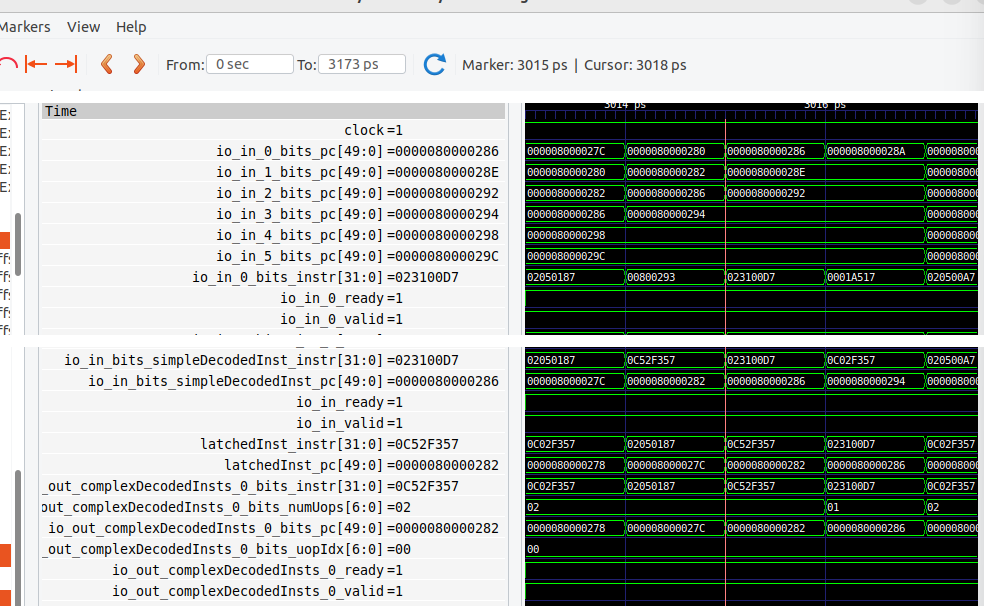

**图 1-1 3015 译码入口出现目标指令**

Marker=3015。decode 第 0 路与 decoderComp 输入均显示目标 PC 和机器码，valid=ready=1。下方 latchedInst 仍是前一条。

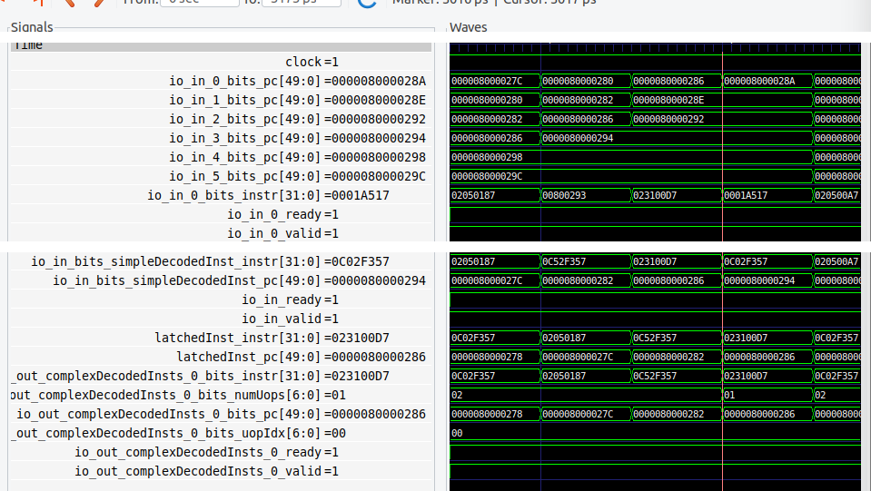

**图 1-2 3016 锁存目标并输出一个微操作**

Marker=3016。latchedInst 和输出已对上目标。numUops=01、uopIdx=00，输出 valid=ready=1。第二章接着看这个微操作的重命名。

# **第 2 章 重命名与物理编号建立**

## **第 1 节 分析对象与结果**

重命名要为 vadd.vv v1, v3, v2 找到三个物理源，并给 v1 分配一个新版本。旧 v1 仍作为源保留，直到后续判断本条指令是否需要它。

3017 的第 0 路给出物理源 0x3C、0x3E、0x3A，新目标为 0x3F；映射写请求在 3018 被寄存，v1 表项在 3019 从 0x3A 更新为 0x3F。这些是编号及映射状态，执行数据与提交状态在后续章节分别核对。

表 3 逻辑与物理寄存器编号

| 对象    | 逻辑含义  | 波形十六进制 | 十进制 |
|---------|-----------|--------------|--------|
| psrc(0) | vs1 即 v2 | 3C           | 60     |
| psrc(1) | vs2 即 v3 | 3E           | 62     |
| psrc(2) | 旧目标 v1 | 3A           | 58     |
| pdest   | 新目标 v1 | 3F           | 63     |

### **源码与波形定位**

本章源码行号对应附录 B 的 XiangShan 提交。

在 inner_ctrlBlock 下查看 rename、rename.vecFreeList 和 rat.vecRat。波形与镜像路径见附录 B。

**源码前的文件名链接到附录 B，可查原始路径及行号。**

下面区分三种状态：RAT 映射已建立、物理数据已就绪、指令已提交。

第 2～5、7～8 节追踪本次重命名；第 6、9 节说明同批旁路和恢复；第 10～12 节对照波形。

## **第 2 节 译码结果与查表地址进入重命名**

译码输出仍带逻辑编号。流水连接将微操作送入 rename，同时准备 RAT 读地址，使查表结果与进入 rename 的微操作对齐。

[CtrlBlock.scala](#Src_10) 第 572 至 582 行

> // Wire 声明译码与重命名之间的连接。
>
> private val decodePipeRename =
>
> Wire(Vec(RenameWidth, DecoupledIO(new DecodedInst)))
>
> for (i \<- 0 until RenameWidth) {
>
> // 建立流水保存逻辑；接收条件和重定向共同控制推进及清除。
>
> PipelineConnect(decode.io.out(i), decodePipeRename(i),
>
> rename.io.in(i).ready, // 下游 ready 参与控制流水推进
>
> s1_s3_redirect.valid \|\| s2_s4_pendingRedirectValid,
>
> moduleName = Some("decodePipeRenameModule"))
>
> // 向前传递 rename 的接收条件。
>
> decodePipeRename(i).ready := rename.io.in(i).ready
>
> // 融合时被清除的槽不构成有效 rename 输入。
>
> rename.io.in(i).valid := decodePipeRename(i).valid &&
>
> !fusionDecoder.io.clear(i) // 被融合清除的槽不作为有效输入
>
> rename.io.in(i).bits := decodePipeRename(i).bits
>
> // 同一份译码信息提前提供给 dispatch，供其准备队列选择。
>
> dispatch.io.renameIn(i).valid := decodePipeRename(i).valid &&
>
> !fusionDecoder.io.clear(i) && !decodePipeRename(i).bits.isMove
>
> dispatch.io.renameIn(i).bits := decodePipeRename(i).bits
>
> }

[DecodeStage.scala](#Src_17) 第 270 至 273 行

> // 用三个逻辑源编号形成 RAT 查询地址，本例为 2、3、1。
>
> io.vecRat(i)(0).addr := io.out(i).bits.lsrc(0)
>
> io.vecRat(i)(1).addr := io.out(i).bits.lsrc(1) // vs2 查询 v3
>
> io.vecRat(i)(2).addr := io.out(i).bits.lsrc(2) // 旧目标查询 v1
>
> // 下游未接收时保持读地址；hold 不表示数据是否就绪。
>
> io.vecRat(i).foreach(\_.hold := !io.out(i).ready)

[CtrlBlock.scala](#Src_10) 第 651 行

> // 把 RAT 返回的物理编号送到 rename；这里不是 128 位向量数据。
>
> rename.io.vecReadPorts := VecInit(
>
> rat.io.vecReadPorts.map(x =\> VecInit(x.map(\_.data))))

本条指令的逻辑源分别为 2、3、1，目标为 1。输入波形直接显示 lsrc(0)=2、lsrc(1)=3、ldest=1；lsrc(2)=1 来自前序译码源码，当前 VCD 中未找到该输入字段。物理旧目标 psrc(2)=58 已由输出波形直接观察。

## **第 3 节 RAT 读出映射并形成物理源**

RegEnable、RegNext 描述寄存器；Mux 描述组合选择。map、zip 在硬件生成时组织连接，不能按“软件依次运行这些语句”的方式判断执行周期。

[RenameTable.scala](#Src_38) 第 127 至 129 行

> // 不保持时寄存查询地址。
>
> val t1_raddr = io.readPorts.map(p =\>
>
> RegEnable(p.addr, !p.hold)) // 仅在不保持时更新查询地址
>
> // 根据已寄存地址读取推测映射。
>
> val t1_rdata_use_t1_raddr = VecInit(
>
> t1_raddr.map(spec_table(\_))) // 按已寄存地址读取推测表
>
> // 写请求也寄存一拍，重定向时清除送入该级的请求。
>
> val t1_wSpec = RegNext(Mux(io.redirect,
>
> 0.U.asTypeOf(io.specWritePorts), io.specWritePorts))

[RenameTable.scala](#Src_38) 第 151 至 156 行

> for ((r, i) \<- io.readPorts.zipWithIndex) {
>
> // 有效写目标与查询地址匹配时，检测到尚未落表的新映射。
>
> val t0_bypass = io.specWritePorts.map(w =\> w.wen &&
>
> Mux(r.hold, w.addr === t1_raddr(i), w.addr === r.addr))
>
> // 寄存匹配结果；重定向时清除这些匹配位。
>
> val t1_bypass = RegNext(Mux(io.redirect,
>
> 0.U.asTypeOf(VecInit(t0_bypass)), VecInit(t0_bypass)))
>
> // 从匹配写端口选择新物理编号。
>
> val bypass_data = ParallelPriorityMux(
>
> t1_bypass.reverse, t1_wSpec.map(\_.data).reverse)
>
> // 命中旁路返回新编号，否则返回表内编号；两条路径都不传递运算数据。
>
> r.data := Mux(t1_bypass.asUInt.orR,
>
> bypass_data, t1_rdata_use_t1_raddr(i))
>
> }

[Rename.scala](#Src_37) 第 376 至 378 行

> // srcType 的相关位选择寄存器类别，本例前三个源均采用向量映射。
>
> uops(i).psrc(0) := Mux1H(uops(i).srcType(0)(2, 0),
>
> Seq(io.intReadPorts(i)(0), io.fpReadPorts(i)(0),
>
> io.vecReadPorts(i)(0))) // 按源类型选择，vadd 选向量映射
>
> uops(i).psrc(1) := Mux1H(uops(i).srcType(1)(2, 0),
>
> Seq(io.intReadPorts(i)(1), io.fpReadPorts(i)(1),
>
> io.vecReadPorts(i)(1))) // 本例对应 v3 的物理源
>
> // 第三源对应旧目标，不是第三个加数。
>
> uops(i).psrc(2) := Mux1H(uops(i).srcType(2)(2, 1),
>
> Seq(io.fpReadPorts(i)(2), io.vecReadPorts(i)(2)))

图 2-1 的物理源是 psrc(0)=0x3C、psrc(1)=0x3E、psrc(2)=0x3A。编号由 RAT 提供，数据是否就绪以及旧目标是否需要等待，要看分发与队列状态。

## **第 4 节 从空闲列表分配新物理目标**

[Rename.scala](#Src_37) 第 105 行

> val vecFreeList = Module(new StdFreeList(
>
> VfPhyRegs - VecLogicRegs, // 可供新分配的物理编号数量
>
> VecLogicRegs, // 初始映射预留的编号范围
>
> Reg_V, 31)) // 向量类别；realNumLogicRegs 参数为 31

[Rename.scala](#Src_37) 第 122 至 128 行

> def needDestReg\[T \<: DecodedInst\](reg_t: RegType, x: T): Bool =
>
> reg_t match {
>
> case Reg_I =\> x.rfWen
>
> case Reg_F =\> x.fpWen
>
> case Reg_V =\> x.vecWen // 向量目标分配取决于 vecWen
>
> case Reg_V0 =\> x.v0Wen
>
> case Reg_Vl =\> x.vlWen
>
> }

[Rename.scala](#Src_37) 第 313 行

> // 输入有效且 vecWen 为真时提出向量目标分配需求。
>
> needVecDest(i) := io.in(i).valid &&
>
> needDestReg(Reg_V, io.in(i).bits)

[Rename.scala](#Src_37) 第 326 行

> // 把向量目标需求送给空闲列表申请端口。
>
> vecFreeList.io.allocateReq(i) := needVecDest(i)

[StdFreeList.scala](#Src_39) 第 65 行

> // 统计同批更早槽位的申请数量，选择对应候选；第 0 路之前没有申请。
>
> io.allocatePhyReg(i) :=
>
> // 候选来自列表头选择，本次有效申请取到 0x3F，即 63；候选定义见同文件第 62 行。
>
> phyRegCandidates(PopCount(io.allocateReq.take(i)))

[Rename.scala](#Src_37) 第 393 至 399 行

> uops(i).pdest := MuxCase(0.U, Seq(
>
> needIntDest(i) -\> intFreeList.io.allocatePhyReg(i),
>
> needFpDest(i) -\> fpFreeList.io.allocatePhyReg(i),
>
> needVecDest(i) -\> vecFreeList.io.allocatePhyReg(i), // 本例选此项
>
> needV0Dest(i) -\> v0FreeList.io.allocatePhyReg(i),
>
> needVlDest(i) -\> vlFreeList.io.allocatePhyReg(i),
>
> ))

图 2-2 的 3017 显示 allocateReq_0=1、canAllocate=1、doAllocate=1；allocatePhyReg_0=0x3F，与 rename 的 pdest 一致。只有候选编号时，不能确认分配有效。

## **第 5 节 握手与分配推进条件**

[Rename.scala](#Src_37) 第 99 行

> // 本版本以第 0 路输出 ready 表示这组下游的接收条件。
>
> private val dispatchCanAcc = io.out.head.ready

[Rename.scala](#Src_37) 第 162 行

> // 正常推进检查下游、各类空闲列表可分配，并排除 walk。
>
> val canOut = dispatchCanAcc &&
>
> fpFreeList.io.canAllocate && intFreeList.io.canAllocate &&
>
> vecFreeList.io.canAllocate && v0FreeList.io.canAllocate &&
>
> vlFreeList.io.canAllocate && !io.rabCommits.isWalk

[Rename.scala](#Src_37) 第 336 行

> // 第 0 路有有效输入时，输入 ready 由 canOut 决定。
>
> io.in(i).ready := !io.in(0).valid \|\| canOut

[Rename.scala](#Src_37) 第 157 行

> // 正常分配受其他列表与下游约束，walk 则用于恢复；列表内部还会结合自身可分配条件。
>
> vecFreeList.io.doAllocate :=
>
> intFreeList.io.canAllocate && fpFreeList.io.canAllocate &&
>
> v0FreeList.io.canAllocate && vlFreeList.io.canAllocate &&
>
> dispatchCanAcc \|\| io.rabCommits.isWalk

[Rename.scala](#Src_37) 第 404 至 405 行

> // 输出有效还需各类空闲列表允许且未处于 walk；与输出 ready 同时为 1 才构成握手。
>
> io.out(i).valid := io.in(i).valid &&
>
> intFreeList.io.canAllocate && fpFreeList.io.canAllocate &&
>
> vecFreeList.io.canAllocate && v0FreeList.io.canAllocate &&
>
> vlFreeList.io.canAllocate && !io.rabCommits.isWalk
>
> io.out(i).bits := uops(i) // 提供组合形成的动态微操作

[StdFreeList.scala](#Src_39) 第 94 至 96 行

> // isAllocate 合并正常分配和 walk 分配，见同文件第 82～84 行；重定向阻止实际推进。
>
> val realDoAllocate = !io.redirect && isAllocate
>
> // 实际分配时推进头指针及独热头指针，否则保持。
>
> headPtr := Mux(realDoAllocate, headPtrAllocate, headPtr)
>
> headPtrOH := Mux(realDoAllocate, headPtrOHAllocate, headPtrOH)

图 2-1 的 3017，重命名输入和输出的 valid、ready 均为 1，redirect.valid=0、isWalk=0。下一记录点的输入已换成另一条指令。

## **第 6 节 扩展理解同批微操作的编号旁路**

多路重命名时，后一条微操作可能读取前一条刚刚写入的逻辑目标，尚不能只依赖旧表值。例如同批前一路写 v2、后一路读 v2，后一路应使用前一路新分配的 pdest。这一节说明通用机制；本次目标位于第 0 路，没有同批更早槽位。

[Rename.scala](#Src_37) 第 533 至 536 行

> val vecCond = io.in(i).bits.srcType.map(\_ === SrcType.vp)
>
> val fpCond = io.in(i).bits.srcType.map(\_ === SrcType.fp)
>
> val intCond = io.in(i).bits.srcType.map(\_ === SrcType.xp)
>
> val target = io.in(i).bits.lsrc // 当前各个逻辑源编号

下段位于各源的遍历循环内：t 是当前逻辑源，外层 j 是源序号；内层 map 的 j 是更早微操作的槽位。

[Rename.scala](#Src_37) 第 538 至 544 行

> // 逐一检查同批更早微操作是否生产当前源。
>
> val destToSrc = io.in.take(i).zipWithIndex.map { case (in, j) =\>
>
> val indexMatch = in.bits.ldest === t // 更早目标是否等于当前源
>
> // 普通依赖同时检查寄存器类别和目标写需求；cond1、cond2、cond3 对应向量、浮点、整数。
>
> val writeMatch = cond3 && needIntDest(j) \|\|
>
> cond2 && needFpDest(j) \|\| cond1 && needVecDest(j)
>
> // v0、VL 等独立类别另行检查。
>
> val v0vlMatch = condV0 && needV0Dest(j) \|\|
>
> condVl && needVlDest(j)
>
> indexMatch && writeMatch \|\| v0vlMatch
>
> }
>
> // 把各个更早槽位的依赖结果组成位向量。
>
> bypassCond(j)(i - 1) := VecInit(destToSrc).asUInt

[Rename.scala](#Src_37) 第 550 至 552 行

> // 有同批依赖时用更早微操作的新 pdest 替换当前物理源。
>
> io.out(i).bits.psrc(1) := io.out.take(i).map(\_.bits.pdest)
>
> .zip(bypassCond(1)(i-1).asBools)
>
> // 从 RAT 结果开始按槽位折叠选择，最终保留最近的匹配版本。
>
> .foldLeft(uops(i).psrc(1)) {
>
> (z, next) =\> Mux(next.\_2, next.\_1, z)
>
> }

RAT 读旁路处理跨流水时序的待写映射；这里的旁路处理同批微操作之间的依赖。两者传递的都是编号。重命名保留真实的数据依赖，并通过不同物理版本消除名称复用造成的冲突，不会让尚未完成的运算自动变成就绪。

## **第 7 节 形成推测映射写请求**

spec 是 speculative 的缩写。推测写端口是一组真实硬件连线；映射编号已经确定，推测的是该指令所处路径能否最终保留并提交。Ports 的下标表示端口槽位，由 addr 决定修改哪个逻辑寄存器。

[RenameTable.scala](#Src_38) 第 41 至 45 行

> class RatWritePort(ratAddrWidth: Int)(implicit p: Parameters)
>
> extends XSBundle {
>
> val wen = Bool() // 本端口是否提出有效写请求
>
> val addr = UInt(ratAddrWidth.W) // 逻辑编号，不是内存地址
>
> val data = UInt(PhyRegIdxWidth.W) // 新物理编号，不是向量数据
>
> }

[Rename.scala](#Src_37) 第 439 行

> // 存在向量目标需求，允许且执行分配，并且没有 walk 或重定向时才使写请求有效。
>
> vecSpecWen(i) := needVecDest(i) &&
>
> vecFreeList.io.canAllocate && vecFreeList.io.doAllocate &&
>
> !io.rabCommits.isWalk && !io.redirect.valid

[Rename.scala](#Src_37) 第 625 至 627 行

> io.vecRenamePorts(i).wen := vecSpecWen(i)
>
> io.vecRenamePorts(i).addr :=
>
> uops(i).ldest(log2Ceil(VecLogicRegs) - 1, 0) // 本例为 1
>
> io.vecRenamePorts(i).data :=
>
> vecFreeList.io.allocatePhyReg(i) // 本例为 0x3F

[CtrlBlock.scala](#Src_10) 第 634 行

> // 把 rename 的整组向量映射写请求连接到 RAT 包装。
>
> rat.io.vecRenamePorts := rename.io.vecRenamePorts

[RenameTable.scala](#Src_38) 第 350 至 356 行

> for ((spec, rename) \<-
>
> vecRat.io.specWritePorts.zip(io.vecRenamePorts)) {
>
> when (rename.wen) { // 正常 rename 有有效写入时采用这组请求
>
> spec.wen := true.B
>
> spec.addr := rename.addr
>
> spec.data := rename.data
>
> }
>
> }

图 2-2 的 3017，两侧写端口都是 wen=1、addr=01、data=3F，说明 v1→63 的请求已到达内部表。wen=0 时，地址和数据不作为写入证据。

## **第 8 节 写请求寄存与表项更新**

[RenameTable.scala](#Src_38) 第 129 行

> // 寄存本拍写请求，重定向时改存全零请求；本例 3017 的请求在 3018 出现。
>
> val t1_wSpec = RegNext(Mux(io.redirect,
>
> 0.U.asTypeOf(io.specWritePorts), io.specWritePorts))

[RenameTable.scala](#Src_38) 第 137 行

> // 有效写地址转成独热位；无效端口生成全 0，不选择任何表项。
>
> val t1_wSpec_addr = t1_wSpec.map(w =\>
>
> Mux(w.wen, UIntToOH(w.addr), 0.U))

[RenameTable.scala](#Src_38) 第 138 至 148 行

> for ((next, i) \<- spec_table_next.zipWithIndex) {
>
> val matchVec = t1_wSpec_addr.map(w =\> w(i)) // 哪些端口写第 i 项
>
> // 反转后按优先级选择，使同批更靠后的匹配写端口优先。
>
> val wMatch = ParallelPriorityMux(
>
> matchVec.reverse, t1_wSpec.map(\_.data).reverse)
>
> next := Mux(
>
> // 恢复控制优先于正常写入，按条件选择快照或架构映射。
>
> RegNext(t1_redirect),
>
> Mux(t2_snpt.useSnpt,
>
> snapshots(t2_snpt.snptSelect)(i), arch_table(i)),
>
> // 正常路径有匹配则采用新编号，否则保留原表项。
>
> Mux(VecInit(matchVec).asUInt.orR,
>
> wMatch, spec_table(i)) // 有匹配则更新，无匹配则保持
>
> )
>
> }
>
> spec_table := spec_table_next // 在后续时钟沿保存表的下一状态

表 4 映射写请求与更新记录

| 记录点 | 本条请求所在位置  | 实测内容              |
|--------|-------------------|-----------------------|
| 3017   | specWritePorts(0) | wen=1 addr=01 data=3F |
| 3018   | t1_wSpec(0)       | wen=1 addr=01 data=3F |
| 3019   | spec_table(1)     | 由 3A 更新为 3F       |

表数组晚于写端口改变，是这段寄存逻辑的结果。读端口另有编号旁路，不能把数组更新延迟直接当成“后续指令必须再等两拍才能知道新编号”。图 2-2 已直接观测 v1 表项变化，不需要用请求端口代替表状态证据。

## **第 9 节 扩展理解推测状态与重定向恢复**

推测映射是真实建立并供当前执行路径使用的映射。即使运算已经完成并写回，只要尚未提交，仍可能因错误路径或其他恢复事件而被撤销。“推测”不是猜测物理编号，也不等同于“还没有算完”。

[RenameTable.scala](#Src_38) 第 112 至 116 行

> val spec_table = RegInit(rename_table_init) // 当前推测路径的映射
>
> val spec_table_next = WireInit(spec_table)
>
> // arch state rename table
>
> val arch_table = RegInit(rename_table_init)
>
> val arch_table_next = WireDefault(arch_table)

redirect 是改变后续执行路径并触发相关清除或恢复的控制事件。例如分支预测失败时，错误路径上的年轻指令及其状态需要被清除或恢复。它不是每条普通跳转都会产生的“跳转地址信号”，也不是数据是否就绪。

[CtrlBlock.scala](#Src_10) 第 629 行

> // RAT 接收是否发生重定向的布尔控制。
>
> rat.io.redirect := s1_s3_redirect.valid

[CtrlBlock.scala](#Src_10) 第 638 行

> // rename 接收完整重定向信息，波形中因而可见 redirect.valid。
>
> rename.io.redirect := s1_s3_redirect

第 8 节的 RegNext 在重定向时清零待寄存写请求，清零的是 wen、addr、data 这组请求，不是整张映射表。恢复逻辑按控制选择快照或架构映射作为起点，并可能配合 walk 重建应保留的映射。

[RenameTable.scala](#Src_38) 第 345 至 349 行

> for ((spec, i) \<- vecRat.io.specWritePorts.zipWithIndex) {
>
> // walk 时用有效恢复记录驱动这组推测映射写端口。
>
> spec.wen := io.rabCommits.isWalk &&
>
> io.rabCommits.walkValid(i) && io.rabCommits.info(i).vecWen
>
> // 恢复记录的逻辑目标和物理目标分别送到地址与数据字段。
>
> spec.addr := io.rabCommits.info(i).ldest
>
> spec.data := io.rabCommits.info(i).pdest
>
> }

[RenameTable.scala](#Src_38) 第 340 至 344 行

> for ((arch, i) \<- vecRat.io.archWritePorts.zipWithIndex) {
>
> // 正常提交且提交记录有效、需要写向量映射时，才更新架构映射。
>
> arch.wen := io.rabCommits.isCommit &&
>
> io.rabCommits.commitValid(i) && io.rabCommits.info(i).vecWen
>
> // 提交记录中的逻辑目标与物理目标形成已提交映射。
>
> arch.addr := io.rabCommits.info(i).ldest
>
> arch.data := io.rabCommits.info(i).pdest
>
> }

本章局部波形的 redirect.valid=0、isWalk=0，展示正常重命名路径；实际重定向恢复未在这些截图中测量。本条指令的正常提交另见第 6 章。

## **第 10 节 输入输出波形与物理编号**

图 2-1 以 3017 为 Marker。上段保留时间轴和第 0 路 PC，下段保留机器码与源、目标字段。两段使用同一时间轴，其他路的 PC 已省略。

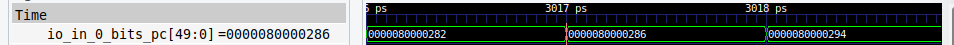

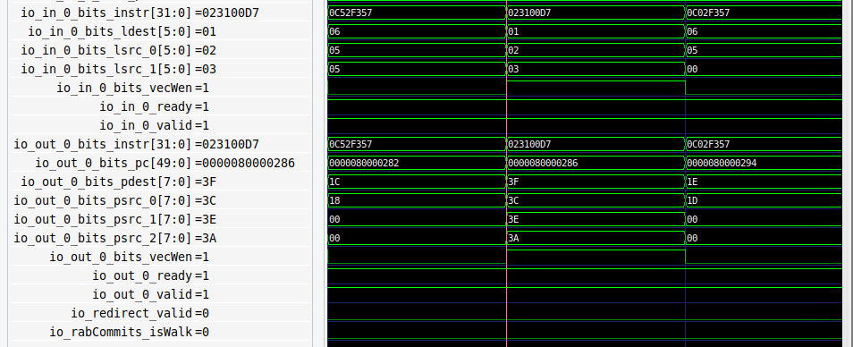

**图 2-1 目标指令的身份 物理编号与握手**

**3017 的第 0 路握手有效；物理源与新目标在同一记录点核对。**

表 5 重命名输出的实测值

| 观察项         | 3017 读数                     | 判断                   |
|----------------|-------------------------------|------------------------|
| 输入与输出身份 | PC=80000286 instr=023100D7    | 对应同一条目标指令     |
| 逻辑源与目标   | lsrc_0=02 lsrc_1=03 ldest=01  | 源为 v2、v3，目标为 v1 |
| 物理源         | psrc_0=3C psrc_1=3E psrc_2=3A | 编号分别为 60、62、58  |
| 新目标         | pdest=3F                      | 新 v1 放到物理编号 63  |
| 有效性与接收   | 输入输出 valid=1、ready=1     | 具备正常接口传递条件   |
| 恢复控制       | redirect.valid=0 isWalk=0     | 当前没有这两类恢复控制 |

3018 的第 0 路 PC 已换为 0x80000294，不能继续把这一路新出现的编号当作目标 vadd。截图未显示输入 lsrc_2；旧目标的逻辑含义依据译码源码，输出 psrc_2 的值则由本图实测。

## **第 11 节 FreeList 与推测映射更新波形**

图 2-2 延续至 3021 附近，加入 RAT 写端口、t1_wSpec、spec_table_1 和向量 FreeList。

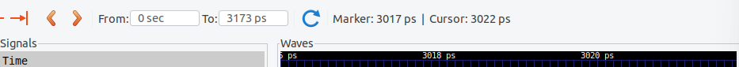

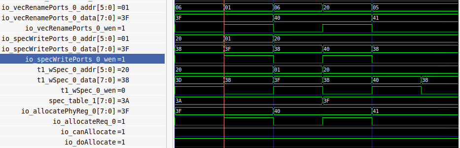

**图 2-2 映射写入与 FreeList 的关键行**

**同一次映射更新经过三个记录点：3017 请求有效，3018 请求寄存，3019 表项改值。**

上下两段来自同一张截图，中间输入输出行省略。红色标记为 3017，左侧数值栏显示该标记处的值；3018、3019 的变化应读右侧轨迹。

表 6 空闲列表及推测映射变化

<table>
<colgroup>
<col style="width: 24%" />
<col style="width: 10%" />
<col style="width: 31%" />
<col style="width: 33%" />
</colgroup>
<thead>
<tr class="header">
<th>观察位置</th>
<th>记录点</th>
<th>实测值</th>
<th>对应代码</th>
</tr>
</thead>
<tbody>
<tr class="odd">
<td>vecFreeList</td>
<td>3017</td>
<td>req=1 canAllocate=1 
doAllocate=1 编号=3F</td>
<td>StdFreeList.scala 第 65、94～96 行</td>
</tr>
<tr class="even">
<td>vecRenamePorts(0)</td>
<td>3017</td>
<td>wen=1 addr=01 data=3F</td>
<td>Rename.scala 第 625～627 行</td>
</tr>
<tr class="odd">
<td>specWritePorts(0)</td>
<td>3017</td>
<td>wen=1 addr=01 data=3F</td>
<td>RenameTable.scala 第 350～356 行</td>
</tr>
<tr class="even">
<td>t1_wSpec(0)</td>
<td>3018</td>
<td>wen=1 addr=01 data=3F</td>
<td>RenameTable.scala 第 129 行</td>
</tr>
<tr class="odd">
<td>spec_table(1)</td>
<td>3019</td>
<td>3A 更新为 3F</td>
<td>RenameTable.scala 第 138～148 行</td>
</tr>
</tbody>
</table>

FreeList 候选、rename 输出目标与映射写数据三处均为 0x3F；表内旧映射 0x3A 到 3019 才被新编号替换。

## **第 12 节 时间判读与本阶段结论**

3017 的写请求与 3019 的表项变化分开读。左侧栏只显示 Marker 处的值，后两点应沿右侧轨迹确认。

表 7 重命名关键记录点

<table>
<colgroup>
<col style="width: 12%" />
<col style="width: 37%" />
<col style="width: 49%" />
</colgroup>
<thead>
<tr class="header">
<th>记录点</th>
<th>波形实测</th>
<th>源码定位</th>
</tr>
</thead>
<tbody>
<tr class="odd">
<td>3017</td>
<td>psrc=3C/3E/3A 
pdest=3F</td>
<td>Rename.scala 第 376～378、393～399 行</td>
</tr>
<tr class="even">
<td>3017</td>
<td>映射请求 1/01/3F</td>
<td>Rename.scala 第 625～627 行</td>
</tr>
<tr class="odd">
<td>3018</td>
<td>t1_wSpec 为 1/01/3F</td>
<td>RenameTable.scala 第 129 行</td>
</tr>
<tr class="even">
<td>3019</td>
<td>spec_table_1 从 3A 变为 3F</td>
<td>RenameTable.scala 第 138～148 行</td>
</tr>
</tbody>
</table>

新 v1 对应 3F，旧 v1 仍以 3A 作为本条的第三个源。分发接着用物理源编号查询就绪状态。

# **第 3 章 分发与队列入口**

## **第 1 节 分发阶段的输入输出与职责**

Dispatch 接收已经带有物理寄存器编号的微操作，查询源操作数就绪状态，将其送往兼容的 Issue Queue，并产生 ROB 入队请求。它不负责执行加法，也不要求所有源操作数已经就绪；源尚未就绪的微操作可以先进入队列等待。

表 8 分发入口的状态与用途

| 接口或状态             | 当前目标                     | 含义               |
|------------------------|------------------------------|--------------------|
| fromRename 第 0 路     | 3018 有效且 ready=1          | 接收 rename 结果   |
| toIssueQueues 第 16 路 | 3018 PC 匹配且 valid=ready=1 | 目标的实际分发出口 |
| enqRob.req 第 0 路     | 3018 请求有效                | 登记在途指令的请求 |
| srcState0 至 2         | 3018 均为 0                  | 依赖尚未就绪       |

[CtrlBlock.scala](#Src_10) 第 684 至 687 行

> // pipeline between rename and dispatch
>
> // rename 和 dispatch 之间存在流水连接；重定向参与清除。
>
> PipeGroupConnect(renameOut, dispatch.io.fromRename, s1_s3_redirect.valid, dispatch.io.toRenameAllFire,  
> "renamePipeDispatch")
>
> dispatch.io.redirect := s1_s3_redirect

### **输入的物理编号和握手**

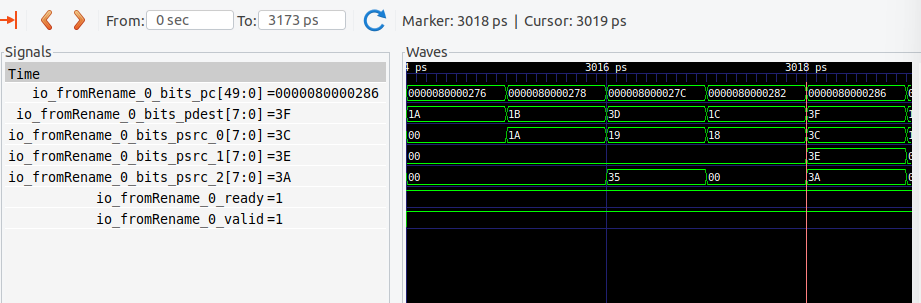

**图 3-1 3018 接收到目标重命名结果**

**fromRename_0 的握手和目标 PC 在同一记录点匹配。**

层级为 inner_ctrlBlock.dispatch；Marker=3018。PC=0x80000286、pdest=3F、psrc=3C/3E/3A，并且 fromRename_0 的 valid、ready 都为 1。这里看到的是物理编号，不是向量数据。

截图来源 image(20261015-122635).png 原始截图

## **第 2 节 BusyTable 怎样给出源就绪状态**

RAT 回答逻辑寄存器当前映射到哪个物理编号；BusyTable 回答这个物理编号的数据是否就绪。新目标被登记为忙，生产者写回或相应唤醒可以更新就绪状态，取消也可能重新使依赖变忙。两种表都不保存 128 位向量结果。

[NewDispatch.scala](#Src_23) 第 267 至 270 行

> busyTables.zip(idxRegType).zipWithIndex.map { case ((b, idxseq), i) =\> {
>
> // 按各寄存器类别实际使用的源位置筛选 psrc，再展开成查询端口地址。
>
> val readAddr = VecInit(fromRename.map(x =\> x.bits.psrc.zipWithIndex.filter(xx =\>  
> idxseq.contains(xx.\_2)).map(\_.\_1)).flatten)
>
> val readValid = VecInit(fromRename.map(x =\> x.bits.psrc.zipWithIndex.filter(xx =\>  
> idxseq.contains(xx.\_2)).map(y =\> x.valid && SrcType.isXp(x.bits.srcType(y.\_2)))).flatten)
>
> // 查询请求接入对应 BusyTable。
>
> b.io.read.map(\_.req).zip(readAddr).map(x =\> x.\_1 := x.\_2)

[BusyTable.scala](#Src_36) 第 155 至 168 行

> tableUpdate.zipWithIndex.foreach{ case (update, idx) =\>
>
> // 写回或有效唤醒使内部忙位清零。
>
> when(wakeUpMask(idx) \|\| wbMask(idx)) {
>
> update := false.B //ready
>
> }
>
> // 分配新目标或取消相关依赖，使内部忙位置一；其他情况保持。
>
> .elsewhen(allocMask(idx) \|\| ldCancelMask(idx)) {
>
> update := true.B //busy
>
> if (idx == 0 && pregWB.isInstanceOf\[IntWB\]) {
>
> // Int RegFile 0 is always ready
>
> update := false.B
>
> }
>
> }
>
> .otherwise {
>
> update := table(idx)
>
> }

[BusyTable.scala](#Src_36) 第 171 至 174 行

> io.read.foreach{ case res =\>
>
> // 同周期分配了相同 pdest 时，即使旧表项看起来就绪，也不能误读为新值已经就绪。
>
> val readBypass = VecInit(io.allocPregs.map(x =\> x.valid && x.bits === res.req))
>
> // 内部 table 的 1 表示忙；对外 resp 取反，所以 resp=1 表示就绪。
>
> res.resp := !(table(res.req) \|\| readBypass.asUInt.orR)
>
> res.loadDependency :=  
> (if (needLoadCancel) loadDependency(res.req) else 0.U.asTypeOf(res.loadDependency))

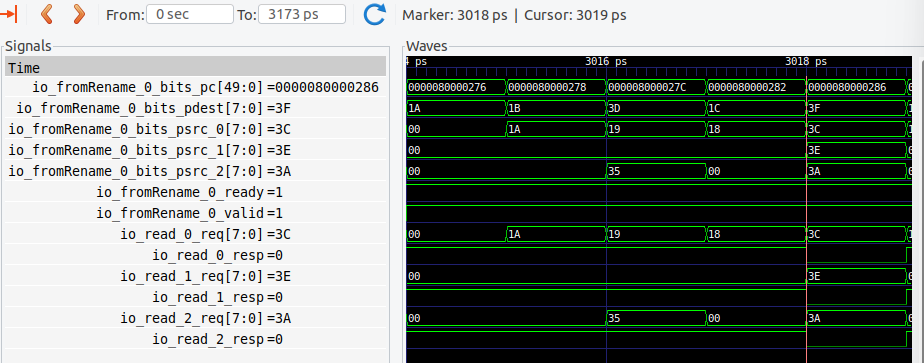

**图 3-2 3018 三个向量源的查询响应**

**三个查询地址命中本条指令的物理源；三个响应均为 0。**

层级为 dispatch 与 dispatch.vecBusyTable；Marker=3018。read_0/1/2_req 分别为 3C、3E、3A，三个 resp 均为 0。目标入口 valid=ready=1，说明未就绪依赖不阻止本次分发接收。

截图来源 image(20261015-123056).png 原始截图

[NewDispatch.scala](#Src_23) 第 296 至 304 行

> // 由 rename 槽位、源位置和寄存器类别定位实际读端口。
>
> val readidx = i \* idxRegType(k).size + idxRegType(k).indexOf(j)
>
> val readEn = k match {
>
> case 0 =\> SrcType.isXp(fromRename(i).bits.srcType(j))
>
> case 1 =\> SrcType.isFp(fromRename(i).bits.srcType(j))
>
> // 源类型为向量时，使能向量类别的查询结果。
>
> case 2 =\> SrcType.isVp(fromRename(i).bits.srcType(j))
>
> case 3 =\> SrcType.isV0(fromRename(i).bits.srcType(j))
>
> case 4 =\> true.B
>
> }
>
> // 将源类型与响应结合成各类别的就绪状态；立即数无需等待寄存器生产者。
>
> allSrcState(i)(j)(k) := readEn && busyTables(k).io.read(readidx).resp \|\|  
> SrcType.isImm(fromRename(i).bits.srcType(j))

## **第 3 节 接收条件与源状态写入出口**

[NewDispatch.scala](#Src_23) 第 444 至 450 行

> for (i \<- 0 until RenameWidth){
>
> // update valid logic
>
> // 有效微操作还要满足资源与顺序约束；被消除、异常和单步等情况另外处理。
>
> fromRenameUpdate(i).valid := fromRename(i).valid && allowDispatch(i) && !uopBlockByIQ(i) &&  
> thisCanActualOut(i) &&
>
> lsqCanAccept && !fromRename(i).bits.eliminatedMove && !fromRename(i).bits.hasException &&  
> !fromRenameUpdate(i).bits.singleStep
>
> // ready 检查分发许可、IQ 阻塞、实际输出条件和 LSQ 接收条件，并不是所有源 ready 的与。
>
> fromRename(i).ready := allowDispatch(i) && !uopBlockByIQ(i) && thisCanActualOut(i) && lsqCanAccept
>
> // update src type if eliminate old vd
>
> // 若满足旧 vd 消除条件，源类型改成 no；本次在 3018 仍观测到源 2 类型为 4。
>
> fromRenameUpdate(i).bits.srcType(numRegSrcVf - 1) := Mux(ignoreOldVdVec(i), SrcType.no,  
> fromRename(i).bits.srcType(numRegSrcVf - 1))

[NewDispatch.scala](#Src_23) 第 459 至 465 行

> allIssueParams.zipWithIndex.map{ case(issue, iqidx) =\> {
>
> for (i \<- 0 until issue.numEnq){
>
> val oh = Wire(Vec(renameWidth, Bool())).suggestName(s"oh_IQSelUop\_\$temp")
>
> // 选中送到本 IQ 第 i 个入队端口的 rename 微操作。
>
> oh := uopSelIQMatrix.map(\_(iqidx)).map(\_ === (i+1).U)
>
> // 按选择条件取得指令信息。
>
> IQSelUop(temp) := PriorityMux(oh, fromRenameUpdate)
>
> // there only assign valid not use PriorityMuxDefalut for better timing
>
> // 为选中的有效微操作产生出口 valid。
>
> IQSelUop(temp).valid := PriorityMuxDefault(oh.zip(fromRenameUpdate.map(\_.valid)), false.B)

[NewDispatch.scala](#Src_23) 第 475 至 476 行

> // 不同队列支持的寄存器源类别形成选择集合。
>
> val selSrcState = Seq(thisSrcHasInt \|\| maskForStd, thisSrcHasFp \|\| maskForStd, thisSrcHasVec,  
> thisSrcHasV0, thisSrcHasVl)
>
> // 从选中微操作的各类就绪结果中，得到每个源的 srcState。
>
> IQSelUop(temp).bits.srcState(j) := PriorityMux(oh,  
> allSrcState)(j).zip(selSrcState).filter(\_.\_2 == true).map(\_.\_1).foldLeft(false.B)(\_ \|\| \_).asUInt

[NewDispatch.scala](#Src_23) 第 493 至 496 行

> io.toIssueQueues.zip(IQSelUop).map(x =\> {
>
> // 出口的有效位和微操作信息分别连接；实际接收仍由 valid 与 ready 一起判断。
>
> x.\_1.valid := x.\_2.valid
>
> x.\_1.bits := x.\_2.bits
>
> })

## **第 4 节 为什么是第 16 路出口**

[CtrlBlock.scala](#Src_10) 第 732 至 733 行

> // 按整数 浮点 向量 存储的顺序展开各调度器入口。
>
> val toIssueBlockUops = Seq(io.toIssueBlock.intUops, io.toIssueBlock.fpUops, io.toIssueBlock.vfUops,  
> io.toIssueBlock.memUops).flatten
>
> // 展开后的端口逐一连接 dispatch 的全局出口。
>
> toIssueBlockUops.zip(dispatch.io.toIssueQueues).map(x =\> x.\_1 \<\> x.\_2)

Parameters.scala 第 395–464 行给出本配置：整数部分 4 个 IQ、浮点部分 3 个 IQ、向量部分 3 个 IQ，各有 2 个入队口。因此全局出口 0–7 为整数、8–13 为浮点、14–19 为向量。全局第 16 路对应向量局部入口第 2 路，也就是第二个向量 IQ 的第一个入队口。这个编号来自本配置，不应推广到其他提交或核配置。

表 9 分发出口与向量队列端口

| dispatch 全局出口 | vfScheduler 局部入口 | 向量 IQ 与入队口      |
|-------------------|----------------------|-----------------------|
| 14 / 15           | 0 / 1                | 第 0 个 IQ 入队 0 / 1 |
| 16 / 17           | 2 / 3                | 第 1 个 IQ 入队 0 / 1 |
| 18 / 19           | 4 / 5                | 第 2 个 IQ 入队 0 / 1 |

本次目标 IQ 的功能配置见 Parameters.scala 第 451–454 行：包含 VFEX2 的 VfmaCfg、VialuCfg，以及 VFEX3 的 VfaluCfg。后续选中的执行端口是 VFEX2；分发到 IQ 和最终选择 FU 是两个不同层级的选择。

## **第 5 节 ROB 请求与下游接收的实测对应**

[NewDispatch.scala](#Src_23) 第 820 至 826 行

> for (i \<- 0 until RenameWidth) {
>
> // needAlloc no use, need deleted
>
> io.enqRob.needAlloc(i) := fromRename(i).valid
>
> // dispatch 输入握手成立时，形成相应 ROB 入队请求。
>
> io.enqRob.req(i).valid := fromRename(i).fire
>
> // 请求携带更新后的微操作，而不是已经执行完成的算术结果。
>
> io.enqRob.req(i).bits := updatedUop(i)
>
> io.enqRob.req(i).bits.hasException := updatedUop(i).hasException \|\| updatedUop(i).singleStep
>
> io.enqRob.req(i).bits.numWB := Mux(updatedUop(i).singleStep, 0.U, updatedUop(i).numWB)

[CtrlBlock.scala](#Src_10) 第 693 至 697 行

> // 进入 ROB 实际接口前还有请求寄存。
>
> enqRob.needAlloc := RegNext(dispatch.io.enqRob.needAlloc)
>
> enqRob.req.zip(dispatch.io.enqRob.req).map { case (sink, source) =\>
>
> // 寄存有效位并处理 ROB 重定向；因此 dispatch.enqRob 请求不等于同一记录点已观察到 ROB 内部写入。
>
> sink.valid := RegNext(source.valid && !rob.io.redirect.valid)
>
> sink.bits := RegEnable(source.bits, source.valid)
>
> }

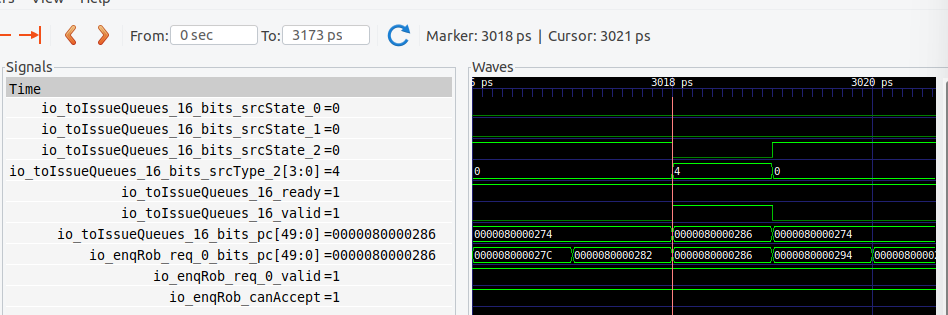

**图 3-3 3018 队列出口和 ROB 入队请求**

Marker=3018；inner_ctrlBlock.dispatch。

表 10 分发波形核对顺序

| 顺序       | 信号或位置              | 读数与判断                     |
|------------|-------------------------|--------------------------------|
| 1 队列出口 | toIssueQueues_16        | PC=80000286，valid=ready=1     |
| 2 源依赖   | srcState0/1/2；srcType2 | 0/0/0；4，允许带未就绪依赖入队 |
| 3 ROB 请求 | enqRob_req_0            | PC 匹配，valid=1，canAccept=1  |

ROB 部分显示的是 Dispatch 的入队请求侧；这不表示目标已经完成运算或提交。

截图来源 image(20261015-125000).png 原始截图

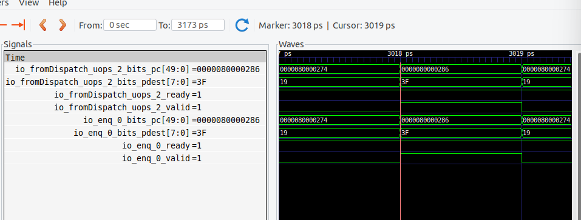

**图 3-4 3018 从调度器入口到队列入队口**

**向量调度器入口 2 与目标队列入队口 0 对上了同一条指令。**

3018，inner_vfScheduler 的 fromDispatch_uops_2 与目标 Issue Queue 的 io_enq_0 均显示目标 PC、pdest=3F、valid=ready=1。这与全局出口 16 到向量局部入口 2 的连接一致。后续状态改从队列条目读，入口可以继续接收其他指令。

截图来源 image(20261016-040731).png 原始截图

# **第 4 章 发射 取数与执行入口**

## **第 1 节 发射阶段保存什么以及等待什么**

分发后的微操作留在 Issue Queue 等待源数据。具备发射资格并被选中后，它经 DataPath、Og2 和旁路网络进入执行模块。本章追踪到 FU 输入。

表 11 发射阶段关键事件

| 记录坐标 | 位置或事件                | 已核实的目标状态               |
|----------|---------------------------|--------------------------------|
| 3018     | IQ 入队口 0               | PC 匹配 pdest=3F valid=ready=1 |
| 3019     | enqEntries_0              | 有效 源状态 000 canIssue=0     |
| 3020     | othersEntriesComp_0       | 有效 pdest=3F 源状态 000       |
| 3023     | 复杂项旧 vd 依赖          | 源 2 状态变 1 类型 4 变 0      |
| 3068     | 复杂项被选择              | 源 0/1/2=1 canIssue=1 deqSel=1 |
| 3069     | deqDelay 与 DataPath 输入 | 目标有效 输入握手成立          |
| 3070     | DataPath 输出             | valid=1 pdest=3F               |
| 3071     | Og2 与旁路输出            | valid=ready=1 pdest=3F         |
| 3072     | 执行模块与 FU 输入        | 目标握手 操作数匹配 SEW=8 vm=1 |

## **第 2 节 条目定义 状态保存和初值**

[EntryBundles.scala](#Src_32) 第 93 至 97 行

> // Bundle 描述条目的字段结构；这里不是存储寄存器，也不产生复位初值。
>
> class EntryBundle(implicit p: Parameters, params: IssueBlockParams) extends XSBundle {
>
> // status 保存依赖和发射管理状态。
>
> val status = new Status()
>
> val imm = Option.when(params.needImm)(UInt((params.deqImmTypesMaxLen).W))
>
> // payload 保存微操作的指令信息。
>
> val payload = new DynInst()
>
> }

[EnqEntry.scala](#Src_30) 第 48 至 49 行

> // 有效状态通过专用有效位寄存器保存，初始无有效条目。
>
> val validReg = GatedValidRegNext(common.validRegNext, false.B)
>
> // payload 等数据另行寄存；不能在 valid=0 时解释残留数据。
>
> val entryReg = RegNext(entryRegNext)

[EnqEntry.scala](#Src_30) 第 59 至 63 行

> // 入队有效且条目允许接收时，保存新条目；否则采用内部更新结果。
>
> when(io.commonIn.enq.valid && common.enqReady) {
>
> entryRegNext := io.commonIn.enq.bits
>
> }.otherwise {
>
> entryRegNext := entryUpdate
>
> }

[IssueQueue.scala](#Src_33) 第 330 至 336 行

> // 这些赋值构造入队条目的状态；定义字段与赋值在不同位置。
>
> enq.bits.status.blocked := false.B
>
> // 新进入的微操作还没有发射。
>
> enq.bits.status.issued := false.B
>
> enq.bits.status.firstIssue := false.B
>
> enq.bits.status.issueTimer := "b11".U
>
> enq.bits.status.deqPortIdx := 0.U
>
> enq.bits.imm.foreach(\_ := s0_enqBits(enqIdx).imm)
>
> // 将实际微操作存入 payload。
>
> enq.bits.payload := s0_enqBits(enqIdx)

这里分三处建立条目状态：Bundle 定义字段，队列逻辑构造入队值，条目模块用寄存器保存。有效位复位为 0 就表示条目无效，不要求所有 payload 位都复位清零。

## **第 3 节 从入队项转入复杂项**

[Entries.scala](#Src_31) 第 68 至 71 行

> // 入队项与其他保存项分别实例化。
>
> val enqEntries = Seq.fill(EnqEntryNum)(Module(EnqEntry(isComp = true)(p, params)))
>
> val othersEntriesSimp = Seq.fill(SimpEntryNum)(Module(OthersEntry(isComp = false)(p, params)))
>
> val othersEntriesComp = Seq.fill(CompEntryNum)(Module(OthersEntry(isComp = true)(p, params)))
>
> // 内部保存项按简单项在前 复杂项在后的顺序组织。
>
> val othersEntries = othersEntriesSimp ++ othersEntriesComp

本配置 numEntries=16、numEnq=2、numComp=12，因此还剩 2 个简单项。简单项与复杂项指实现类别，不是把 vadd 称为复杂指令。enqEntries 是新进入队列的项；需要继续等待的微操作可被转入其他项。

[EntryBundles.scala](#Src_32) 第 188 至 200 行

> // 公共可发射条件同时受有效位约束。
>
> common.canIssue := validReg && status.canIssue
>
> // 条目为空或本次转移后可接收新数据。
>
> common.enqReady := !validReg \|\| commonIn.transSel
>
> // 冲刷 成功反馈或转移都可能清除当前保存项。
>
> common.clear := common.flushed \|\| common.deqSuccess \|\| commonIn.transSel
>
> common.srcCancelVec.zip(hasIQWakeupGet.srcWakeupByIQWithoutCancel).zipWithIndex.foreach { case ((srcCancel, wakeUpByIQVec), srcIdx) =\>
>
> common.srcLoadTransCancelVec(srcIdx) := (if(params.hasIQWakeUp) Mux1H(wakeUpByIQVec,  
> hasIQWakeupGet.wakeupLoadDependencyByIQVec.map(dep =\> LoadShouldCancel(Some(dep),  
> commonIn.ldCancel))) else false.B)
>
> common.srcLoadCancelVec(srcIdx) := LoadShouldCancel(Some(status.srcStatus(srcIdx).srcLoadDependency),  
> commonIn.ldCancel)
>
> srcCancel := common.srcLoadTransCancelVec(srcIdx) \|\| common.srcLoadCancelVec(srcIdx)
>
> }
>
> common.srcLoadDependencyNext.zip(status.srcStatus.map(\_.srcLoadDependency)).foreach { case (ldsNext,  
> lds) =\>
>
> ldsNext.zip(lds).foreach{ case (ldNext, ld) =\> ldNext := ld \<\< 1 }
>
> }
>
> // 对入队项，接收新条目优先置有效；否则按清除条件更新。
>
> if(isEnq) {
>
> common.validRegNext := Mux(commonIn.enq.valid && common.enqReady, true.B, Mux(common.clear,  
> false.B, validReg))

[EntryBundles.scala](#Src_32) 第 462 至 467 行

> // 有未冲刷且未发射的有效条目，才可作为转移候选。
>
> commonOut.transEntry.valid := validReg && !common.flushed && !status.issued
>
> commonOut.transEntry.bits := entryUpdate
>
> // debug
>
> commonOut.entryInValid := commonIn.enq.valid
>
> // entryOutDeqValid 与转移有效位是不同含义。
>
> commonOut.entryOutDeqValid := validReg && (common.flushed \|\| common.deqSuccess)
>
> // 被选中转移且未被冲刷或成功清除时，产生转移有效。
>
> commonOut.entryOutTransValid := validReg && commonIn.transSel && !(common.flushed \|\|  
> common.deqSuccess)

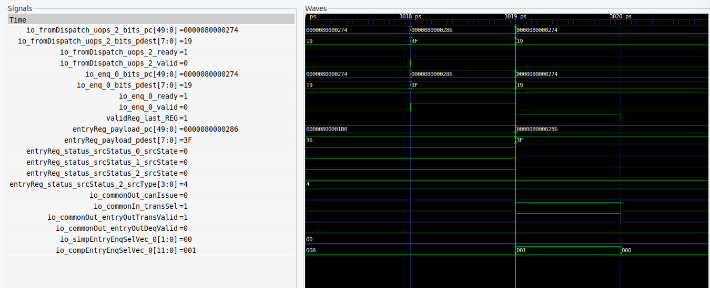

**图 4-1 3019 入队项有效并选择复杂项 0**

**enqEntries_0 有效，转移选择指向复杂项 0。**

层级为目标 IQ.entries.enqEntries_0 以及 entries 的选择输出；Marker=3019。PC 匹配、pdest=3F、validReg=1，srcState0/1/2=0、canIssue=0。transSel=1、entryOutTransValid=1；compEntryEnqSelVec_0=001，simpEntryEnqSelVec_0=00，选择复杂项 0。

截图来源 image(20261016-042537).png 原图矩形裁切 未修改数值或波形

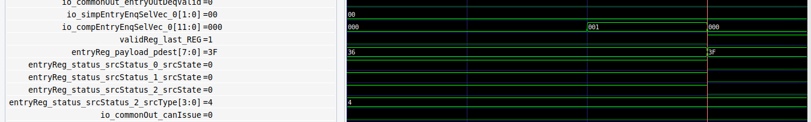

**图 4-2 3020 复杂项 0 保存目标**

**用 3019 的转移选择和 3020 的 pdest，把两个条目关联起来。**

层级为目标 IQ.entries；Marker=3020。裁切上方两行是分配选择，下面一组为 othersEntriesComp_0：validReg=1、pdest=3F，三个源状态为 0、canIssue=0。复杂项没有可用的 PC 字段，目标关联依据前一记录的转移选择、时序、有效位与 pdest；不补造复杂项 PC。

截图来源 image(20261016-043151).png 原图矩形裁切 未修改数值或波形

## **第 4 节 就绪 发射资格和旧 vd 消除**

[EntryBundles.scala](#Src_32) 第 35 至 40 行

> def srcReady: Bool = {
>
> // 检查条目中全部源状态，而不是只检查截图中的前三个向量源。
>
> VecInit(srcStatus.map(\_.srcState).map(SrcState.isReady)).asUInt.andR
>
> }
>
> def canIssue: Bool = {
>
> // 源就绪 还未发射且未阻塞，才具备基本发射资格。
>
> srcReady && !issued && !blocked

公共逻辑还结合条目有效、冲刷和某些旁路唤醒条件。canIssue 是资格，不等于已被仲裁选中；deqSel 才说明这个条目本次被选中。issued 表示已经发起过发射，也不等于运算完成。

[EntryBundles.scala](#Src_32) 第 307 至 311 行

> // 根据 VL 唤醒携带的性质判断最大 VL 与非零 VL。
>
> val vlIsVlmax = (vlFromIntIsVlmax && vlWakeUpByIntWb) \|\| (vlFromVfIsVlmax && vlWakeUpByVfWb)
>
> val vlIsNonZero = (!vlFromIntIsZero && vlWakeUpByIntWb) \|\| (!vlFromVfIsZero && vlWakeUpByVfWb)
>
> // 满 VL 时的尾部与掩码条件，或允许尾部无关时的整体条件，可使旧目标不再需要。
>
> val ignoreTail = vlIsVlmax && (vm =/= 0.U \|\| vma) && !isWritePartVd
>
> val ignoreWhole = (vm =/= 0.U \|\| vma) && vta
>
> val srcIsVec = SrcType.isVp(srcStatus.srcType)

[EntryBundles.scala](#Src_32) 第 319 至 326 行

> // 对旧 vd 所在的源 2，满足这些条件才能消除依赖；VL=0 不满足非零条件。
>
> ignoreOldVd := srcIsVec && vlIsNonZero && !isDependOldVd && (ignoreTail \|\| ignoreWhole)
>
> } else {
>
> ignoreOldVd := false.B
>
> }
>
> srcStatusNext.psrc := srcStatus.psrc
>
> // 依赖消除时把源类型改为 no。
>
> srcStatusNext.srcType := Mux(ignoreOldVd, SrcType.no, srcStatus.srcType)
>
> // 源变就绪可能来自写回 IQ 唤醒或依赖消除，不能只凭变 1 就认定发生写回。
>
> srcStatusNext.srcState :=  
> srcStatus.srcState & !srcLoadCancel \| wakeupByWB \| wakeupByIQ \| ignoreOldVd

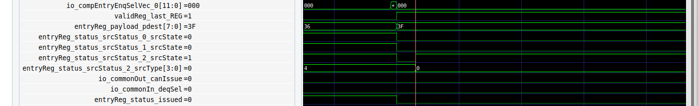

**图 4-3 3023 旧目标依赖消除**

**复杂项的源 2 变为就绪，源 0、1 仍在等待。**

层级为 othersEntriesComp_0；Marker=3023。下方复杂项源 2 的 srcState=1、srcType=0，源 0/1 仍为 0，canIssue=0。图中上方无效入队项残留的 PC 不作为复杂项 PC 证据。结合源码，这与旧 vd 依赖消除一致；具体哪一路 VL 唤醒触发尚未追踪，不能写成物理寄存器 3A 已经写回。

截图来源 image(20261016-043555).png 原图矩形裁切 未修改数值或波形

## **第 5 节 选择 发射状态与延迟输出**

队列在依赖满足后还要检查 FU 兼容性和资源可用性，并进行分区与年龄相关选择。IssueQueue.scala 第 416–445、517–577 行包含这些条件，不能把实现概括成所有指令中无条件选择最老一条。当前截图直接证明的是目标获得 canIssue 和 deqSel。

[EntryBundles.scala](#Src_32) 第 375 至 378 行

> // 发射选择成立且未被取消时置 issued；失败或源取消时可以清除以便重试。
>
> entryUpdate.status.issued := MuxCase(status.issued, Seq(
>
> (commonIn.deqSel &&  
> !cancelBypassVec.asUInt.orR) -\> true.B,
>
> (srcCancelByLoad \|\|  
> respIssueFail) -\> false.B,
>
> ))

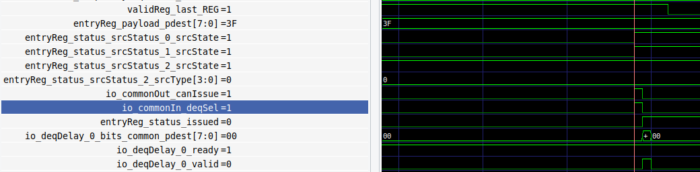

**图 4-4 3068 目标具备发射资格且被选择**

Marker=3068；目标 IQ 的 othersEntriesComp_0。

表 12 发射状态读图顺序

| 顺序     | 信号或位置                 | 读数与判断                        |
|----------|----------------------------|-----------------------------------|
| 1 条目   | validReg / pdest           | 1 / 3F，条目继续对应目标          |
| 2 源状态 | srcState0/1/2              | 1/1/1，所需源均已就绪             |
| 3 选择   | canIssue / deqSel / issued | 1 / 1 / 0；被选择但尚未记为已发射 |

同图下方 deqDelay.valid 仍为 0。内部选择与延迟端口有效输出处于不同记录点，3069 的下游握手见图 4-5。

截图来源 image(20261016-044527).png 原图矩形裁切 未修改数值或波形

[IssueQueue.scala](#Src_33) 第 758 至 760 行

> deqBeforeDly.zipWithIndex.foreach { case (deq, i) =\>
>
> // 先生成选择结果的有效位，并排除取消。
>
> deq.valid := finalDeqSelValidVec(i) && !cancelDeqVec(i)
>
> deq.bits.addrOH := finalDeqSelOHVec(i)

[IssueQueue.scala](#Src_33) 第 800 至 812 行

> // deqDelay 是实际寄存器，保存发射端口信息。
>
> val deqDelay = Reg(params.genIssueValidBundle)
>
> deqDelay.zip(deqBeforeDly).foreach { case (deqDly, deq) =\>
>
> // 每拍保存选择结果的有效位。
>
> deqDly.valid := deq.valid
>
> // 队列有有效项时保存 bits；对外仍需用有效位判断其含义。
>
> when(validVec.asUInt.orR) {
>
> deqDly.bits := deq.bits
>
> }
>
> // deqBeforeDly.ready is always true
>
> deq.ready := true.B
>
> }
>
> // 对外的延迟输出使用上述寄存结果。
>
> io.deqDelay.zip(deqDelay).foreach { case (sink, source) =\>
>
> sink.valid := source.valid
>
> sink.bits := source.bits
>
> }

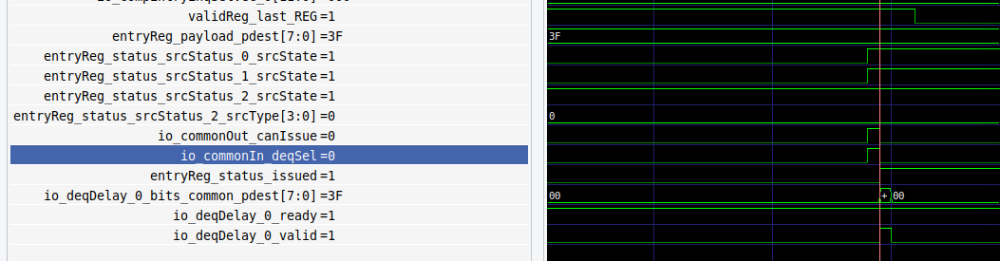

**图 4-5 3069 延迟输出有效并更新 issued**

**3069 的 issued 和 deqDelay 握手记录的是发射进度。**

层级为复杂项与目标 IQ.deqDelay_0；Marker=3069。复杂项 issued=1，canIssue、deqSel 回到 0；deqDelay_0 的 pdest=3F、valid=ready=1。条目此时仍有效；不能把 issued=1 或条目后来清除当作运算结果完成的证据。

截图来源 image(20261016-044722).png 原图矩形裁切 未修改数值或波形

## **第 6 节 DataPath 读物理寄存器**

[Scheduler.scala](#Src_34) 第 264 至 266 行

> io.toDataPathAfterDelay.zipWithIndex.foreach { case (toDpDy, i) =\>
>
> // 目标 IQ 的 deqDelay 对应到调度器的取数输出。
>
> toDpDy \<\> issueQueues(i).io.deqDelay
>
> }

[Backend.scala](#Src_8) 第 481 行

> // 向量调度器延迟输出连接 DataPath 的 fromVfIQ。
>
> dataPath.io.fromVfIQ \<\> vfScheduler.io.toDataPathAfterDelay

[DataSource.scala](#Src_13) 第 8 至 10 行

> // readReg 检查编码的高位。
>
> def readReg: Bool = value(3)
>
> // readRegOH 精确判断寄存器路径编码。
>
> def readRegOH: Bool = value === DataSource.reg

[DataSource.scala](#Src_13) 第 31 行

> // 寄存器来源的编码为二进制 1000，即十进制 8。
>
> def reg: UInt = "b1000".U

本次 fromVfIQ_1_0 在 3069 有效，rf_0_0_addr=3C、rf_1_0_addr=3E，dataSources0/1=8，表示前两个源走寄存器取数路径。dataSources2=4 是另一套 DataSource 枚举中的立即数路径编码；这里旧 vd 已消除依赖，不是 vadd.vv 变成了 vadd.vi。源类型 SrcType 的 4 和数据来源 DataSource 的 4 也不能混为同一编码。

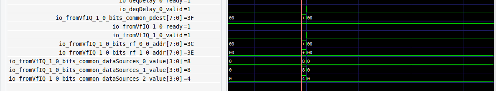

**图 4-6 3069 DataPath 接收目标及读地址**

**pdest=3F 的请求握手有效；两个读地址为 3C、3E。**

层级为 dataPath.fromVfIQ_1_0；Marker=3069。图中输入 pdest=3F、valid=ready=1，两个寄存器读地址为 3C、3E，dataSources 为 8/8/4。仅裁切相关输入行，上方其他微操作不参与判断。

截图来源 image(20261016-045952).png 原图矩形裁切 未修改数值或波形

[DataPath.scala](#Src_12) 第 605 至 614 行

> // 输入握手且不冲刷 不取消，才设置下一阶段有效位。
>
> when (s0.fire && !s1_flush && !s0_ldCancel) {
>
> s1_valid := true.B
>
> }.otherwise {
>
> s1_valid := false.B
>
> }
>
> // 保存从队列来的控制信息。
>
> when (s0.valid) {
>
> s1_data.fromIssueBundle(s0.bits) // no src data here
>
> s1_addrOH := s0.bits.addrOH
>
> }
>
> // 输入 ready 还受到读端口 写回资源和取消条件影响。
>
> s0.ready := notBlock && !s0_cancel

[DataPath.scala](#Src_12) 第 670 至 678 行

> for (i \<- toExu.indices) {
>
> for (j \<- toExu(i).indices) {
>
> // s1Reg --\[Ctrl\]--\> exu(s1) ---------- begin
>
> // refs
>
> val sinkData = toExu(i)(j).bits
>
> // assign
>
> // 输出有效位来自 s1 的寄存状态。
>
> toExu(i)(j).valid := s1_toExuValid(i)(j)
>
> s1_toExuReady(i)(j) := toExu(i)(j).ready
>
> // 将保存的控制信息送到输出；实际 src 数据在后续读数据选择逻辑中连接。
>
> sinkData := s1_toExuData(i)(j)

[DataPath.scala](#Src_12) 第 704 至 705 行

> // 向量源选择向量物理寄存器堆的读数据。
>
> OptionWrapper(s1_vfPregRData(i)(j).isDefinedAt(k) && srcDataTypeSet.intersect(VecRegSrcDataSet).nonEmpty,
>
> (SrcType.isVp(s1_srcType(i)(j)(k)) -\> s1_vfPregRData(i)(j)(k)))

[DataPath.scala](#Src_12) 第 712 至 713 行

> if (readRfMap.nonEmpty)
>
> // 按源类型选择每个输出操作数。
>
> sinkData.src(k) := Mux1H(readRfMap)

3070 可读到 DataPath 输出 valid=1、pdest=3F。该图的 src 有截断，图中文字也不一致，完整操作数以 3071 旁路出口为准。本次 VCD 在该层未找到 toVecExu 的 ready。

## **第 7 节 Og2 与旁路网络的衔接**

[Backend.scala](#Src_8) 第 509 行

> // toVecExu 先接到 Og2，并非直接接算术 ALU。
>
> og2ForVector.io.fromOg1VfArith \<\> dataPath.io.toVecExu

[Og2ForVector.scala](#Src_15) 第 39 至 50 行

> // 核对冲刷与 load 依赖取消。
>
> val s2_flush = s1_dataVec2(i)(j).robIdx.needFlush(Seq(io.flush, RegNextWithEnable(io.flush)))
>
> val s1_ldCancel = LoadShouldCancel(s1_dataVec2(i)(j).loadDependency, io.ldCancel)
>
> // 输入有效且握手成立，未取消时保存到 s2。
>
> when(s1_validVec2(i)(j) && s1_readyVec2(i)(j) && !s2_flush && !s1_ldCancel) {
>
> s2_toExuValid(i)(j) := true.B
>
> s2_toExuData(i)(j) := s1_dataVec2(i)(j)
>
> s2_toExuData(i)(j).loadDependency.foreach(\_ := s1_dataVec2(i)(j).loadDependency.get.map(\_ \<\< 1))
>
> }.otherwise {
>
> s2_toExuValid(i)(j) := false.B
>
> }
>
> // 此输入 ready 在源码中恒置 1；这是源码结论。
>
> s1_readyVec2(i)(j) := true.B
>
> // 输出取 s2 保存的有效位和数据。
>
> toExu(i)(j).valid := s2_toExuValid(i)(j)
>
> toExu(i)(j).bits := s2_toExuData(i)(j)

[Backend.scala](#Src_8) 第 521 行

> // Og2 输出接入旁路网络的向量分支。
>
> bypassNetwork.io.fromDataPath.vf \<\> og2ForVector.io.toVfArithExu

[BypassNetwork.scala](#Src_11) 第 133 至 137 行

> toExus.zip(fromDPs).foreach { case (sink, source) =\>
>
> // 先连接对应控制字段。
>
> connectSamePort(sink.bits, source.bits)
>
> // 此处是组合传递有效位和 ready，并未新增一个输出寄存级。
>
> sink.valid := source.valid
>
> source.ready := sink.ready
>
> }

[BypassNetwork.scala](#Src_11) 第 163 至 174 行

> // 每个源操作数分别按 DataSource 控制选择数据。
>
> src := Mux1H(
>
> Seq(
>
> readForward -\> Mux1H(forwardOrBypassValidVec3(exuIdx)(srcIdx), forwardDataVec),
>
> readBypass -\> Mux1H(forwardOrBypassValidVec3(exuIdx)(srcIdx), bypassDataVec),
>
> readBypass2 -\> (if (bypass2ExuIdx \>= 0) Mux1H(bypass2ValidVec3(bypass2ExuIdx)(srcIdx),  
> bypass2DataVec) else 0.U),
>
> readZero -\> 0.U,
>
> readV0 -\> (if (srcIdx \< 3 && isReadVfRf) exuInput.bits.src(3) else 0.U),
>
> // 寄存器来源使用 DataPath 经 Og2 带来的值；其他来源可选择转发或旁路结果。
>
> readRegOH -\> fromDPs(exuIdx).bits.src(srcIdx),
>
> readRegCache -\> fromDPsRCData(exuIdx)(srcIdx),
>
> readImm -\> (if (exuParm.hasLoadExu && srcIdx == 0) immLoadSrc0 else imm)
>
> )
>
> )

**图 4-7 3071 Og2 和旁路网络输出握手**

**Og2 与旁路出口均握手，完整操作数从旁路出口读取。**

层级分别为 inner_og2ForVector.toVfArithExu_1_0 与 bypassNetwork.toExus_vf_1_0；Marker=3071。两者 valid=ready=1、pdest=3F。旁路出口两个 src 完整可读，如下表。裁切只保留本次相关输出；此时 DataPath 的 valid 已为 0，不用其残留 src 比较。

截图来源 image(20261016-051706).png 原图矩形裁切 未修改数值或波形

表 13 有效旁路出口与数据

| 有效的旁路出口 | 十六进制值                       |
|----------------|----------------------------------|
| src_0 对应 v2  | 7FF8F8030100FFFF7F7F7FF8F8030100 |
| src_1 对应 v3  | 0008000F0200FF0001070008000F0200 |

该层没有找到 dataSources_0_value 和 dataSources_1_value，故“前两个源使用寄存器路径”是前级编码与本提交源码的推导，不能写成本次在旁路出口直接观测了选择编码。

## **第 8 节 进入执行模块并选择向量整数 FU**

[Backend.scala](#Src_8) 第 644 至 653 行

> val shouldLdCancel = LoadShouldCancel(bypassNetwork.io.toExus.vf(i)(j).bits.loadDependency,  
> io.mem.ldCancel)
>
> // 旁路网络和向量执行模块之间还有 NewPipelineConnect。
>
> NewPipelineConnect(
>
> // 左端是旁路出口，右端是执行模块输入。
>
> bypassNetwork.io.toExus.vf(i)(j), vfExuBlock.io.in(i)(j), vfExuBlock.io.in(i)(j).fire,
>
> Mux(
>
> // 根据新接收或已保存的指令，检查冲刷和取消条件。
>
> bypassNetwork.io.toExus.vf(i)(j).fire,
>
> bypassNetwork.io.toExus.vf(i)(j).bits.robIdx.needFlush(ctrlBlock.io.toExuBlock.flush) \|\|  
> shouldLdCancel,
>
> vfExuBlock.io.in(i)(j).bits.robIdx.needFlush(ctrlBlock.io.toExuBlock.flush)
>
> ),
>
> Option("bypassNetwork2vfExuBlock")
>
> )

[NewPipelineConnect.scala](#Src_14) 第 40 至 50 行

> // 有效位复位为空。
>
> val valid = RegInit(false.B)
>
> left.ready := right.ready \|\| !valid
>
> // 左端握手时才保存完整数据。
>
> val data = RegEnable(left.bits, left.fire)
>
> // 下游取走可清空，上游新送入可重新置有效，最后冲刷优先清除。
>
> when (rightOutFire) { valid := false.B }
>
> when (left.fire) { valid := true.B }
>
> when (isFlush) { valid := false.B }
>
> // 右侧看到的是已寄存数据。
>
> right.bits := data
>
> right.valid := valid

因此，3071 的旁路出口握手先进入这个流水寄存器。3072 执行模块 in_1_0 才有效。按 Parameters.scala 第 451–454 行和 ExuBlock 的展开次序，它对应 VFEX2；实际 GTKWave 层级是 inner_vfExuBlock.exus_2。不要误选 exus 或 exus_1 中另一个同名 FU。

[ExeUnit.scala](#Src_24) 第 217 至 226 行

> def acceptCond(input: ExuInput): Seq\[Bool\] = {
>
> // 每个 FU 用自己的 fuSel 判断是否接收当前微操作。
>
> input.params.fuConfigs.map(\_.fuSel(input))
>
> }
>
> // 执行单元内部的分发器选择 FU；它不是 rename 后的 Dispatch 阶段。
>
> val in1ToN = Module(new Dispatcher(new ExuInput(exuParams), funcUnits.length, acceptCond))
>
> // ExeUnit.in \<---\> Dispatcher.in
>
> // 执行单元不忙时才传入有效指令。
>
> in1ToN.io.in.valid := io.in.valid && !busy
>
> in1ToN.io.in.bits := io.in.bits
>
> io.in.ready := !busy && in1ToN.io.in.ready

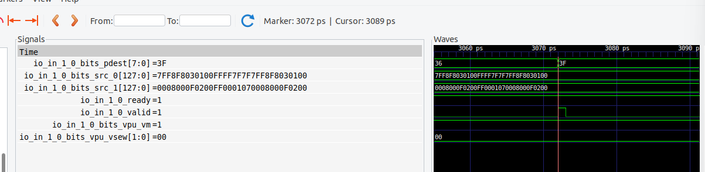

**图 4-8 3072 执行模块输入与元素宽度**

**3072 的执行入口握手有效，控制字段给出 SEW=8、vm=1。**

层级为 inner_vfExuBlock；Marker=3072。in_1_0 的 valid=ready=1、pdest=3F，两个操作数与 3071 旁路出口相同；vpu_vsew=00 即 SEW=8，vpu_vm=1 即不使用掩码。本图未显示 VL，第 5 章在 MGU 中补核为 2；128/8=16 只是当前数据块可容纳的元素数。

截图来源 image(20261016-063958).png 原始截图

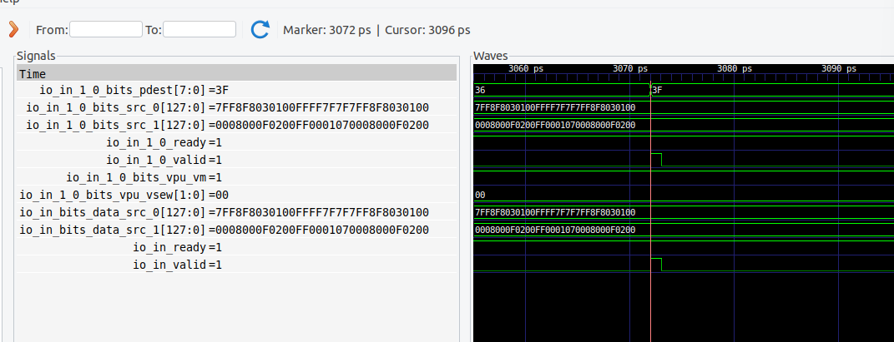

**图 4-9 3072 FU 输入与外层操作数对照**

Marker=3072；按操作时选定的 exus_2.VialuFix 层级读取。

表 14 向量执行入口读图顺序

| 顺序       | 信号或位置                | 读数与判断                            |
|------------|---------------------------|---------------------------------------|
| 1 数据源 0 | data_src_0                | 与外层 src_0 一致，完整值见本章数据表 |
| 2 数据源 1 | data_src_1                | 与外层 src_1 一致，完整值见本章数据表 |
| 3 输入有效 | io_in_valid / io_in_ready | 1 / 1，FU 输入握手条件成立            |

截图未显示完整 SST 路径；归属由当时选定的层级、相同记录点和双操作数对照建立。FU 的 ctrl_pdest 不在现有信号中，未列为直接观测。

截图来源 image(20261016-065017).png 原始截图

## **第 9 节 阶段结论与 ALU 衔接**

3072 的 FU 输入与 3071 旁路出口的两个操作数一致。第 5 章用它们验算分片结果，再核对 MGU 如何形成最终输出。

# **第 5 章 向量 ALU 运算与整核输出**

从 3072 接收操作数到 3073 给出有效输出，两个 64 位分片先做逐元素加法，MGU 再处理有效长度和尾部。FU 输出为 FFFFFFFFFFFFFFFFFFFFFFFFFFFF0300，目标身份另由第 6 章的执行单元输出核对。

本次 psrc0=0x3C、psrc1=0x3E、psrc2=0x3A、pdest=0x3F。执行输出处确认的 ROB 身份为 flag=0、value=0x19；跨阶段关联同时核对有效时刻、编号和结果。

整核外层采用本文的 XiangShan 固定提交；64 位算术子模块采用该提交记录的 YunSuan 基线。完整提交号统一见文末实验材料，代码行号分别对应各自源文件。

3072 与 3073 沿用同一整核运行的记录坐标。子模块数据可以提前稳定，因此首次看到某个数据值，不等于该条指令已经产生有效输出；结果还须与外层 valid、ready 和目标身份配套判断。

## **第 1 节 整核入口与操作数含义**

实际执行层级为 backend 下的 inner_vfExuBlock.exus_2.VialuFix，其中 VialuFix 对应 Scala 类 VIAluFix。子实例 vIntFixpAlus_0 和 vIntFixpAlus_1 分别处理低、高 64 位，mgu 负责普通向量目标的逐字节更新。整核外层直接实例化 64 位算术模块。

[VecPipedFuncUnit.scala](#Src_28) 第 62 至 66 行

> // FU 的 src(0) 是已读取的向量数据，和 Rename 中仅保存编号的 psrc 不同。
>
> private val src0 = inData.src(0)
>
> private val src1 = WireInit(inData.src(1)) // vs2 only
>
> // 本功能单元中 src(1) 对应 vs2，src(0) 对应 vs1；汇编书写顺序则是 vd、vs2、vs1。
>
> protected val vs2 = src1
>
> protected val vs1 = src0
>
> // src(2) 是旧目的向量的数据通路；是否需要依赖它，还受尾部和掩码策略约束。
>
> protected val oldVd = inData.src(2)

表 15 执行入口信号与配置

| 信号或参数                | 本次值                           |
|---------------------------|----------------------------------|
| src(0) 即 vs1 对应逻辑 v2 | 7FF8F8030100FFFF7F7F7FF8F8030100 |
| src(1) 即 vs2 对应逻辑 v3 | 0008000F0200FF0001070008000F0200 |
| 新物理目的寄存器 pdest    | 3F                               |
| vsew 编码与元素宽度       | 00 即 SEW=8                      |
| vm                        | 1 不使用掩码屏蔽                 |
| 有效长度与开始位置        | VL=2、vstart=0                   |
| 尾部策略                  | vta=1 允许尾部无关               |

入口 SEW 和 vm 见图 4-8，FU 操作数对照见图 4-9。VL、vstart、vta 要到本章第 8 至 10 节的 MGU 波形中核对。128 位通路能容纳 16 个字节，本次只有 VL=2 个有效元素。

## **第 2 节 加法操作码与控制产生**

[VAluDecode.scala](#Src_50) 第 9 行

> // 这是 ALU 内部六位运算编码，不是整条 32 位 RISC-V 机器码。
>
> val vadd = 0.U(6.W)

[VIntFixpAlu.scala](#Src_52) 第 31 至 35 行

> // Bundle 只定义 sub、misc、cmp 三个控制字段；具体取值来自下面的译码表。
>
> class VIntFixpDecode extends Bundle {
>
> val sub = Bool()
>
> val misc = Bool()
>
> val cmp = Bool()
>
> }

[VAluDecode.scala](#Src_50) 第 76 行

> // 译码表按 sub、misc、cmp 给出普通 vadd 的三个控制位，均为 0。
>
> BitPat(vadd) -\> BitPat("b0 0 0"),

[VIAluFix.scala](#Src_29) 第 178 至 181 行

> // 从整核 fuOpType 提取 ALU 使用的操作码。
>
> private val opcode = VialuFixType.getOpcode(inCtrl.fuOpType).asTypeOf(vIntFixpAlus.head.io.opcode)
>
> // 类型生成模块提供源和目标类型，其中包含元素宽度编码。
>
> private val vs1Type = typeMod.io.out.vs1Type
>
> private val vs2Type = typeMod.io.out.vs2Type
>
> private val vdType = typeMod.io.out.vdType

[VIAluFix.scala](#Src_29) 第 186 至 194 行

> // TruthTable 与 decoder 生成组合译码逻辑，不增加流水级。
>
> private val truthTable = TruthTable(VIntFixpTable.table, VIntFixpTable.default)
>
> private val decoderOut = decoder(QMCMinimizer, Cat(opcode.op), truthTable)
>
> private val vIntFixpDecode = decoderOut.asTypeOf(new VIntFixpDecode)
>
> // 普通 vadd 不属于饱和、平均或缩放移位，isFixp 为假。
>
> private val isFixp = Mux(vIntFixpDecode.misc, opcode.isScalingShift, opcode.isSatAdd \|\| opcode.isAvgAdd)
>
> // 源与目标宽度相同，因此本次不选扩宽路径。
>
> private val widen = opcode.isAddSub && vs1Type(1, 0) =/= vdType(1, 0)
>
> private val widen_vs2 = widen && vs2Type(1, 0) =/= vdType(1, 0)
>
> private val eewVs1 = SewOH(vs1Type(1, 0))
>
> private val eewVd = SewOH(vdType(1, 0))
>
> private val isVwsll = opcode.isVwsll

波形直接读到 isSub=0、isMisc=0、isFixp=0，与源码中普通整数加法路径一致。cmp、widen 等未在当前截图中直接显示的字段，只作为由指令与源码推导的条件，不补写成实测值。

## **第 3 节 两个 64 位模块怎样获得数据**

[VIAluFix.scala](#Src_29) 第 138 至 147 行

> private val dataWidth = cfg.destDataBits
>
> private val dataWidthOfDataModule = 64
>
> // 每个算术子模块处理 64 位；当前数据宽度为 128 位，因此生成两个并行模块。
>
> private val numVecModule = dataWidth / dataWidthOfDataModule
>
> // modules
>
> private val typeMod = Module(new VIAluSrcTypeModule)
>
> // 分块模块提供不同粒度的切片，供普通与扩宽等路径选择。
>
> private val vs2Split = Module(new VecDataSplitModule(dataWidth, dataWidthOfDataModule))
>
> private val vs1Split = Module(new VecDataSplitModule(dataWidth, dataWidthOfDataModule))
>
> private val oldVdSplit = Module(new VecDataSplitModule(dataWidth, dataWidthOfDataModule))
>
> // Seq.fill 在生成硬件时实例化并行模块，不表示用两拍循环计算。
>
> private val vIntFixpAlus = Seq.fill(numVecModule)(Module(new VIntFixpAlu64b))

[VIAluFix.scala](#Src_29) 第 171 至 173 行

> // 将两份整核源数据和旧目标数据送入对应分块模块。
>
> vs2Split.io.inVecData := vs2
>
> vs1Split.io.inVecData := vs1
>
> oldVdSplit.io.inVecData := oldVd

[VIAluFix.scala](#Src_29) 第 206 至 214 行

> // 扩宽、缩窄等操作可能重排数据；本次普通等宽 vadd 不满足这些条件。
>
> when(widen \|\| isNarrow \|\| isVwsllEewVdIs64) {
>
> vs1VecUsed := vs1GroupedVec32b
>
> }.elsewhen(isVwsllEewVdIs32) {
>
> vs1VecUsed := vs1GroupedVec16b
>
> }.elsewhen(isVwsllEewVdIs16) {
>
> vs1VecUsed := vs1GroupedVec8b
>
> }.otherwise {
>
> // 本次进入 otherwise，vs1 按连续低、高 64 位使用。
>
> vs1VecUsed := vs1Split.io.outVec64b
>
> }

[VIAluFix.scala](#Src_29) 第 225 行

> // 本次 widen_vs2=false，vs2 加法路径也选择连续 64 位切片。
>
> private val vs2Adder = Mux(widen_vs2, vs2GroupedVec32b, vs2Split.io.outVec64b)

[VIAluFix.scala](#Src_29) 第 235 至 245 行

> vIntFixpAlus.zipWithIndex.foreach {
>
> case (mod, i) =\>
>
> // 注意这里接的是 io.in.valid，不能沿用测试 wrapper 的 io.in.fire 连接。
>
> mod.io.fire := io.in.valid
>
> mod.io.opcode := opcode
>
> // 把本条操作的向量控制送给每个子模块。
>
> mod.io.info.vm := vm
>
> mod.io.info.ma := vma
>
> mod.io.info.ta := vta
>
> mod.io.info.vlmul := vlmul
>
> mod.io.info.vl := vl
>
> mod.io.info.vstart := vstart

[VIAluFix.scala](#Src_29) 第 249 至 263 行

> // 子模块 srcType(0) 描述 vs2，srcType(1) 描述 vs1；不要与外层 src(0)/src(1) 混淆。
>
> mod.io.srcType(0) := vs2Type
>
> mod.io.srcType(1) := vs1Type
>
> mod.io.vdType := vdType
>
> mod.io.narrow := isNarrow
>
> // 用已译码控制选择普通加法分支。
>
> mod.io.isSub := vIntFixpDecode.sub
>
> mod.io.isMisc := vIntFixpDecode.misc
>
> mod.io.isFixp := isFixp
>
> mod.io.widen := widen
>
> mod.io.widen_vs2 := widen_vs2
>
> // i=0 使用低 64 位，i=1 使用高 64 位；vs2_adder 是加法路径的输入。
>
> mod.io.vs1 := vs1VecUsed(i)
>
> mod.io.vs2_adder := vs2Adder(i)
>
> mod.io.vs2_misc := vs2VecUsed(i)
>
> mod.io.vmask := maskUsed(i)
>
> mod.io.oldVd := oldVdUsed(i)
>
> }

表 16 两个加法分片的操作数

| 分片       | vs1              | vs2_adder        |
|------------|------------------|------------------|
| 0 低 64 位 | 7F7F7FF8F8030100 | 01070008000F0200 |
| 1 高 64 位 | 7FF8F8030100FFFF | 0008000F0200FF00 |

## **第 4 节 64 位模块内的字节加法**

[VIntFixpAlu.scala](#Src_52) 第 65 至 76 行

> // 64 位算术模块内部实例化 VIntAdder64b。
>
> val vIntAdder64b = Module(new VIntAdder64b)
>
> vIntAdder64b.io.opcode := io.opcode
>
> vIntAdder64b.io.info := io.info
>
> vIntAdder64b.io.srcType := io.srcType
>
> vIntAdder64b.io.vdType := io.vdType
>
> // vs1 直接接入，vs2 使用外层选好的 vs2_adder。
>
> vIntAdder64b.io.vs1 := io.vs1
>
> vIntAdder64b.io.vs2 := io.vs2_adder
>
> vIntAdder64b.io.vmask := io.vmask
>
> vIntAdder64b.io.oldVd := io.oldVd
>
> // 减法与扩宽控制也一并接入，普通 vadd 的这些条件均为假。
>
> vIntAdder64b.io.isSub := io.isSub
>
> vIntAdder64b.io.widen := io.widen
>
> vIntAdder64b.io.widen_vs2 := io.widen_vs2

[VIntAdder64b.scala](#Src_51) 第 48 至 50 行

> // 普通加法 sub=0，且不是 vadc 等带进位操作。
>
> val sub = io.isSub
>
> val signed = srcTypeVs1(3, 2) === 1.U
>
> val addWithCarry = opcode.isAddWithCarry

[VIntAdder64b.scala](#Src_51) 第 59 至 61 行

> // 本次不扩宽，直接使用原来的 vs2。
>
> val vs2_adjust = Mux(io.widen_vs2, vs2Widen, vs2)
>
> // Subtract: bit negate
>
> // sub=0 时 Fill(64,sub) 全为 0，XOR 不改变 vs1。
>
> val vs1_adjust = Mux(io.widen, vs1Widen, vs1) ^ Fill(64, sub)

[VIntAdder64b.scala](#Src_51) 第 66 至 74 行

> class Adder_8b(in1: UInt, in2: UInt, cin: UInt) {
>
> // 两个 Cat 相加等于 2\*(in1+in2+cin)，因此移去最低位后得到正常加法结果。
>
> private val bits = Cat(0.U(1.W), in1, cin) +
>
> Cat(0.U(1.W), in2, cin)
>
> // out 取低 8 位加法结果，cout 单独保存该字节的进位。
>
> val (cout, out) = (bits(9), bits(8, 1))
>
> }
>
> // 这些 Wire 描述八组组合信号；实际结果寄存在第 7 节。
>
> val cin = Wire(Vec(8, Bool()))
>
> val cout = Wire(Vec(8, Bool()))
>
> val vd = Wire(Vec(8, UInt(8.W)))
>
> val carryIn = Wire(Vec(8, Bool()))

## **第 5 节 元素边界怎样隔离进位**

[VIntAdder64b.scala](#Src_51) 第 81 至 96 行

> for (i \<- 0 until 8) {
>
> // 每组处理位段 8\*i+7 至 8\*i，i=0 对应最低字节。
>
> val adder_8b = new Adder_8b(vs1_adjust(8\*i+7, 8\*i), vs2_adjust(8\*i+7, 8\*i), cin(i))
>
> // Generate carry-in from sub and vmask(11.4 Add-with-Carry/Sub-with_Borrow)
>
> // 普通 vadd 的 addWithCarry=false、sub=0，因此每个元素的初始进位为 0。
>
> carryIn(i) := Mux(addWithCarry, Mux(vm, sub, vmask_adjust(i) ^ sub), sub)
>
> // Generate final carry-in: cin
>
> val eewCin = Wire(new SewOH)
>
> // 普通加减依据目标元素宽度，决定相邻字节是否属于同一个元素。
>
> eewCin.oneHot := Mux(opcode.isAddSub, eewVd.oneHot, eewVs1.oneHot)
>
> if (i == 0) {
>
> // 最低字节从自己的初始进位开始。
>
> cin(i) := carryIn(i)
>
> } else if (i == 4) {
>
> // 跨过第 4 字节边界时，只有 64 位元素继续接前一字节进位。
>
> cin(i) := Mux(eewCin.is64, cout(i-1), carryIn(i))
>
> } else if (i % 2 == 0) {
>
> // 跨过第 2、6 字节边界时，32 位或 64 位元素继续传进位。
>
> cin(i) := Mux(eewCin.is64 \|\| eewCin.is32, cout(i-1), carryIn(i))
>
> } else {
>
> // 奇数字节在 SEW=8 时重新开始，否则接前一字节进位。
>
> cin(i) := Mux(eewCin.is8, carryIn(i), cout(i-1))
>
> }

[VIntAdder64b.scala](#Src_51) 第 100 至 102 行

> // 形成当前字节的组合进位信号；只有同一元素内的后续字节才可能使用它，此处未增加寄存器。
>
> cout(i) := adder_8b.cout
>
> vd(i) := adder_8b.out
>
> }

对本次普通 vadd，SEW=8 且初始进位为 0，每个字节独立相加，跨元素进位不传递。SEW=16、32、64 时，分别在每 2、4、8 个字节内传递进位，在元素边界重新开始。每个元素保留对应宽度的低位结果。

表 17 不同元素边界的进位处理

| 当前数据中的例子 | 完整字节和 | 保留的 8 位 | 下一元素                                      |
|------------------|------------|-------------|-----------------------------------------------|
| 元素 4 F8 + 08   | 100        | 00          | 元素 5 为 7F + 00 = 7F，不加入上一元素的进位  |
| 元素 9 FF + FF   | 1FE        | FE          | 元素 10 为 00 + 00 = 00，不加入上一元素的进位 |

表中数值是按源码计算的核对值；当前截图没有单独显示这些内部 cout。它们用于解释候选结果的逐字节来源，不作为各元素最终都被写入的证据。

## **第 6 节 本次整核数据的算术核对**

下面从最低字节向最高字节编号。候选值按每个 8 位元素独立相加并取低 8 位得到；是否进入最终结果还取决于 VL、vstart 和尾部策略。

表 18 八位元素加法与最终结果

| 元素                 | vs1 | vs2 | 候选值 |                                  | 本次最终处理 |     |
|----------------------|-----|-----|--------|----------------------------------|--------------|-----|
| 位置                 |     |     |        | 本次读数                         |              |     |
| 0                    | 00  | 00  | 00     |                                  | 采用加法值   |     |
| 1                    | 01  | 02  | 03     |                                  | 采用加法值   |     |
| 2                    | 03  | 0F  | 12     |                                  | 尾部填 FF    |     |
| 3                    | F8  | 00  | F8     |                                  | 尾部填 FF    |     |
| 4                    | F8  | 08  | 00     |                                  | 尾部填 FF    |     |
| 5                    | 7F  | 00  | 7F     |                                  | 尾部填 FF    |     |
| 6                    | 7F  | 07  | 86     |                                  | 尾部填 FF    |     |
| 7                    | 7F  | 01  | 80     |                                  | 尾部填 FF    |     |
| 8                    | FF  | 00  | FF     |                                  | 尾部填 FF    |     |
| 9                    | FF  | FF  | FE     |                                  | 尾部填 FF    |     |
| 10                   | 00  | 00  | 00     |                                  | 尾部填 FF    |     |
| 11                   | 01  | 02  | 03     |                                  | 尾部填 FF    |     |
| 12                   | 03  | 0F  | 12     |                                  | 尾部填 FF    |     |
| 13                   | F8  | 00  | F8     |                                  | 尾部填 FF    |     |
| 14                   | F8  | 08  | 00     |                                  | 尾部填 FF    |     |
| 15                   | 7F  | 00  | 7F     |                                  | 尾部填 FF    |     |
| 低 64 位子模块 io_vd |     |     |        | 80867F00F8120300                 |              |     |
| 高 64 位子模块 io_vd |     |     |        | 7F00F8120300FEFF                 |              |     |
| 拼接后的候选数据     |     |     |        | 7F00F8120300FEFF80867F00F8120300 |              |     |

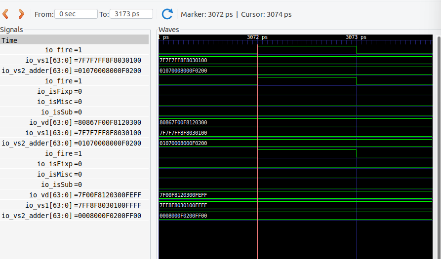

**图 5-1 3072 两个 64 位模块的候选加法值**

**低、高分片对应实例 0、1；拼接时把实例 1 放在高位。**

Marker=3072，Cursor=3074。按添加顺序，上面一组来自 vIntFixpAlus_0，下面新增一组来自 vIntFixpAlus_1。两组 fire=1，isFixp=isMisc=isSub=0；io_vd 分别为 80867F00F8120300 和 7F00F8120300FEFF。重复的短信号名需要结合添加层级识别；子模块输出在窗口内已经稳定，不能据此声称结果首次在 3073 出现。

截图来源 image(20261017-041809).png 原始截图

## **第 7 节 结果寄存与高低位拼接**

[VIntFixpAlu.scala](#Src_52) 第 88 至 93 行

> // fire 为真时，在时钟沿保存加法结果；不使能时保持原值。
>
> val vdAdderS1 = RegEnable(vIntAdder64b.io.vd, fire)
>
> val vdMiscS1 = RegEnable(vIntMisc64b.io.vd, fire)
>
> // isMisc 和 isFixp 与结果同时寄存，避免用下一条输入的控制选择当前结果。
>
> val isMiscS1 = RegEnable(io.isMisc, fire)
>
> val narrowVdMiscS1 = RegEnable(vIntMisc64b.io.narrowVd, fire)
>
> val cmpOutS1 = RegEnable(vIntAdder64b.io.cmpOut, fire)
>
> val isFixpS1 = RegEnable(io.isFixp, fire)

[VIntFixpAlu.scala](#Src_52) 第 105 行

> // 本次 isFixpS1、isMiscS1 均为 0，因此选择已寄存的 vdAdderS1。
>
> io.vd := Mux(isFixpS1, vFixPoint64b.io.vd, Mux(isMiscS1, vdMiscS1, vdAdderS1))

[VIAluFix.scala](#Src_29) 第 275 至 280 行

> // reverse 后按模块 1、模块 0 的顺序拼接；模块 1 在高位，模块 0 在低位。
>
> private val outVdTmp = Cat(vIntFixpAlus.reverse.map(\_.io.vd))
>
> private val outVd = Mux1H(Seq(
>
> // 本次不是 vwsll，直接采用 outVdTmp，不走下面的重排分支。
>
> (outIsVwsllEewVdIs64 \|\| !outIsVwsll) -\> outVdTmp,
>
> outIsVwsllEewVdIs32 -\> Cat(outVdTmp(127, 96), outVdTmp(63, 32), outVdTmp( 95, 64), outVdTmp(31, 0)),
>
> outIsVwsllEewVdIs16 -\> Cat(outVdTmp(127, 112), outVdTmp(63, 48), outVdTmp(111, 96), outVdTmp(47, 32),  
> outVdTmp(95, 80), outVdTmp(31, 16), outVdTmp(79, 64), outVdTmp(15,0)),
>
> ))

因此 128 位候选数据为 7F00F8120300FEFF80867F00F8120300。这里已经经过 64 位子模块的结果寄存，但尚未落实哪些元素参与本次操作。3073 时子模块 fire 回到 0 而数据保持，符合使能关闭后寄存器保持的行为；该保持值不能脱离外层 valid 单独解释为新指令完成。

## **第 8 节 MGU 接收有效长度与尾部控制**

[VIAluFix.scala](#Src_29) 第 333 至 341 行

> // 普通 vadd 不缩窄、也不产生掩码目标，因此使用默认候选数据 outVd。
>
> mgu.io.in.vd := MuxCase(outVd, Seq(
>
> narrow -\> outNarrowVd,
>
> dstMask -\> outCmpWithTail.asUInt,
>
> ))
>
> // 旧目的值供需要保留的字节使用；mask 和 vma 参与被屏蔽元素的处理。
>
> mgu.io.in.oldVd := outOldVd
>
> mgu.io.in.mask := maskToMgu
>
> // vta 决定尾部是否允许无关；本次输出对应控制 ta=1。
>
> mgu.io.in.info.ta := outVecCtrl.vta
>
> mgu.io.in.info.ma := outVecCtrl.vma
>
> // 普通 vadd 采用实际 outVl，本次图中 VL=2。
>
> mgu.io.in.info.vl := Mux(outIsVmvsx, 1.U, outVl)

[VIAluFix.scala](#Src_29) 第 343 至 350 行

> // 源码中存在有效位连接，但本次波形未显示该端口；使用父 FU 的 valid 判断事务有效。
>
> mgu.io.in.info.valid := validVec.last
>
> // 开始位置、元素宽度和微操作位置与输出数据配套，不能随意使用下一条输入的配置。
>
> mgu.io.in.info.vstart := outVecCtrl.vstart
>
> mgu.io.in.info.eew := outEew
>
> mgu.io.in.info.vsew := outVecCtrl.vsew
>
> mgu.io.in.info.vdIdx := outVecCtrl.vuopIdx
>
> mgu.io.in.info.narrow := narrow
>
> mgu.io.in.info.dstMask := dstMask
>
> mgu.io.in.isIndexedVls := false.B

[Mgu.scala](#Src_27) 第 73 至 80 行

> // MGU 把掩码与尾部策略送入字节使能生成模块。
>
> maskTailGen.io.in.vma := info.ma
>
> maskTailGen.io.in.vta := info.ta
>
> maskTailGen.io.in.vsew := realEw
>
> maskTailGen.io.in.maskUsed := maskUsed
>
> maskTailGen.io.in.vdIdx := vdIdx
>
> // activeEn 标记采用新计算结果的字节；agnosticEn 标记填全 1 的字节。
>
> private val activeEn = maskTailGen.io.out.activeEn
>
> private val agnosticEn = maskTailGen.io.out.agnosticEn

[ByteMaskTailGen.scala](#Src_26) 第 72 至 79 行

> private val maskEn = MaskExtractor(vlen)(io.in.maskUsed, io.in.vsew)
>
> private val maskOffEn = (~maskEn).asUInt
>
> // vma 只控制有效区间内被掩码关闭的元素。
>
> private val maskAgnosticEn = Mux(io.in.vma, maskOffEn, 0.U) & bodyEnInVd
>
> // vta=1 时，尾部对应字节进入无关填充集合。
>
> private val tailAgnosticEn = Mux(io.in.vta, tailEnInVd, 0.U)
>
> // 有效区间为空时不更新；否则新结果还要满足有效区间与掩码。
>
> private val activeEn = Mux(io.in.begin \>= io.in.end, 0.U(numBytes.W), bodyEnInVd & maskEn)
>
> private val agnosticEn = Mux(io.in.begin \>= io.in.end, 0.U(numBytes.W), maskAgnosticEn \| tailAgnosticEn)

本次 vm=1，普通 vadd 的掩码不屏蔽元素；vstart=0、VL=2，所以只采用元素 0 和 1。图中 io_out_active=0003，按位表示最低两个字节有效。该信号是字节选择掩码，不是 ready/valid 握手的 valid。

## **第 9 节 每个字节选择新值 全一或旧值**

[Mgu.scala](#Src_27) 第 82 至 94 行

> // the result of normal inst and narrow inst which does not need concat
>
> // byte1s 是一个字节的全 1，即 FF；这些 FF 不是加法溢出产生的。
>
> private val byte1s: UInt = (~0.U(8.W)).asUInt
>
> private val resVecByte = Wire(Vec(numBytes, UInt(8.W)))
>
> // 把候选数据和旧目的数据按低字节在前解释为 Vec。
>
> private val vdVecByte = vd.asTypeOf(resVecByte)
>
> private val oldVdVecByte = oldVd.asTypeOf(resVecByte)
>
> for (i \<- 0 until numBytes) {
>
> // 默认保留旧字节，再按下面的条件选择替换内容。
>
> resVecByte(i) := MuxCase(oldVdVecByte(i), Seq(
>
> // activeEn 为 1 时选择候选加法值。
>
> activeEn(i) -\> vdVecByte(i),
>
> // agnosticEn 为 1 时选择 FF。
>
> agnosticEn(i) -\> byte1s,
>
> ))
>
> }

[Mgu.scala](#Src_27) 第 127 至 130 行

> // 普通向量目标采用字节结果 resVecByte；掩码目标才选择另一路。
>
> io.out.vd := MuxCase(resVecByte.asUInt, Seq(
>
> info.dstMask -\> resVecBit.asUInt,
>
> ))
>
> // 波形可用 io_out_active 观察新计算结果被采用的字节。
>
> io.out.active := activeEn

表 19 各字节范围的结果选择

| 本次字节范围    | 计算或控制             | 最终采用值 |
|-----------------|------------------------|------------|
| 字节 0 即元素 0 | 00 + 00 = 00，active=1 | 00         |
| 字节 1 即元素 1 | 01 + 02 = 03，active=1 | 03         |
| 字节 2 至 15    | 超出 VL=2，且 vta=1    | 每字节 FF  |

高位在左、低位在右显示，因此两个有效元素组合成低 16 位 0300，前面 14 个尾部字节均为 FF。vta=1 在体系结构上允许尾部无关，本实现选择写全 1；不能把允许全 1 泛化为所有实现都必须填全 1。若 vta=0，尾部应保留旧目的值，也不会采用这些尾部的候选加法结果。

## **第 10 节 最终 FU 输出与有效性**

[VIAluFix.scala](#Src_29) 第 331 行

> // vstart\>=VL 时整份目标保持旧值；本次 0\<2，所以不走这个整份旧值分支。
>
> private val outVstartGeVl = outVstart \>= outVl

[VIAluFix.scala](#Src_29) 第 358 行

> // 本次不是掩码目标，最终输出选择 mgu.io.out.vd。
>
> io.out.bits.res.data := Mux(outVstartGeVl, outOldVd, Mux(dstMask, mgtu.io.out.vd, mgu.io.out.vd))

[FuncUnit.scala](#Src_25) 第 225 至 232 行

> io.in.ready := fixRdyVec.head
>
> // FU 输出 valid 来自流水有效状态；不能仅凭数据稳定认定结果有效。
>
> io.out.valid := fixValidVec.last
>
> // 流水中的目标身份和写使能随本次输出一起提供。
>
> io.out.bits.ctrl.robIdx := ctrlVec.last.robIdx
>
> io.out.bits.ctrl.pdest := ctrlVec.last.pdest
>
> io.out.bits.ctrl.rfWen.foreach(\_ := ctrlVec.last.rfWen.get)
>
> io.out.bits.ctrl.fpWen.foreach(\_ := ctrlVec.last.fpWen.get)
>
> io.out.bits.ctrl.vecWen.foreach(\_ := ctrlVec.last.vecWen.get)

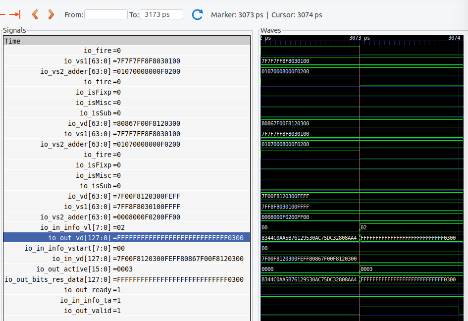

**图 5-2 3073 MGU 处理与 FU 有效输出**

Marker=3073，Cursor=3074；VialuFix.mgu 与父 FU。

表 20 向量执行输出读图顺序

| 顺序       | 信号或位置                | 读数与判断                                      |
|------------|---------------------------|-------------------------------------------------|
| 1 候选值   | MGU in_vd                 | 7F00F8120300FEFF80867F00F8120300                |
| 2 更新范围 | VL / vstart / ta / active | 02 / 00 / 1 / 0003，仅低两个字节取加法值        |
| 3 最终输出 | out_vd；父 FU 的 res_data | FFFFFFFFFFFFFFFFFFFFFFFFFFFF0300；valid=ready=1 |

MGU 与父 FU 的实例归属沿用操作时所选层级。图中不含执行单元 pdest；完整动态身份在图 6-1 继续核对。

截图来源 image(20261017-044618).png 原始截图

图中子模块 fire=0 表示此刻没有新的输入使能，不影响流水中已有结果从父 FU 输出。判断本条结果被下游接收，应看父 FU 的 valid 与 ready 同时为 1，而不是要求子模块输入 fire 继续为 1。

## **第 11 节 执行单元输出与阶段结论**

[ExeUnit.scala](#Src_24) 第 366 至 375 行

> // 任一内部 FU 提供有效结果，执行单元输出相应有效位。
>
> io.out.valid := Cat(fuOutValidOH).orR
>
> // 执行单元的下游 ready 反馈到 FU 输出。
>
> funcUnits.foreach(fu =\> fu.io.out.ready := io.out.ready)
>
> // select one fu's result
>
> // 按有效来源选择结果数据，同时选择对应的动态身份与物理目的编号。
>
> io.out.bits.data := VecInit(outDataVec.zip(outDataValidOH).map{ case(data, validOH) =\> Mux1H(validOH,  
> data)})
>
> io.out.bits.robIdx := Mux1H(fuOutValidOH, fuOutBitsVec.map(\_.ctrl.robIdx))
>
> io.out.bits.pdest := Mux1H(fuOutValidOH, fuOutBitsVec.map(\_.ctrl.pdest))
>
> io.out.bits.intWen.foreach(x =\> x := Mux1H(fuOutValidOH, fuIntWenVec))
>
> io.out.bits.fpWen.foreach(x =\> x := Mux1H(fuOutValidOH, fuFpWenVec))
>
> // 向量写使能与该来源的结果配套输出。
>
> io.out.bits.vecWen.foreach(x =\> x := Mux1H(fuOutValidOH, fuVecWenVec))

执行单元输出字段按下表核对。图 6-1 直接显示 3073 的 valid、ready、pdest=3F 和 robIdx=0:19；完整数据由同刻写回请求及图 6-2 交叉核对。vecWen=1 由本节输出选择、下一章仲裁条件及有效向量写请求共同支持，属于关联判断，不列为图 6-1 的直接读数。

表 21 执行单元输出与证据口径

| 执行单元信号             | 核对值及证据口径                 |
|--------------------------|----------------------------------|
| io_out_valid             | 1                                |
| io_out_ready             | 1                                |
| io_out_bits_pdest        | 3F                               |
| io_out_bits_vecWen       | 1，关联判断；图 6-1 未显示该字段 |
| io_out_bits_data_0       | FFFFFFFFFFFFFFFFFFFFFFFFFFFF0300 |
| io_out_bits_robIdx_flag  | 0                                |
| io_out_bits_robIdx_value | 19 十六进制                      |

本次最终采用元素 0、1 的加法结果，分别为 00 和 03。剩余字节由本实现按 ta=1 填为 FF。3072 的分片候选值经过 MGU 处理后，才得到 3073 的有效 FU 输出。

# **第 6 章 写回与提交**

写回沿两条通路推进：物理寄存器接收数据，ROB 接收完成通知。3075，物理寄存器 63 已更新，目标的提交接口也有效；3076 表项失效，3078 已提交映射从 3A 变为 3F。

3075 用 isCommit 与 commitValid 确认目标提交请求有效，3076 再以 ROB 的 valid 清零确认状态变化。两张快照不展示完整采样边沿。3078 是本次映射更新的记录点，不能用作固定提交延迟。

## **第 1 节 目标身份与两个写回去向**

表 22 写回目标及结果身份

<table>
<colgroup>
<col style="width: 21%" />
<col style="width: 46%" />
<col style="width: 32%" />
</colgroup>
<thead>
<tr class="header">
<th>身份或结果</th>
<th>本次目标</th>
<th>用途</th>
</tr>
</thead>
<tbody>
<tr class="odd">
<td>指令</td>
<td>PC=0x80000286 
0x023100D7 
vadd.vv v1, v3, v2</td>
<td>衔接取指译码与前序阶段</td>
</tr>
<tr class="even">
<td>逻辑目的寄存器</td>
<td>v1</td>
<td>体系结构中的目标名称</td>
</tr>
<tr class="odd">
<td>物理目的寄存器</td>
<td>0x3F 即十进制 63</td>
<td>保存本次 128 位结果</td>
</tr>
<tr class="even">
<td>ROB 动态身份</td>
<td>flag=0 
value=0x19 即十进制 25</td>
<td>识别本次在途指令与提交事件</td>
</tr>
<tr class="odd">
<td>最终结果</td>
<td>FFFFFFFFFFFFFFFFFFFFFFFFFFFF0300</td>
<td>VL=2 的有效低两字节为 0300，其余为尾部全一</td>
</tr>
</tbody>
</table>

执行输出分成两条相关通路：结果和物理目的编号进入写回仲裁及 DataPath，最终写入物理寄存器堆；执行完成通知携带 ROB 身份进入 CtrlBlock，再更新 ROB 的完成状态。它们的端口编号不同，不能将物理寄存器 63、ROB 项 25、写回端口 1 和完成通知端口 15 混为一谈。

[Backend.scala](#Src_8) 第 668 行

> // 向量执行模块的结果进入写回数据通路，此处是模块间连接。
>
> wbDataPath.io.fromVfExu \<\> vfExuBlock.io.out

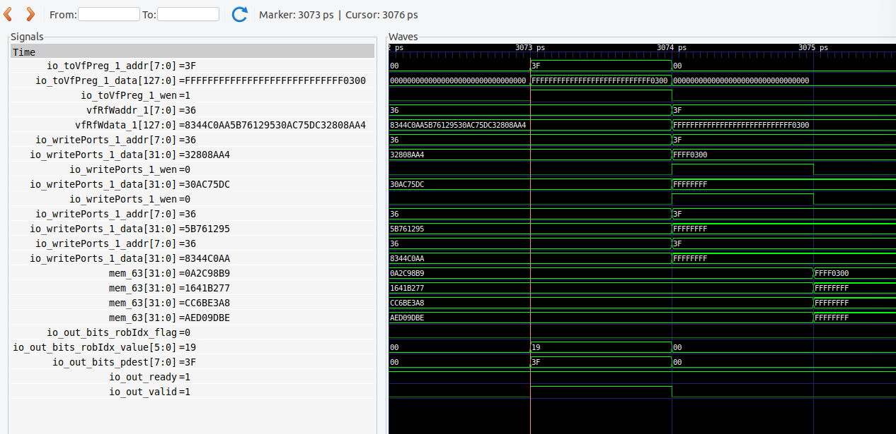

**图 6-1 3073 执行输出携带目标 ROB 身份**

Marker=3073，Cursor=3076；inner_vfExuBlock.exus_2.io_out。

表 23 执行结果写回的读图顺序

| 顺序         | 信号或位置                  | 读数与判断                           |
|--------------|-----------------------------|--------------------------------------|
| 1 有效性     | io_out_valid / io_out_ready | 1 / 1，身份字段属于有效输出          |
| 2 目的与身份 | pdest；robIdx.flag / value  | 3F；0 / 19，即物理目标 63、ROB 项 25 |
| 3 写回关联   | 同刻 toVfPreg_1             | 有效写请求，数据与最终 FU 结果相同   |

下方新增五项按 exus_2 实例读取；该图补齐执行输出的 ROB 身份。无效周期的 bits 不用于识别目标。

截图来源 image(20261017-080100).png 原始截图

## **第 2 节 写回仲裁形成物理寄存器写请求**

[WbArbiter.scala](#Src_16) 第 321 至 325 行

> // 将候选向量结果逐一接入仲裁器；zip 表示按对应位置配对。
>
> vfWbArbiter.io.in.zip(vfArbiterInputsWireY).foreach { case (arbiterIn, in) =\>
>
> // 来源有效并且确实写向量寄存器，才提出向量写回请求。
>
> arbiterIn.valid := in.valid && (in.bits.vecWen.getOrElse(false.B))
>
> // 下游接收能力通过 ready 反馈给执行输出。
>
> in.ready := arbiterIn.ready
>
> arbiterIn.bits.fromExuOutput(in.bits, "vf")
>
> }

[WbArbiter.scala](#Src_16) 第 365 行

> // 只有仲裁输出 fire，才用该结果形成有效的向量物理寄存器写端口。
>
> private val toVfPreg: MixedVec\[RfWritePortWithConfig\] = MixedVecInit(vfWbArbiterOut.map(x =\>  
> x.bits.asVfRfWriteBundle(x.fire)).toSeq)

[WbArbiter.scala](#Src_16) 第 373 行

> // 将形成的端口送到 WbDataPath 对外的 toVfPreg。
>
> io.toVfPreg := toVfPreg

[Backend.scala](#Src_8) 第 490 行

> // DataPath 接收向量物理寄存器写端口。
>
> dataPath.io.fromVfWb := wbDataPath.io.toVfPreg

本配置中 VFEX2 的向量写回资源为端口 1，配置见 Parameters.scala 第 452 行；实际波形也确认目标使用 toVfPreg_1。该端口编号属于当前构建，不能直接推广到其他配置。

[Parameters.scala](#Src_7) 第 452 行

> // VFEX2 配置中的 VfWB(1, 0) 指定向量写回端口 1 及其优先级。
>
> ExeUnitParams("VFEX2", Seq(VfmaCfg, VialuCfg), Seq(VfWB(port = 1, 0), V0WB(port = 1, 0)), Seq(Seq(VfRD(3,  
> 0)), Seq(VfRD(4, 0)), Seq(VfRD(5, 0)), Seq(V0RD(1, 0)), Seq(VlRD(1, 0)))),

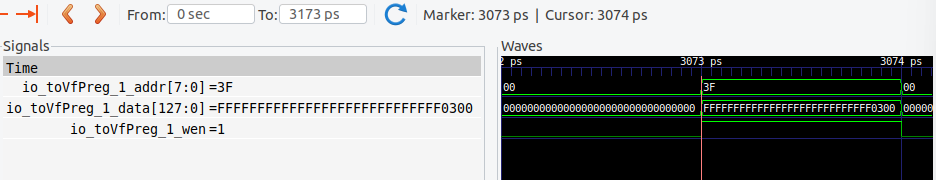

**图 6-2 3073 向量物理寄存器写请求**

**本图确认写请求，物理寄存器实际改值见图 6-4。**

层级为 backend.wbDataPath；Marker=3073，Cursor=3074。io_toVfPreg_1_wen=1、addr=3F、data=FFFFFFFFFFFFFFFFFFFFFFFFFFFF0300。这一图证明写请求有效，不能单独替代后续寄存器内容更新的证据。

截图来源 image(20261017-065737).png 原始截图

## **第 3 节 DataPath 寄存写端口并拆分数据**

[DataPath.scala](#Src_12) 第 357 至 359 行

> // 写使能有效时，将写地址寄存到 DataPath 内部。
>
> vfRfWaddr := io.fromVfWb.map(x =\> RegEnable(x.addr, x.wen)).toSeq
>
> // 与地址一起寄存本次完整结果。
>
> vfRfWdata := io.fromVfWb.map(x =\> RegEnable(x.data, x.wen)).toSeq
>
> // 每个数据分片使用对应的延迟写使能；foreach 与 zip 生成并行连接，不是运行时逐项循环。
>
> vfRfWen.foreach(\_.zip(io.fromVfWb.map(x =\> RegNext(x.wen))).foreach { case (wenSink, wenSource) =\>  
> wenSink := wenSource } )

RegEnable 在使能有效时更新寄存器，RegNext 对写使能进行状态延迟。由此，本次 3073 的外部写请求，在 3074 的快照中表现为 DataPath 的 vfRfWaddr_1=3F、vfRfWdata_1=FFFFFFFFFFFFFFFFFFFFFFFFFFFF0300，并送到下游分片写端口。内部 vfRfWen 没有在本次列表中找到，所以实际使能改查寄存器堆写端口，不把缺失字段补写为观测值。

[Regfile.scala](#Src_35) 第 352 至 363 行

> // 总数据宽度除以分片数，得到每个分片的数据宽度。
>
> val dataWidth = wdata.head.getWidth / splitNum
>
> val numReadPorts = raddr.length
>
> require(splitNum \> 1 && wdata.head.getWidth == dataWidth \* splitNum)
>
> val wdataVec = Wire(Vec(splitNum, Vec(wdata.length, UInt(dataWidth.W))))
>
> val rdataVec = Wire(Vec(splitNum, Vec(raddr.length, UInt(dataWidth.W))))
>
> val debugRDataVec: Option\[Vec\[Vec\[UInt\]\]\] = debugReadData.map(x =\> Wire(Vec(splitNum, Vec(x.length,  
> UInt(dataWidth.W)))))
>
> // 为每个分片生成独立寄存器堆实例，本次实际出现 Part0 至 Part3。
>
> for (i \<- 0 until splitNum) {
>
> // i=0 截取最低位，i=1 截取下一段，依次处理高位。
>
> wdataVec(i) := wdata.map(\_ ((i + 1) \* dataWidth - 1, i \* dataWidth))
>
> Regfile(
>
> // 各片共享物理地址，使用各自写使能与对应切片数据。
>
> name + s"Part\${i}", numEntries, raddr, rdataVec(i), wen(i), waddr, wdataVec(i),
>
> hasZero = false, withReset, bankNum = 1, debugReadAddr, debugRDataVec.map(\_(i))
>
> )

表 24 写回数据的各个分片

| 分片           | 本次位段   | 写入数据 |
|----------------|------------|----------|
| vfRegFilePart0 | \[31:0\]   | FFFF0300 |
| vfRegFilePart1 | \[63:32\]  | FFFFFFFF |
| vfRegFilePart2 | \[95:64\]  | FFFFFFFF |
| vfRegFilePart3 | \[127:96\] | FFFFFFFF |

四个分片共同组成一份 128 位物理向量数据，并不是四条指令。按 Part3、Part2、Part1、Part0 从高到低拼接，得到 FFFFFFFFFFFFFFFFFFFFFFFFFFFF0300。

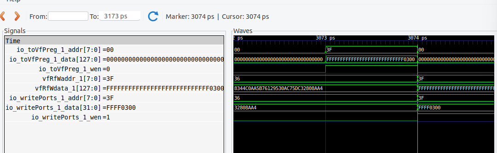

**图 6-3 3074 低 32 位分片收到有效写端口**

**图中只显示 Part0 的分片写使能。**

层级为 backend.dataPath.vfRegFilePart0；Marker=3074，Cursor=3074。io_writePorts_1_wen=1、addr=3F、data\[31:0\]=FFFF0300。上方 DataPath 的完整写地址和结果与该片一致。其他分片的写入最终通过下一图的四份 mem_63 更新确认，不将本图未显示的所有分片使能当成已观测。

截图来源 image(20261017-071211).png 原始截图

## **第 4 节 物理寄存器内容更新的直接证据**

[Regfile.scala](#Src_35) 第 123 至 128 行

> // 对第 i 个物理寄存器，找出写使能有效且地址匹配的端口。
>
> val wenOH = VecInit(io.writePorts.map(w =\> w.wen && w.addr === i.U))
>
> // 选择命中端口的数据。
>
> val wData = Mux1H(wenOH, io.writePorts.map(\_.data))
>
> // 命中有效写端口时，更新对应寄存器的存储值。
>
> when(wenOH.asUInt.orR) {
>
> if (i == 0) mem_0 := wData
>
> // 目标 i=63 时，写入 mem(63)，波形名为 mem_63。
>
> else mem(i) := wData
>
> }

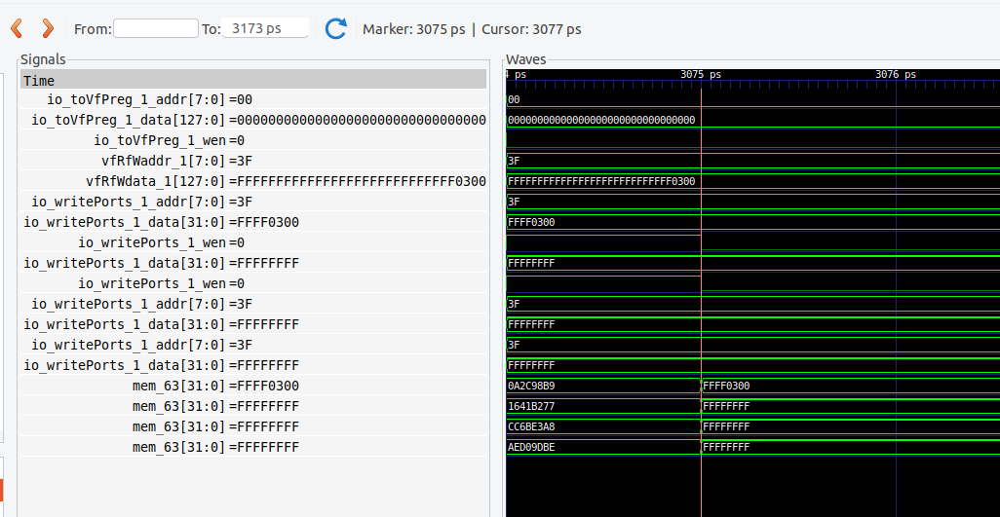

**图 6-4 3075 四个分片的物理寄存器 63 更新**

**四行 mem_63 依次对应 Part0 到 Part3。**

层级为 backend.dataPath.vfRegFilePart0 至 Part3，四行 mem_63 按 Part0、Part1、Part2、Part3 的顺序添加；Marker=3075，Cursor=3077。四行分别变为 FFFF0300、FFFFFFFF、FFFFFFFF、FFFFFFFF。此刻写端口 wen 已回到 0，但存储内容保持新值，不能用当前 wen=0 否定此前有效写入。

截图来源 image(20261017-072253).png 原始截图

表 25 物理寄存器更新前后读数

| 分片 mem_63 | 更新前   | 3075 更新后 |
|-------------|----------|-------------|
| Part0       | 0A2C9889 | FFFF0300    |
| Part1       | 1641B277 | FFFFFFFF    |
| Part2       | CC6BE3A8 | FFFFFFFF    |
| Part3       | AED09DBE | FFFFFFFF    |

这组存储内容变化直接证明最终结果已写入物理寄存器 63。结果有效写入、完成通知和 ROB 提交是不同判据，即使其中某些状态在同一记录坐标出现，也应分别列出证据。

## **第 5 节 执行完成通知怎样到达 ROB**

[WbArbiter.scala](#Src_16) 第 351 至 352 行

> // 将向量执行输出按配置顺序展开，保留每个执行输出的身份。
>
> private val vfExuInputs = io.fromVfExu.flatten.toSeq
>
> // WireInit 建立组合默认连接，本身不增加流水寄存器。
>
> private val vfExuWBs = WireInit(MixedVecInit(vfExuInputs))

[WbArbiter.scala](#Src_16) 第 359 行

> // 完成通知的有效位由执行输出 fire 决定，避免仅有 valid 却未被接收时提前通知。
>
> (vfExuWBs zip vfExuInputs).foreach { case (wb, input) =\> wb.valid := input.fire }

[WbArbiter.scala](#Src_16) 第 369 行

> // 完成通知依次拼接整数、浮点、向量和访存来源。
>
> private val wb2Ctrl = intExuWBs ++ fpExuWBs ++ vfExuWBs ++ memExuWBs

[WbArbiter.scala](#Src_16) 第 376 至 380 行

> // 逐端口向控制块传递完成通知。
>
> io.toCtrlBlock.writeback.zip(wb2Ctrl).foreach { case (sink, source) =\>
>
> // 有效位与身份、结果等信息配套传递。
>
> sink.valid := source.valid
>
> sink.bits := source.bits
>
> source.ready := true.B
>
> }

[Backend.scala](#Src_8) 第 262 行

> // 写回数据通路的控制通知连接到 CtrlBlock。
>
> ctrlBlock.io.fromWB.wbData \<\> wbDataPath.io.toCtrlBlock.writeback

本配置展开后，整数执行来源有 8 项、浮点有 5 项，VFEX2 是向量来源的第 2 项，均从 0 编号，因此其全局完成通知端口为 8+5+2=15。计数依据 Parameters.scala 第 395 至 456 行的执行资源顺序，与本次 io_exuWriteback_15 的实际波形互相验证。端口 15 与向量寄存器写端口 1 的接收者和编号空间不同。

[CtrlBlock.scala](#Src_10) 第 124 至 137 行

> private val delayedNotFlushedWriteBack = io.fromWB.wbData.map(x =\> {
>
> val valid = x.valid
>
> // 这一路检查更老重定向是否杀死结果。
>
> val killedByOlder = x.bits.robIdx.needFlush(Seq(s1_s3_redirect, s2_s4_redirect))
>
> val delayed = Wire(Valid(new ExuOutput(x.bits.params)))
>
> // 未被冲刷的有效通知进入寄存器。
>
> delayed.valid := GatedValidRegNext(valid && !killedByOlder)
>
> // 有效输入时寄存相应 bits，包含动态身份。
>
> delayed.bits := RegEnable(x.bits, x.valid)
>
> delayed.bits.debugInfo.writebackTime := GTimer()
>
> delayed
>
> }).toSeq
>
> // 另一组完成输入保留延迟后的原始有效位。
>
> private val delayedWriteBack = Wire(chiselTypeOf(io.fromWB.wbData))
>
> delayedWriteBack.zipWithIndex.map{ case (x,i) =\>
>
> // GatedValidRegNext 涉及寄存器延迟，不能把到达 ROB 的时刻当成执行单元原始输出时刻。
>
> x.valid := GatedValidRegNext(io.fromWB.wbData(i).valid)
>
> x.bits := delayedNotFlushedWriteBack(i).bits
>
> }

[CtrlBlock.scala](#Src_10) 第 746 至 749 行

> // writeback 连接经过未冲刷筛选的通知，参与异常等控制处理。
>
> rob.io.writeback := delayedNotFlushedWriteBack
>
> // 普通完成计数使用的 exuWriteback 接收 delayedWriteBack。
>
> rob.io.exuWriteback := delayedWriteBack
>
> // 另外传递按 ROB 身份汇总的完成数量。
>
> rob.io.writebackNums := VecInit(delayedNotFlushedWriteBackNums)
>
> rob.io.writebackNeedFlush := delayedNotFlushedWriteBackNeedFlush

两组名称相近但用途不同：ROB 的普通 exuWBs 来自 exuWriteback，不能误写为 uopNum 直接消耗 io.writeback。CtrlBlock.scala 第 152 至 184 行还会在允许合并的来源中，统计同一 ROB 身份的有效写回数量；不能把每个端口永久视为只扣减 1，也不能把两个 Valid Bundle 的 valid 位语义混为一谈。

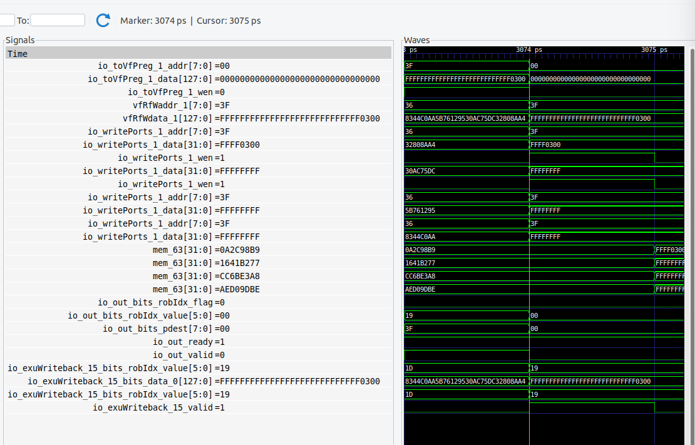

**图 6-5 3074 目标完成通知到达 ROB 端口 15**

Marker=3074，Cursor=3075；inner_ctrlBlock.rob 的端口 15。

表 26 ROB 完成通知读图顺序

| 顺序       | 信号或位置               | 读数与判断                       |
|------------|--------------------------|----------------------------------|
| 1 通知有效 | io_exuWriteback_15_valid | 1，完成通知在该记录点有效        |
| 2 ROB 索引 | bits_robIdx_value        | 19，即十进制 25                  |
| 3 结果     | bits_data_0              | FFFFFFFFFFFFFFFFFFFFFFFFFFFF0300 |

此端口的波形未提供 flag 或 pdest。关联依据是已确认的来源端口、相邻有效时刻、索引及完整结果。上方执行输出已无效，其残留 00 不用于重新解释目标编号。

截图来源 image(20261017-081301).png 原始截图

## **第 6 节 ROB 完成计数清零**

[Rob.scala](#Src_41) 第 134 行

> // 普通执行完成来源取自 exuWriteback，并排除存储数据功能单元。
>
> val exuWBs: Seq\[ValidIO\[ExuOutput\]\] = io.exuWriteback.filter(!\_.bits.params.hasStdFu).toSeq

[Rob.scala](#Src_41) 第 998 至 1004 行

> val enqUopNum = PriorityMux(instCanEnqSeq, enqUopNumVec)
>
> // 从本次入队候选中选出写回数量；enqWBNumVec 在第 976 行由 req.bits.numWB 形成。
>
> val enqWBNum = PriorityMux(instCanEnqSeq, enqWBNumVec)
>
> val enqWriteStd = PriorityMux(instCanEnqSeq, enqWriteStdVec)
>
> // 筛选有效且指向第 i 个 ROB 项的通知；当前目标 i=25。
>
> val canWbSeq = exuWBs.map(writeback =\> writeback.valid && writeback.bits.robIdx.value === i.U)
>
> val canStdWbSeq = VecInit(stdWBs.map(writeback =\> writeback.valid &&  
> writeback.bits.robIdx.value === i.U))
>
> // 选中相应通知携带的汇总完成数量，作为本次扣减数。
>
> val wbCnt = Mux1H(canWbSeq, io.writebackNums.map(\_.bits))

[Rob.scala](#Src_41) 第 1014 至 1029 行

> // 先保留异常冲刷分支作为控制上下文；当前目标按后面的正常分支处理。
>
> when(robEntries(i).valid && (needFlush \|\| needFlushWriteBack)) {
>
> // exception flush
>
> robEntries(i).uopNum := robEntries(i).uopNum - wbCnt
>
> robEntries(i).stdWritebacked := true.B
>
> // 空表项接收第一份指令记录时，初始化完成状态。
>
> }.elsewhen(!robEntries(i).valid && instCanEnqFlag) {
>
> // enq set num of uops
>
> // uopNum 实际用 enqWBNum 初始化，应理解为尚待完成的写回数量。
>
> robEntries(i).uopNum := enqWBNum
>
> // 普通 vadd 没有存储数据部分，这一条件在入队时初始化为真。
>
> robEntries(i).stdWritebacked := Mux(enqWriteStd, false.B, true.B)
>
> }.elsewhen(robEntries(i).valid) {
>
> // update by writing back
>
> // 有效表项收到完成通知后，扣减剩余数量。
>
> robEntries(i).uopNum := robEntries(i).uopNum - wbCnt
>
> // 断言检测扣减下溢；触发时应检查重复通知、完成计数及目标身份关联。
>
> assert(!(robEntries(i).uopNum - wbCnt \> robEntries(i).uopNum), s"robEntries \$i uopNum is overflow!")
>
> when(canStdWbSeq.asUInt.orR) {
>
> robEntries(i).stdWritebacked := true.B
>
> }
>
> }

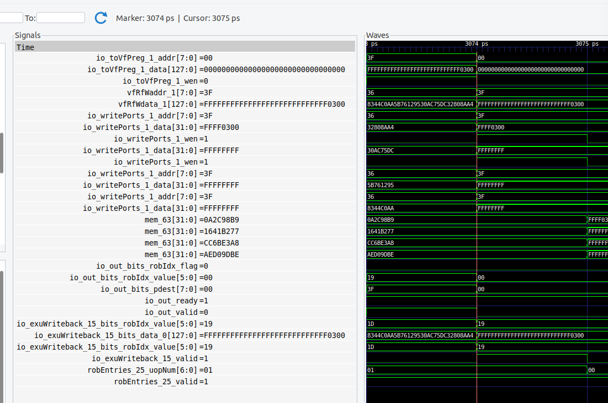

**图 6-6 3075 ROB 第 25 项的完成计数清零**

**左侧栏仍是 3074；3075 的完成计数要沿右侧轨迹读。**

层级为 backend.inner_ctrlBlock.rob；Marker=3074，Cursor=3075。左侧当前值仍为 robEntries_25_uopNum=01、valid=1；右侧显示 uopNum 在 3075 变为 00。这里的 25 是十进制索引，对应通知中的十六进制 19。计数清零只证明普通完成条件满足，不单独证明提交。

截图来源 image(20261017-081926).png 原始截图

[RobBundles.scala](#Src_42) 第 152 至 155 行

> def connectCommitEntry(robCommitEntry: RobCommitEntryBundle, robEntry: RobEntryBundle): Unit = {
>
> robCommitEntry.walk_v := robEntry.valid
>
> // 提交候选先要求 ROB 项有效。
>
> robCommitEntry.commit_v := robEntry.valid
>
> // 再要求普通写回计数为零，且存储数据部分满足完成条件。
>
> robCommitEntry.commit_w := (robEntry.uopNum === 0.U) && (robEntry.stdWritebacked === true.B)

connectCommitEntry 将状态整理成提交候选字段。它是生成硬件时建立连接的 Scala 函数，不是处理器运行时调用的软件过程；函数名中出现 Commit 不表示调用它就已经提交。

## **第 7 节 按序提交的总体和逐项条件**

执行完成与正式提交之间存在顺序约束。较老 load 仍在等待数据时，较新的 vadd 即使已经写回，也不能越过受阻的较老指令正常提交。这样，发生异常或重定向时仍可恢复到正确的程序状态。提交前，依赖该结果的年轻指令可以已经使用物理结果，不需要等到架构提交才执行。

[Rob.scala](#Src_41) 第 751 至 756 行

> val traceBlock = io.trace.blockCommit
>
> // 冲刷、分支恢复、等待中断等状态可能阻止正常提交。
>
> val blockCommit = misPredBlock \|\| lastCycleFlush \|\| hasWFI \|\| io.redirect.valid \|\|
>
> (deqNeedFlush && !deqHasFlushed) \|\| deqFlushBlock \|\| criticalErrorState \|\| traceBlock
>
> // isWalk 表示回滚遍历，不能当作正常提交。
>
> io.commits.isWalk := state === s_walk
>
> // s_idle 是 ROB 的正常工作状态，不表示 ROB 内没有指令。
>
> io.commits.isCommit := state === s_idle && !blockCommit

[Rob.scala](#Src_41) 第 758 至 765 行

> val walk_v = VecInit(walkingPtrVec.map(ptr =\> robEntries(ptr.value).valid))
>
> // 取出当前候选组的有效状态。
>
> val commit_vDeqGroup = VecInit(robDeqGroup.map(\_.commit_v))
>
> // 取出当前候选组的写回完成状态。
>
> val commit_wDeqGroup = VecInit(robDeqGroup.map(\_.commit_w))
>
> val realCommitLast = deqPtrVec(0).lineHeadPtr + Fill(bankAddrWidth, 1.U)
>
> // 尚未完成且尚未提交的候选项会形成提交阻塞。
>
> val commit_block = VecInit((0 until CommitWidth).map(i =\> !commit_wDeqGroup(i) && !hasCommitted(i)))
>
> val allowOnlyOneCommit = VecInit(robDeqGroup.map(x =\> x.commit_v && x.needFlush)).asUInt.orR \|\|  
> intrBitSetReg
>
> // for instructions that may block others, we don't allow them to commit
>
> // 内部候选组整理后形成对外 commitValid；不要直接用内部 bank 编号代替外部提交槽。
>
> io.commits.commitValid := PriorityMux(commitValidThisLine, (0 until CommitWidth).map(i =\>  
> (commitValidThisLine.asUInt \>\> i).asUInt.asTypeOf(io.commits.commitValid)))

[Rob.scala](#Src_41) 第 767 至 774 行

> for (i \<- 0 until CommitWidth) {
>
> // defaults: state === s_idle and instructions commit
>
> // when intrBitSetReg, allow only one instruction to commit at each clock cycle
>
> // 当前中断或待处理冲刷可能阻止本项提交。
>
> val isBlocked = intrEnable \|\| (deqNeedFlush && !deqHasFlushed)
>
> // 检查前序项及单条提交限制，保持正常提交顺序。
>
> val isBlockedByOlder = if (i != 0) commit_block.asUInt(i, 0).orR \|\| allowOnlyOneCommit &&  
> !hasCommitted.asUInt(i - 1, 0).andR else false.B
>
> // 本项有效且完成，无阻塞，并且此前未提交，才成为候选。
>
> commitValidThisLine(i) := commit_vDeqGroup(i) && commit_wDeqGroup(i) && !isBlocked &&  
> !isBlockedByOlder && !hasCommitted(i)
>
> io.commits.info(i) := commitInfo(i)
>
> // 每个对外提交槽给出相应 ROB 动态索引。
>
> io.commits.robIdx(i) := deqPtrVec(i)

[Rob.scala](#Src_41) 第 1511 行

> // 差分提交事件同时要求槽位有效和总体提交模式有效。
>
> difftest.valid := io.commits.commitValid(i) && io.commits.isCommit

对本条目标，必须在同一个记录点、同一个提交槽同时读到 isCommit=1、commitValid=1、robIdx_flag=0、robIdx_value=19。仅看指针移动、uopNum=0、相同 PC 或 commitValid 中某一位，都不足以确认目标已经正常提交。

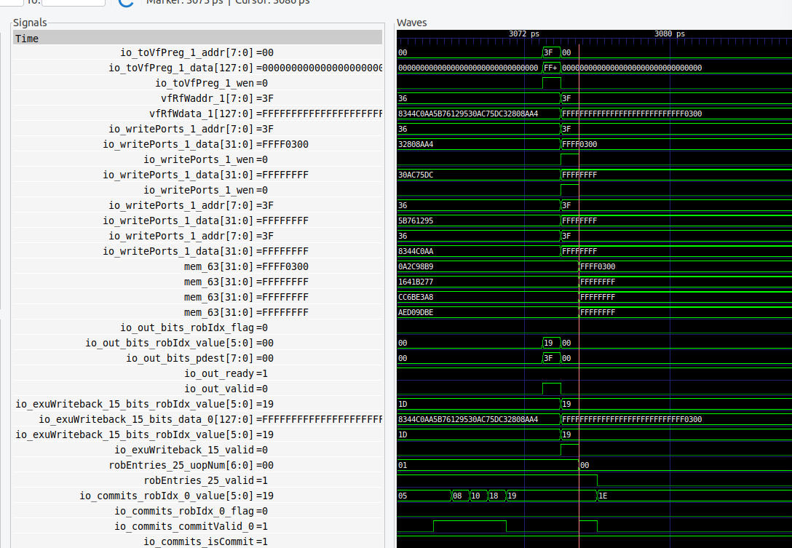

**图 6-7 3075 目标提交接口有效及后续表项释放**

Marker=3075，Cursor=3080；inner_ctrlBlock.rob。

表 27 ROB 提交读图顺序

| 顺序       | 信号或位置              | 读数与判断                  |
|------------|-------------------------|-----------------------------|
| 1 提交有效 | isCommit；commitValid_0 | 1；1，两项同时有效          |
| 2 目标身份 | robIdx_0.flag / value   | 0 / 19，与图 6-1 的目标一致 |
| 3 状态推进 | robEntries_25.valid     | 3075 为 1，3076 降为 0      |

3075 的 uopNum=00；提交槽 0 随后推进到索引 1E。目标提交依据当前有效条件与身份匹配判断；后续候选索引不能替代本条身份，也不把快照说成完整时钟边沿。

截图来源 image(20261017-084239).png 原始截图

[Rob.scala](#Src_41) 第 934 至 938 行

> // update robEntries valid
>
> for (i \<- 0 until RobSize) {
>
> val enqOH = VecInit(canEnqueue.zip(allocatePtrVec.map(\_.value === i.U)).map(x =\> x.\_1 && x.\_2))
>
> // 总体提交有效且某个有效提交槽指向第 i 项，形成该项的 commitCond。
>
> val commitCond = io.commits.isCommit &&  
> io.commits.commitValid.zip(deqPtrVec.map(\_.value === i.U)).map(x =\> x.\_1 && x.\_2).reduce(\_ \|\| \_)
>
> assert(PopCount(enqOH) \< 2.U, s"robEntries\$i enqOH is not one hot")

[Rob.scala](#Src_41) 第 944 至 949 行

> // 正常提交后，该 ROB 表项置为无效。
>
> when(commitCond) {
>
> robEntries(i).valid := false.B
>
> }.elsewhen(enqOH.asUInt.orR && !io.redirect.valid) {
>
> robEntries(i).valid := true.B
>
> // 冲刷也可能使表项无效，因此 valid 下降必须结合前面的提交事件解释。
>
> }.elsewhen(needFlush){
>
> robEntries(i).valid := false.B

## **第 8 节 RAB 将提交记录送往重命名部分**

ROB 确认指令提交，RAB 即 RenameBuffer 保存并传递逻辑目标与物理目标等重命名记录。ROB 提交宽度与 RAB 记录输出宽度不必相同，输出槽位也不能仅凭编号对应。本次通过最终映射状态核对结果，没有单独观察所有 RAB 中间端口。

[Rob.scala](#Src_41) 第 347 至 348 行

> // 向 RAB 通知本次允许提交的目标记录数量；向量访存异常有专门处理。
>
> rab.io.fromRob.commitSize := Mux(deqVlsExceptionNeedCommit, deqVlsExceptionCommitSize, commitSizeSum)
>
> rab.io.fromRob.walkSize := walkSizeSum

[Rab.scala](#Src_40) 第 136 至 144 行

> // number of pair(ldest, pdest) ready to commit to arch_rat
>
> // 寄存尚待送往已提交映射表的记录数量。
>
> val commitSize = RegInit(0.U(log2Up(size).W))
>
> val walkSize = RegInit(0.U(log2Up(size).W))
>
> val specialWalkSize = RegInit(0.U(log2Up(size).W))
>
> val newCommitSize = io.fromRob.commitSize
>
> val newWalkSize = io.fromRob.walkSize
>
> // 加入 ROB 新确认的记录，再减去已输出的数量。
>
> val commitSizeNxt = commitSize + newCommitSize - commitCount

[Rob.scala](#Src_41) 第 355 至 356 行

> // pipe rab commits for better timing and area
>
> // RAB 提交输出还经过 RegNext，不能假定映射表与 ROB 提交同一快照更新。
>
> io.rabCommits := RegNext(rab.io.commits)

[CtrlBlock.scala](#Src_10) 第 630 行

> // 把 ROB 转出的 RAB 记录送入重命名表包装模块。
>
> rat.io.rabCommits := rob.io.rabCommits

[RenameTable.scala](#Src_38) 第 340 至 344 行

> // 为每个向量架构映射写端口生成连接。
>
> for ((arch, i) \<- vecRat.io.archWritePorts.zipWithIndex) {
>
> // RAB 提交记录有效且属于向量目的寄存器时，才使能映射更新。
>
> arch.wen := io.rabCommits.isCommit && io.rabCommits.commitValid(i) && io.rabCommits.info(i).vecWen
>
> // 写地址是逻辑目的编号；当前目标为 v1。
>
> arch.addr := io.rabCommits.info(i).ldest
>
> // 写数据是物理编号 3F，不是 128 位向量结果。
>
> arch.data := io.rabCommits.info(i).pdest
>
> }

[RenameTable.scala](#Src_38) 第 114 至 116 行

> // arch state rename table
>
> // arch_table 是已提交映射的寄存器状态，与 spec_table 的用途不同。
>
> val arch_table = RegInit(rename_table_init)
>
> val arch_table_next = WireDefault(arch_table)

[RenameTable.scala](#Src_38) 第 158 至 161 行

> for ((w, i) \<- io.archWritePorts.zipWithIndex) {
>
> // 提交映射写端口有效时，计算对应逻辑寄存器的新映射。
>
> when (w.wen) {
>
> // 本次预期更新逻辑 v1 对应项为物理编号 3F。
>
> arch_table_next(w.addr) := w.data
>
> }

[RenameTable.scala](#Src_38) 第 167 行

> // 将下一状态写入已提交映射表寄存器。
>
> arch_table := arch_table_next

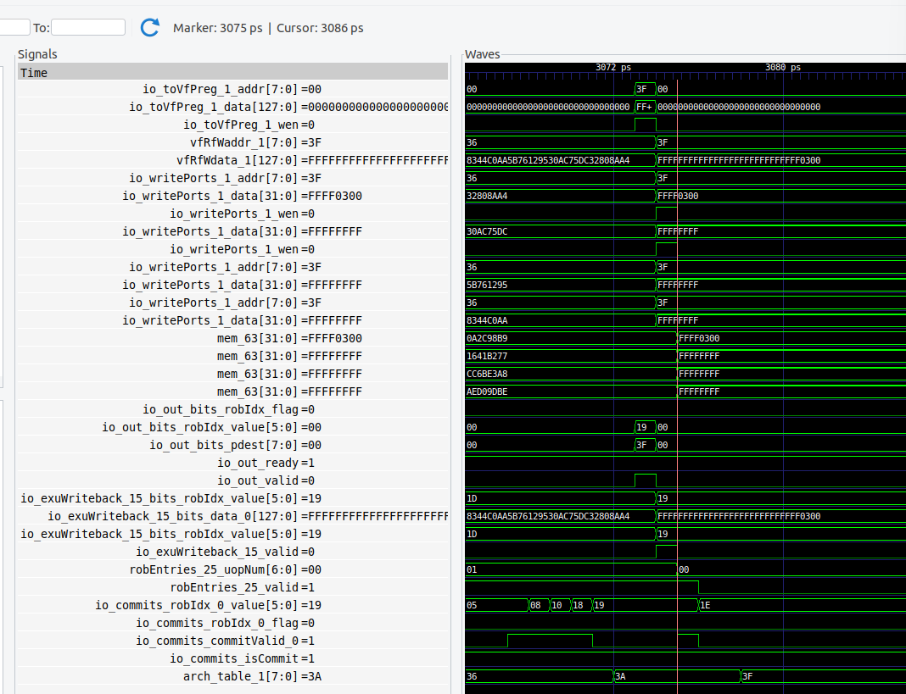

**图 6-8 3078 已提交映射确认 v1 对应物理寄存器 63**

Marker=3075，Cursor=3086；inner_ctrlBlock.rat.vecRat。

表 28 RAB 与映射更新读图顺序

| 顺序       | 信号或位置              | 读数与判断                               |
|------------|-------------------------|------------------------------------------|
| 1 提交关联 | 上方 ROB 的正常提交事件 | 保留 3075 的目标提交上下文               |
| 2 当前读数 | arch_table_1 左侧值     | 3A，属于 Marker=3075                     |
| 3 更新轨迹 | arch_table_1 右侧波形   | 3078 从 3A 变为 3F，确认 v1 的已提交映射 |

3078 的结论来自右侧刻度与轨迹，不能把左侧 3A 按 Cursor=3086 读取。图中更早的 36 属于之前的映射。

截图来源 image(20261017-084747).png 原始截图

重命名时已经建立并使用 v1→3F 的推测映射；本次提交后，已提交映射也确认 v1→3F。物理寄存器 63 中的 FFFFFFFFFFFFFFFFFFFFFFFFFFFF0300 此前已经写入，不需要在提交时再复制到一份独立的逻辑寄存器数据阵列。3A 为本次更新前图中读到的已提交映射；映射确认与旧版本回收是不同事件。

## **第 9 节 写回和提交证据汇总**

表 29 写回与提交证据汇总

| 记录坐标 | 事件               | 直接证据                                                       |
|----------|--------------------|----------------------------------------------------------------|
| 3073     | 执行输出与写回请求 | 输出 valid=ready=1；pdest=3F、robIdx=0:19；toVfPreg_1 的 wen=1 |
| 3074     | 数据进入分片写端口 | DataPath 地址 3F、完整结果匹配；Part0 写端口 wen=1             |
| 3074     | 完成通知到达 ROB   | exuWriteback_15.valid=1、value=19、data 匹配                   |
| 3075     | 完整物理结果写入   | Part0 至 Part3 的 mem_63 更新为 FFFF0300 和三个 FFFFFFFF       |
| 3075     | 完成计数清零       | robEntries_25.uopNum 从 01 变为 00                             |
| 3075     | 目标提交接口有效   | isCommit=1、commitValid_0=1、robIdx=0:19                       |
| 3076     | ROB 表项释放       | robEntries_25.valid 从 1 变为 0                                |
| 3078     | 已提交映射更新     | vecRat.arch_table_1 从 3A 变为 3F                              |

沿同一条 vadd 核对到的最终状态是：低两个字节为 00、03，尾部按本实现的 ta=1 策略填全 1；物理寄存器 63 保存完整结果，ROB 项释放后，v1 的已提交映射指向 3F。

这组证据覆盖所选指令的正常路径。判定依据是各级的有效接口、匹配的动态身份和可见的状态变化。恢复路径与前端缓存时序未用本次波形测量。

# **第 7 章 数据通路与微架构总结**

## **第 1 节 两个源如何变成写回结果**

这次跟踪的是 vadd.vv v1, v3, v2。译码把 v2、v3 放进 lsrc(0)、lsrc(1)，重命名把它们换成 0x3C 和 0x3E。只有 DataPath 发出读请求、选中寄存器返回值之后，src(0) 和 src(1) 才表示送进 ALU 的两个 128 位操作数。

表 30 vadd 的数据通路

| 记录坐标     | 所在阶段           | 数据或编号怎样变化                                                                                         |
|--------------|--------------------|------------------------------------------------------------------------------------------------------------|
| 3015 至 3016 | 取指与译码         | 机器码 0x023100D7 进入译码，形成一个微操作。逻辑源是 v2、v3，逻辑目标是 v1。见图 1-1、图 1-2。             |
| 3017         | Rename             | v2 和 v3 映射为 3C、3E，旧 v1 为 3A。新目标分配为 3F。见图 2-1。                                           |
| 3069         | DataPath 取数入口  | rf_0_0_addr=3C，rf_1_0_addr=3E。两个数据来源均选择寄存器堆。见图 4-6。                                     |
| 3071 至 3072 | 旁路出口与 FU 入口 | 两路 src 分别携带 v2、v3 的完整数据。两端的读数一致。见图 4-7、图 4-9。                                    |
| 3072 至 3073 | 向量加法和 MGU     | 高低两个 64 位分片给出候选值。MGU 根据 VL=2 和尾部策略保留低 16 位 0300，其余字节填 FF。见图 5-1、图 5-2。 |
| 3073 至 3075 | DataPath 写回      | 写地址为 3F。结果经过写端口寄存后按四个 32 位分片写入 mem_63。见图 6-1 至图 6-4。                          |

低位两个有效元素可以直接验算。元素 0 的两个字节是 00 和 00，和为 00。元素 1 的两个字节是 01 和 02，和为 03。按高位在左的显示顺序，低 16 位为 0300。四个分片从 Part3 到 Part0 拼起来是 0xFFFFFFFFFFFFFFFFFFFFFFFFFFFF0300。

## **第 2 节 哪些状态使数据通路能够推进**

重命名和分发解决的是两个问题。RAT 决定去哪个物理寄存器找数据，BusyTable 判断该编号的值能否使用。3017 的 FreeList 分配结果为 3F，推测映射写请求先寄存再更新表项。3018 三个向量源的查询响应都为 0，分发仍把目标送入向量队列，由队列保存并等待。

发射队列的有效位说明条目占用，源状态说明依赖是否就绪。3023，旧 v1 的依赖被消除，两个加数仍需等待。到 3068，目标具备发射资格并被选中。3069，deqDelay 的有效位与目的编号一起出现在 DataPath 入口。这里经历了条目就绪、仲裁选中和输出握手三个可分别检查的状态。

DataPath 以物理编号发出读请求，保存本级控制信息，再根据源类型把选中的寄存器读数接入 src。后续 Og2、旁路网络和流水连接把操作数送到执行单元。读图时用 3069 核对读地址，3071 和 3072 核对实际数据与有效条件。3070 的局部观测只用于确认有效输出和目标编号。

进入执行单元后，SEW=8 决定每个字节独立计算，字节溢出时只保留低 8 位。两个分片各自保存候选结果，外层拼接成 128 位。VL、vstart、vm 与 vta 再决定每个字节用候选值、全一还是旧值。这个用例中只采用元素 0 和 1，尾部统一填 FF。

写回时，向量结果凭 pdest=3F 经 DataPath 写到物理寄存器 63，完成通知按索引 0x19 更新 ROB 第 25 项。完成计数清零后，以 isCommit 和槽位 commitValid 判断提交，并核对执行输出和提交槽的 flag=0、value=0x19。3078，已提交的 v1 映射由 3A 改为 3F，指向此前写好的向量结果。

表 31 关键状态的观察位置

| 记录坐标     | 状态或事件     | 波形判据                                                                                      |
|--------------|----------------|-----------------------------------------------------------------------------------------------|
| 3017 至 3019 | 推测映射更新   | 有效写请求、寄存后的写请求、spec_table_1 更新依次出现。图 2-2。                               |
| 3018 至 3023 | 入队后保留依赖 | 入队有效，随后 validReg=1。旧 vd 的类型变为 no 时，源 2 的状态置 1。图 3-4、图 4-1 至图 4-3。 |
| 3068 至 3069 | 选中并发射     | 先看 canIssue 和 deqSel，再看 deqDelay 的 valid、ready 和 pdest。图 4-4、图 4-5。             |
| 3074 至 3076 | 完成与提交     | 完成通知有效、uopNum 清零、提交槽匹配目标，随后 ROB 条目释放。图 6-5 至图 6-7。               |
| 3078         | 已提交映射确认 | arch_table_1=3F。和 mem_63 写回一起核对 v1 的最终值。图 6-4、图 6-8。                         |

## **第 3 节 本次波形中的周期间隔**

以第一章第三节的采样方式读横轴，本例的两个记录坐标相减得到仿真周期间隔。每个间隔都以表中写明的信号事件为边界。

表 32 本次运行可直接比较的周期间隔

| 起止坐标     | 观察间隔 | 按什么事件计数                                                                           |
|--------------|----------|------------------------------------------------------------------------------------------|
| 3018 至 3068 | 50 拍    | 从分发入队接口有效到发射选择有效。这个区间覆盖了队列保存、依赖等待和选中目标之前的过程。 |
| 3069 至 3072 | 3 拍     | 从 DataPath 输入握手到向量执行入口有效，包含读取和传递操作数。                           |
| 3072 至 3073 | 1 拍     | 从 FU 有效输入到 FU 有效结果，读数用图 4-9 和图 5-2 核对。                               |
| 3073 至 3075 | 2 拍     | 从有效执行输出和写请求到四个物理寄存器分片改值。                                         |
| 3075 至 3078 | 3 拍     | 从目标提交接口有效到已提交映射项更新。                                                   |

因此，本次看到的队列等待、执行单元出结果和写回都要用各自的起止信号判读。3015 到 3075 是从译码入口提供目标到物理结果写入的 60 拍，覆盖整条观测路径。3072 到 3073 的一拍才对应本次向量加法单元的输入到输出。

# **附录 A 实验复现与验证**

复核本次运行时，先核对镜像、配置和记录文件。以下命令可在原工程中验证材料或发起新运行。配置、种子和构建变化可能改变端口编号及记录坐标，不能直接套用 3015 至 3078。

## **A1 实验对象与记录来源**

表 33 复现实验材料与核对口径

| 项目     | 本报告采用的材料                              | 核对口径                                       |
|----------|-----------------------------------------------|------------------------------------------------|
| 源码     | 附录 B 所列四个固定提交                       | 机制解释和代码行号的基准                       |
| 测试     | riscv-vector-tests 的 stage2-xs/vadd.vv-0.bin | stage2-xs 为测试目录名，不是竞赛第二阶段       |
| 目标     | PC=80000286；编码=023100D7                    | 局部窗口内以有效时刻、编号和 ROB 身份继续关联  |
| 波形     | vadd-debug.vcd；普通高电平记录                | 以 Marker 读当前值，以轨迹读后续变化           |
| 整体运行 | 既有学习日志所保存的 run-check-fixed.log 摘录 | 补充说明终止事件与整体统计，不替代目标逐图证据 |

测试镜像、整核波形和源码根目录的完整位置统一列在附录 B。当前波形对应的完整构建命令、参考模型文件及镜像校验值，应随原始运行材料一起归档；不能用另一次 hello 或模块测试的配置替代。

## **A2 已有整核运行记录**

以下 run-check-fixed.log 摘录来源于早期学习日志 第 16 页；同页记录 Difftest enabled。

> Core 0: HIT GOOD TRAP at pc = 0x80011f48
>
> Core-0 instrCnt = 184, cycleCnt = 3,173
>
> IPC = 0.057989
>
> Guest cycle spent: 3,177

0x80011f48 是 GOOD TRAP 的程序终止地址，0x80000286 才是目标 vadd。184 条指令、3173 个周期均为整次运行统计。

本报告对所选 vadd 的正确性判断来自实际输入验算、有效输出、物理目标写入和匹配的提交事件。整个生成测试的通过结论，还应与原始日志的 pass/fail 出口、运行退出状态和实际启用的参考模型一起核对。既有摘录与当前 VCD 的对应关系以同次运行的命令及文件校验记录为准。

## **A3 原工程中的版本与镜像复核**

以下各段在同一个 Bash 会话中依次执行。先建立独立记录目录，不覆盖原来的镜像、VCD 或运行日志。命令只生成复核记录，不自动修改源码或重建测试镜像。

**终端复核命令 初始化路径与记录目录**

> cd /home/pz/xiangshan/xs-env
>
> source ./env.sh
>
> task_rec_dir=\$(mktemp -d "\$NOOP_HOME/build/vadd-review.XXXXXX")
>
> task_img="\$PWD/riscv-vector-tests/out/v128x64machine/bin/stage2-xs/vadd.vv-0.bin"
>
> task_elf="\${task_img%.bin}"

**终端复核命令 保存实际版本与工作区状态**

> git -C "\$NOOP_HOME" rev-parse HEAD \> "\$task_rec_dir/xiangshan-commit.txt"
>
> git -C "\$NOOP_HOME" submodule status --recursive \> "\$task_rec_dir/submodules.txt"
>
> git -C "\$NOOP_HOME" status --short \> "\$task_rec_dir/worktree-status.txt"
>
> git -C "\$NOOP_HOME" diff HEAD --binary \> "\$task_rec_dir/xiangshan-changes.patch"
>
> git -C "\$NOOP_HOME" submodule foreach --recursive git status --short \\
>
> \> "\$task_rec_dir/submodule-worktrees.txt"
>
> git -C riscv-vector-tests rev-parse HEAD \> "\$task_rec_dir/test-commit.txt"
>
> git -C riscv-vector-tests status --short \> "\$task_rec_dir/test-worktree.txt"

将实际提交与附录 B 对照。父仓库的补丁不包含子模块内部文件的改动；若 submodule-worktrees.txt 显示子模块有改动，应在该子模块执行 git diff HEAD --binary，分别归档已暂存及未暂存的差异。工作区状态还用于发现未被补丁包含的未跟踪文件。

**终端复核命令 校验镜像字节与目标反汇编**

> sha256sum "\$task_img" "\$task_elf" "\$NOOP_HOME/build/emu" \\
>
> \> "\$task_rec_dir/sha256.txt"
>
> od -An -tx1 -j 646 -N 4 "\$task_img" \\
>
> \| tee "\$task_rec_dir/target-bytes.txt"
>
> riscv64-linux-gnu-objdump -d \\
>
> --start-address=0x80000286 --stop-address=0x8000028e "\$task_elf" \\
>
> \| tee "\$task_rec_dir/target-disassembly.txt"

表 34 复现时需核对的条件

| 核对项目   | 预期关系                                       | 解释                                                     |
|------------|------------------------------------------------|----------------------------------------------------------|
| BIN 偏移   | 0x80000286 − 0x80000000 = 0x286 = 646          | 仅适用于本文讨论的普通线性镜像加载布局                   |
| 四个字节   | d7 00 31 02                                    | 0x023100D7 的小端字节序；此处为推导的核对值              |
| ELF 反汇编 | 地址 80000286、编码 023100d7、vadd.vv v1,v3,v2 | 以本地工具实际输出为准，不能拿 ELF 的文件偏移当 BIN 偏移 |

若字节或反汇编不一致，先检查 ELF 与 BIN 是否来自同次构建及是否经过镜像修正，再确认加载布局。输入对应关系一致后，再比较流水线波形。文件哈希由 sha256sum 实际生成并保存。

## **A4 新运行的构建与启动方法**

优先使用生成原波形的既有 emu 进行复核。以下给出固定源码支持的一套新运行方法：单核 DefaultConfig、VCD 编译支持、普通高电平导出、种子 1。它定义新的实验条件，不追认为原来的完整启动参数。

**终端命令 记录工具与构建条件**

> cd "\$NOOP_HOME"
>
> ./build/emu --help \> "\$task_rec_dir/emu-help.txt" 2\>&1
>
> verilator --version \> "\$task_rec_dir/verilator-version.txt"
>
> java -version \> "\$task_rec_dir/java-version.txt" 2\>&1
>
> clang++ --version \> "\$task_rec_dir/clang-version.txt"

如需重建，在独立工程副本中执行下面的命令，或先保存原 emu。VCD 编译格式由 EMU_TRACE=vcd 选择。

**终端命令 可选的新构建**

> set -o pipefail
>
> make emu CONFIG=DefaultConfig NUM_CORES=1 EMU_TRACE=vcd -j8 \\
>
> 2\>&1 \| tee "\$task_rec_dir/emu-build.log"
>
> task_build_rc=\${PIPESTATUS\[0\]}
>
> printf '%s\n' "\$task_build_rc" \> "\$task_rec_dir/emu-build-exit.txt"

仅在构建退出状态为 0 后继续。新构建后重新记录 emu 与生成 RTL 的校验值，保留构建日志中的生成配置；同名源码提交不等于同一份生成 RTL。

**终端命令 新运行并保存真实退出状态**

> task_ref="\$NEMU_HOME/build/riscv64-nemu-interpreter-so"
>
> (
>
> test -x ./build/emu \|\| exit 1
>
> test -r "\$task_img" \|\| exit 1
>
> test -r "\$task_ref" \|\| exit 1
>
> set -o pipefail
>
> ./build/emu --image="\$task_img" --diff="\$task_ref" --seed=1 \\
>
> --max-cycles=10000 --log-begin=0 --log-end=10000 \\
>
> --dump-wave --wave-path="\$task_rec_dir/vadd-review.vcd" \\
>
> 2\>&1 \| tee "\$task_rec_dir/emu-run.log"
>
> task_emu_rc=\${PIPESTATUS\[0\]}
>
> printf '%s\n' "\$task_emu_rc" \> "\$task_rec_dir/emu-exit-status.txt"
>
> exit "\$task_emu_rc"
>
> )

新运行需使用支持本测试向量扩展的参考模型。--max-cycles 为运行上限，达到上限不代表通过。仿真参数与导出开关见固定提交 emu.cpp 第 69 至 108、136 至 198 行。

**终端命令 保存新运行的文件校验值**

> sha256sum ./build/emu "\$task_img" "\$task_ref" \\
>
> "\$task_rec_dir/vadd-review.vcd" \> "\$task_rec_dir/run-sha256.txt"
>
> find build/rtl -type f -name '\*.sv' -exec sha256sum {} + \\
>
> \> "\$task_rec_dir/rtl-sha256.txt"

## **A5 运行结果与波形复核**

**终端命令 检查新运行的终止记录**

> tail -n 60 "\$task_rec_dir/emu-run.log"
>
> grep -nE 'Difftest enabled\|HIT GOOD TRAP\|HIT BAD TRAP\|ABORT\|instrCnt\|cycleCnt' \\
>
> "\$task_rec_dir/emu-run.log"
>
> cat "\$task_rec_dir/emu-exit-status.txt"

结合实际 DiffTest 模式、参考模型、正常出口、报错和退出状态判断整体运行；单独的 GOOD TRAP 或退出状态 0 不足以说明所有用例均通过。所选 vadd 另按正文波形复核。

**终端命令 打开原波形或新波形**

> gtkwave "\$NOOP_HOME/build/vadd-wave/vadd-debug.vcd"
>
> \# 查看新运行时，改用下面这一条。
>
> gtkwave "\$task_rec_dir/vadd-review.vcd"

原波形定位到 3015 至 3078，按快速审阅路线逐级添加少量身份、有效位和数据字段。保存 .gtkw 会话后，可用 gtkwave 波形文件 会话文件 恢复。新运行应重找目标，端口号、物理编号和记录坐标可能变化。

# **附录 B 实验材料与源码索引**

## **实验文件**

测试镜像  
/home/pz/xiangshan/xs-env/riscv-vector-tests/out/v128x64machine/bin/stage2-xs/vadd.vv-0.bin

整核波形  
/home/pz/xiangshan/xs-env/XiangShan/build/vadd-wave/vadd-debug.vcd

## **源码文件定位**

源码根目录 /home/pz/xiangshan/xs-env/XiangShan

以下相对路径每个只列一次。正文每段代码前均有短文件名和原始行号；点击短文件名跳到本索引，点击索引路径打开对应固定提交的官方源码。

difftest/src/test/csrc/verilator/emu.cpp

rocket-chip/src/main/scala/rocket/Instructions.scala

src/main/scala/xiangshan/Parameters.scala

src/main/scala/xiangshan/backend/Backend.scala

src/main/scala/xiangshan/backend/Bundles.scala

src/main/scala/xiangshan/backend/CtrlBlock.scala

src/main/scala/xiangshan/backend/datapath/BypassNetwork.scala

src/main/scala/xiangshan/backend/datapath/DataPath.scala

src/main/scala/xiangshan/backend/datapath/DataSource.scala

src/main/scala/xiangshan/backend/datapath/NewPipelineConnect.scala

src/main/scala/xiangshan/backend/datapath/Og2ForVector.scala

src/main/scala/xiangshan/backend/datapath/WbArbiter.scala

src/main/scala/xiangshan/backend/decode/DecodeStage.scala

src/main/scala/xiangshan/backend/decode/DecodeUnit.scala

src/main/scala/xiangshan/backend/decode/DecodeUnitComp.scala

src/main/scala/xiangshan/backend/decode/VecDecoder.scala

src/main/scala/xiangshan/backend/dispatch/NewDispatch.scala

src/main/scala/xiangshan/backend/exu/ExeUnit.scala

src/main/scala/xiangshan/backend/fu/FuncUnit.scala

src/main/scala/xiangshan/backend/fu/vector/ByteMaskTailGen.scala

src/main/scala/xiangshan/backend/fu/vector/Mgu.scala

src/main/scala/xiangshan/backend/fu/vector/VecPipedFuncUnit.scala

src/main/scala/xiangshan/backend/fu/wrapper/VIAluFix.scala

src/main/scala/xiangshan/backend/issue/EnqEntry.scala

src/main/scala/xiangshan/backend/issue/Entries.scala

src/main/scala/xiangshan/backend/issue/EntryBundles.scala

src/main/scala/xiangshan/backend/issue/IssueQueue.scala

src/main/scala/xiangshan/backend/issue/Scheduler.scala

src/main/scala/xiangshan/backend/regfile/Regfile.scala

src/main/scala/xiangshan/backend/rename/BusyTable.scala

src/main/scala/xiangshan/backend/rename/Rename.scala

src/main/scala/xiangshan/backend/rename/RenameTable.scala

src/main/scala/xiangshan/backend/rename/freelist/StdFreeList.scala

src/main/scala/xiangshan/backend/rob/Rab.scala

src/main/scala/xiangshan/backend/rob/Rob.scala

src/main/scala/xiangshan/backend/rob/RobBundles.scala

yunsuan/src/main/scala/yunsuan/vector/VectorALU/VAluDecode.scala

yunsuan/src/main/scala/yunsuan/vector/VectorALU/VIntAdder64b.scala

yunsuan/src/main/scala/yunsuan/vector/VectorALU/VIntFixpAlu.scala

## **构建与复现所用文件**

Makefile

difftest/Makefile

difftest/verilator.mk
