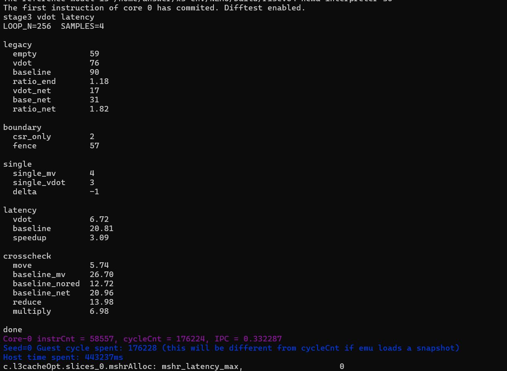

# vdot.vv 专用点积指令性能分析

> CIE 香山赛道第三阶段  基于 RTL 仿真的延迟测量

团队：一拍即合

# **阅读目录**

点击目录条目跳到对应章节。页脚的“目录”可返回此处。

**[第 1 章 结论](#第-1-章-结论) [[2](#第-1-章-结论)](#第-1-章-结论)**

> [1.1 主要结果](#主要结果) [[2](#主要结果)](#主要结果)

**[第 2 章 任务与测量口径](#第-2-章-任务与测量口径) [[2](#第-2-章-任务与测量口径)](#第-2-章-任务与测量口径)**

> [2.1 任务要求](#任务要求) [[2](#任务要求)](#任务要求)
>
> [2.2 被测对象](#被测对象) [[3](#被测对象)](#被测对象)
>
> [2.3 延迟的定义](#延迟的定义) [[4](#延迟的定义)](#延迟的定义)
>
> [2.4 测量环境](#测量环境) [[4](#测量环境)](#测量环境)

**[第 3 章 初始测量方案及其局限](#第-3-章-初始测量方案及其局限) [[5](#第-3-章-初始测量方案及其局限)](#第-3-章-初始测量方案及其局限)**

> [3.1 计时框架的构造](#计时框架的构造) [[5](#计时框架的构造)](#计时框架的构造)
>
> [3.2 测量结果](#测量结果) [[7](#测量结果)](#测量结果)
>
> [3.3 与波形观测的偏差](#与波形观测的偏差) [[7](#与波形观测的偏差)](#与波形观测的偏差)

**[第 4 章 测量方法的迭代](#第-4-章-测量方法的迭代) [[7](#第-4-章-测量方法的迭代)](#第-4-章-测量方法的迭代)**

> [4.1 计时框架开销的分解](#计时框架开销的分解) [[7](#计时框架开销的分解)](#计时框架开销的分解)
>
> [4.2 fence 屏障的语义局限](#fence-屏障的语义局限) [[8](#fence-屏障的语义局限)](#fence-屏障的语义局限)
>
> [4.3 框架扣除无法消除口径差异](#框架扣除无法消除口径差异) [[8](#框架扣除无法消除口径差异)](#框架扣除无法消除口径差异)
>
> [4.4 无屏障单发测量的失效](#无屏障单发测量的失效) [[9](#无屏障单发测量的失效)](#无屏障单发测量的失效)
>
> [4.5 测量结构的重构需求](#测量结构的重构需求) [[10](#测量结构的重构需求)](#测量结构的重构需求)

**[第 5 章 基于天然 RAW 依赖链的延迟测量](#第-5-章-基于天然-raw-依赖链的延迟测量) [[10](#第-5-章-基于天然-raw-依赖链的延迟测量)](#第-5-章-基于天然-raw-依赖链的延迟测量)**

> [5.1 测量原理](#测量原理) [[10](#测量原理)](#测量原理)
>
> [5.2 专用指令的依赖链构造](#专用指令的依赖链构造) [[10](#专用指令的依赖链构造)](#专用指令的依赖链构造)
>
> [5.3 基线组合的依赖链构造](#基线组合的依赖链构造) [[11](#基线组合的依赖链构造)](#基线组合的依赖链构造)
>
> [5.4 延迟实测结果](#延迟实测结果) [[11](#延迟实测结果)](#延迟实测结果)

**[第 6 章 结果验证](#第-6-章-结果验证) [[12](#第-6-章-结果验证)](#第-6-章-结果验证)**

> [6.1 基于搬运闭环的独立复测](#基于搬运闭环的独立复测) [[12](#基于搬运闭环的独立复测)](#基于搬运闭环的独立复测)
>
> [6.2 加法树的流水级增量验证](#加法树的流水级增量验证) [[13](#加法树的流水级增量验证)](#加法树的流水级增量验证)
>
> [6.3 与波形观测的吻合](#与波形观测的吻合) [[13](#与波形观测的吻合)](#与波形观测的吻合)

**[第 7 章 测量口径的一致性](#第-7-章-测量口径的一致性) [[13](#第-7-章-测量口径的一致性)](#第-7-章-测量口径的一致性)**

> [7.1 三套口径的对应关系](#三套口径的对应关系) [[13](#三套口径的对应关系)](#三套口径的对应关系)
>
> [7.2 初始数据的重新定位](#初始数据的重新定位) [[14](#初始数据的重新定位)](#初始数据的重新定位)

**[第 8 章 原始数据与复现](#第-8-章-原始数据与复现) [[14](#第-8-章-原始数据与复现)](#第-8-章-原始数据与复现)**

> [8.1 测量输出](#测量输出) [[14](#测量输出)](#测量输出)
>
> [8.2 测量函数清单](#测量函数清单) [[15](#测量函数清单)](#测量函数清单)
>
> [8.3 复现步骤](#复现步骤) [[15](#复现步骤)](#复现步骤)

**[附录 A 术语与符号](#附录-a-术语与符号) [[15](#附录-a-术语与符号)](#附录-a-术语与符号)**

# **第 1 章 结论**

在香山 RTL 仿真中，用跨迭代的 RAW（先写后读）依赖链测量八元素有符号 int8 点积。基线组合平均每轮 20.81 周期，专用指令 vdot.vv 为 6.72 周期，程序输出的周期比为 3.09 倍。本文用这组结果比较两条依赖链。

保留清零并加入搬运指令的基线闭环，经扣除估计的搬运开销后得到 20.96 周期，与 20.81 周期相差 0.15 周期，约 0.7%。带 fence 的原始区间另有 90 与 76 周期两项读数，扣除 59 周期空框架后为 31 与 17 周期。

## **1.1 主要结果**

表 1 三种计时口径与主要结果

| 指标                        | 基线组合 | vdot.vv | 比值  | 说明                       |
|-----------------------------|----------|---------|-------|----------------------------|
| RAW 依赖链（周期/次）       | 20.81    | 6.72    | 3.09x | 主测结果，周期比取终端输出 |
| 扣空框架的区间增量（周期）  | 31       | 17      | 1.82x | 扣去 59 拍框架             |
| 含 fence 的原始区间（周期） | 90       | 76      | 1.18x | 第一版原始读数             |
| VIMac 流水级增量            | —        | 0       | —     | 归约树沿用既有寄存级       |

依赖链计时用于估计结果返回给下一轮计算所需的周期。计时窗口覆盖整个循环，基线的 vtype 切换也在窗口内。VIMac 单元输入到输出的波形观察另见第 3.3 节。

测量沿用已有的 XiangShan RTL 与 NEMU 构建。第八章保留了仿真器的终端输出和复现命令。

# **第 2 章 任务与测量口径**

## **2.1 任务要求**

第三阶段比较专用点积指令与标准 RVV 指令组合的周期差别。两种功能实现都计算八组有符号 int8 乘积的和，并返回 32 位点积。

## **2.2 被测对象**

nexus-am/apps/stage3-vdot-baseline/baseline.S 的计算段共五条指令，包含两条 vsetivli。先在 e8 配置下用 vwmul.vv 得到八个 16 位乘积，再切到 e16，用 vmv.v.i 清零 v3，为 vwredsum.vs 提供零累加初值。vdot.vv（0x3a1121d7）在 VIMac 内完成乘法和三层归约，写回低 32 位点积及高 96 位的零。

baseline.S 第 19–32 行 向量状态与输入准备

> 19 run_vdot_baseline:  
> 20 \# 将 mstatus.VS 置为 Dirty，启用向量状态。  
> 21 li t0, 0x600  
> 22 csrs mstatus, t0  
> 23 csrw vstart, zero  
> 24  
> 25 \# 加载完整的 16 字节输入。  
> 26 \# 高八个元素也进入源寄存器，用于检查是否错误地多算。  
> 27 vsetivli zero, 16, e8, m1, tu, mu  
> 28 vle8.v v1, (a0)  
> 29 vle8.v v2, (a1)  
> 30  
> 31 \# 只计算低八组输入：有符号 8 位 × 8 位 → 16 位。  
> 32 \# t0 保存计算阶段的实际 VL。

baseline.S 第 33–52 行 加宽乘法、清零、归约及存回

> 33 vsetivli t0, 8, e8, m1, tu, mu  
> 34 vwmul.vv v4, v1, v2  
> 35  
> 36 \# 乘法目的寄存器组为 v4、v5，但八个有效乘积  
> 37 \# 总共只有 128 位，全部位于 v4，因此按 e16、m1 读取。  
> 38 vsetivli zero, 8, e16, m1, tu, mu  
> 39  
> 40 \# 此时八个 16 位元素覆盖整个 v3，完整清零。  
> 41 \# 低 32 位作为累加初值，高 96 位预置为最终输出的零。  
> 42 vmv.v.i v3, 0  
> 43  
> 44 \# 将八个乘积按有符号数加宽归约到 32 位。  
> 45 \# 结果写入 v3\[31:0\]，tu 使高 96 位保持为零。  
> 46 vwredsum.vs v3, v4, v3  
> 47  
> 48 \# 按字节保存整个 v3，共 16 字节。  
> 49 vsetivli zero, 16, e8, m1, tu, mu  
> 50 vse8.v v3, (a2)  
> 51  
> 52 \# 通过 a0 返回计算阶段的 VL；点积结果由缓冲区返回。

表 2 功能基线与专用指令的计算段

| 项目         | 基线组合                    | vdot.vv                          |
|--------------|-----------------------------|----------------------------------|
| 计算段指令数 | 5 条（含 2 次 vtype 切换）  | 1 条                             |
| 执行单元     | Vimac 算乘 + Vipu 算归约    | 仅 Vimac                         |
| 中间结果     | 乘积写入 v4，再由 Vipu 读出 | 同一单元内从已寄存的完整乘积取数 |
| 结果写回     | v3 低 32 位，高位靠 tu 保持 | v3 全 128 位覆盖写               |

## **2.3 延迟的定义**

本报告保留三组周期口径。依赖链按循环轮数取平均，另外两组记录带 fence 的计时窗口及扣除空框架后的区间增量。

表 3 测量边界与读数范围

| 层  | 起点                     | 终点                     | 范围                                                     |
|-----|--------------------------|--------------------------|----------------------------------------------------------|
| ①   | 前一轮结果可供当前轮使用 | 当前轮结果可供下一轮使用 | 跨轮依赖。以循环总周期除以轮数估计，包含循环内配置等影响 |
| ②   | 第一次 rdcycle           | 第二次 rdcycle           | 先测含 fence 区间，再减去空框架读数                      |
| ③   | 第一次 rdcycle           | 第二次 rdcycle           | 原始区间读数，包含区间内的 fence                         |

比较采用相邻两轮之间的 RAW 依赖。循环中的寄存器取数、执行、结果传递及相关控制都会影响每轮周期。原始五条指令的单次计时区间结果在第三章单独记录。

## **2.4 测量环境**

终端记录显示 XiangShan build/emu 加载了 riscv64-nemu-interpreter-so，并启用了 Difftest。表中的周期由测试程序用 rdcycle 读取，按模拟核心周期解释。

bench-v3.S 包含 11 个测量函数。依赖链循环执行 256 轮，各项采样 4 次并取最小值。因此表中的数值表示这组采样中的最短测量结果。

基线与计时代码都显式使用 tu（tail undisturbed）。闭环为建立依赖对源寄存器和清零步骤作了调整，具体区别见第 5.3 节与第 6.1 节。

闭环将前一轮结果重新用作输入，输出只服务于计时。功能正确性另由第二阶段的 C 参考值校验和第三阶段的 RTL/NEMU 差分验证检查。

# **第 3 章 初始测量方案及其局限**

## **3.1 计时框架的构造**

原始测量使用 TF_BEGIN 和 TF_END，将空框架、专用指令段和基线段放在同一套计时宏内。专用段也包含一次 vsetivli，两组都在区间内设置计算所需的 vtype。

表 4 第一版计时对照的三组函数

| 函数                 | 计时区中间内容                                        | 用途           |
|----------------------|-------------------------------------------------------|----------------|
| bench_empty_fence    | 空                                                    | 测框架自身开销 |
| bench_fence_vdot     | vsetivli + .word 0x3a1121d7                           | 专用指令区间   |
| bench_fence_baseline | vsetivli(e8) + vwmul + vsetivli(e16) + vmv + vwredsum | 基线区间       |

第一次 rdcycle 前、第二次 rdcycle 后各有一道 fence，两次读取之间另有两道。汇编器通过 .word 0x3a1121d7 发出自定义指令。

bench-v3.S 第 21–40 行 共用准备和无屏障计时宏

> 21 \# 每个函数共用的准备：打开向量、装数据、v3 填 -1。  
> 22 \# v3 填非零是为了万一实现漏写结果，能立刻看出来。  
> 23 .macro PREAMBLE  
> 24 li t0, 0x600  
> 25 csrs mstatus, t0  
> 26 csrw vstart, zero  
> 27 vsetivli zero, 16, e8, m1, tu, mu  
> 28 vle8.v v1, (a0)  
> 29 vle8.v v2, (a1)  
> 30 vmv.v.i v3, -1  
> 31 .endm  
> 32  
> 33 .macro T_BEGIN  
> 34 rdcycle t2  
> 35 .endm  
> 36  
> 37 .macro T_END  
> 38 rdcycle t3  
> 39 sub a0, t3, t2  
> 40 .endm

bench-v3.S 第 41–54 行 含 fence 的计时宏

> 41  
> 42 \# 旧版的边界，前后各夹一道 fence，只在 E2 里用。  
> 43 .macro TF_BEGIN  
> 44 fence iorw, iorw  
> 45 rdcycle t2  
> 46 fence iorw, iorw  
> 47 .endm  
> 48  
> 49 .macro TF_END  
> 50 fence iorw, iorw  
> 51 rdcycle t3  
> 52 fence iorw, iorw  
> 53 sub a0, t3, t2  
> 54 .endm

bench-v3.S 第 81–94 行 带 fence 的专用指令计时

> 81 \# 第一版的两个测量：同样的 fence 包夹，中间分别放 vdot 和 baseline。  
> 82 \# 计时区内容与原始 bench.S 一致，用来复现 76 和 90。  
> 83 .balign 64  
> 84 .globl bench_fence_vdot  
> 85 .type bench_fence_vdot, @function  
> 86 bench_fence_vdot:  
> 87 PREAMBLE  
> 88 TF_BEGIN  
> 89 vsetivli t0, 8, e8, m1, tu, mu  
> 90 .word 0x3a1121d7 \# vdot.vv v3, v1, v2  
> 91 TF_END  
> 92 ret  
> 93 .size bench_fence_vdot, .-bench_fence_vdot  
> 94

bench-v3.S 第 95–108 行 带 fence 的基线计时

> 95 .balign 64  
> 96 .globl bench_fence_baseline  
> 97 .type bench_fence_baseline, @function  
> 98 bench_fence_baseline:  
> 99 PREAMBLE  
> 100 TF_BEGIN  
> 101 vsetivli t0, 8, e8, m1, tu, mu  
> 102 vwmul.vv v4, v1, v2  
> 103 vsetivli zero, 8, e16, m1, tu, mu  
> 104 vmv.v.i v3, 0  
> 105 vwredsum.vs v3, v4, v3  
> 106 TF_END  
> 107 ret  
> 108 .size bench_fence_baseline, .-bench_fence_baseline

## **3.2 测量结果**

表 5 第一版计时读数和区间增量

| 函数             | 周期 | 说明                      |
|------------------|------|---------------------------|
| empty            | 59   | 空框架                    |
| vdot             | 76   | 框架 + vsetivli + vdot.vv |
| baseline         | 90   | 框架 + 基线五条           |
| vdot − empty     | 17   | 扣框架后的增量            |
| baseline − empty | 31   | 扣框架后的增量            |

带框架的原始周期比约为 90 ÷ 76 = 1.18。两侧各减去空框架的 59 周期，得到 31 与 17 周期，区间增量之比约为 1.82。

## **3.3 与波形观测的偏差**

此前的波形观察中，vdot.vv 从 VIMac 输入有效到输出有效间隔两个仿真周期。乘法沿用原有的流水寄存，点积加法树接在 fullProducts 之后。两拍对应单元输入、输出两个观测点。

扣框架后的 17 周期覆盖测试计时区间的增量。它与单元波形中的两拍使用不同的观测端点，因此需要分别解释。

# **第 4 章 测量方法的迭代**

## **4.1 计时框架开销的分解**

bench_empty_csr 连续读取两次 rdcycle。bench_empty_fence 使用同一准备代码，换用含四道 fence 的计时宏。表 6 比较两种空框架的读数。

bench-v3.S 第 59–69 行 连续读取计数器的空框架

> 59 \# 两次 rdcycle 紧挨着，中间什么也不做。计时的地板。  
> 60 .balign 64  
> 61 .globl bench_empty_csr  
> 62 .type bench_empty_csr, @function  
> 63 bench_empty_csr:  
> 64 PREAMBLE  
> 65 T_BEGIN  
> 66 T_END  
> 67 ret  
> 68 .size bench_empty_csr, .-bench_empty_csr  
> 69

bench-v3.S 第 70–79 行 带 fence 的空框架

> 70 \# 同上，但换成 fence 包夹。用来复现旧版 empty=59，看那 59 拍里都是什么。  
> 71 .balign 64  
> 72 .globl bench_empty_fence  
> 73 .type bench_empty_fence, @function  
> 74 bench_empty_fence:  
> 75 PREAMBLE  
> 76 TF_BEGIN  
> 77 TF_END  
> 78 ret  
> 79 .size bench_empty_fence, .-bench_empty_fence

表 6 两种空框架的周期对照

| 函数              | 周期 | 说明                       |
|-------------------|------|----------------------------|
| bench_empty_csr   | 2    | 两次 rdcycle 的地板        |
| bench_empty_fence | 59   | 复现第一版 empty           |
| 差值              | 57   | 两种空框架的差额，占 96.6% |

空框架的带 fence 读数为 59 周期，与最初测量一致。连续读取计数器的对照为 2 周期，两种框架相差 57 周期，占 59 周期的 96.6%。

两种框架共用含两条 vle8.v 的准备代码。57 周期是这组前导操作和计时边界下的实测差额，前导操作变化后，等待时间也可能变化。

## **4.2 fence 屏障的语义局限**

RISC-V 规范用 FENCE 对访存和设备 I/O 排序。CSR 读取在 FENCE 排序中归入设备输入。纯向量算术结果可用的时点仍需靠数据依赖或实现提供的完成边界确认。规范出处列于附录 A。

当前仿真器中，fence 周围的等待会反映在 rdcycle 区间读数里。空框架对照只给出整体差额，具体等待发生在哪些流水阶段需要额外证据。

## **4.3 框架扣除无法消除口径差异**

三个函数使用相同的带 fence 计时宏。以 59 周期为空框架对照，从 76 和 90 周期分别得到 17 和 31 周期的区间增量。

下表把区间增量与依赖链结果并列，便于比较两种测量边界。

表 7 区间增量与 RAW 依赖链读数的差额

| 量                          | vdot | baseline | 说明         |
|-----------------------------|------|----------|--------------|
| 减完的结果（76−59 / 90−59） | 17   | 31       |              |
| 天然 RAW 实测延迟           | 6.72 | 20.81    |              |
| 两者之差                    | 10.3 | 10.2     | 差额量级接近 |

基线与专用路径的差额分别约为 10.2 和 10.3 周期。这里比较了不同的计时结构和指令序列，差额无法单独归给派遣、发射或提交中的某一级。

从数值上看，两侧都增加近似的周期数后，比值会向 1 靠近。这解释了本组区间增量的比值为何低于依赖链比值。

## **4.4 无屏障单发测量的失效**

去掉 fence 后，用 bench_single_mv 作为对照。两组都设置 vtype 并执行 vmv.x.s，bench_single_vdot 还在搬运前插入一条 vdot.vv。

bench-v3.S 第 113–125 行 无屏障搬运对照

> 113 \# 一条标量搬运。S2 的对照，用来算出"多一条 vdot"应该多几拍。  
> 114 .balign 64  
> 115 .globl bench_single_mv  
> 116 .type bench_single_mv, @function  
> 117 bench_single_mv:  
> 118 PREAMBLE  
> 119 T_BEGIN  
> 120 vsetivli t0, 8, e8, m1, tu, mu  
> 121 vmv.x.s t4, v3  
> 122 T_END  
> 123 ret  
> 124 .size bench_single_mv, .-bench_single_mv  
> 125

bench-v3.S 第 126–138 行 加入 vdot.vv 的无屏障对照

> 126 \# 比 S1 多一条 vdot。如果单发能测准，这个数应该更大。  
> 127 .balign 64  
> 128 .globl bench_single_vdot  
> 129 .type bench_single_vdot, @function  
> 130 bench_single_vdot:  
> 131 PREAMBLE  
> 132 T_BEGIN  
> 133 vsetivli t0, 8, e8, m1, tu, mu  
> 134 .word 0x3a1121d7 \# vdot.vv v3, v1, v2  
> 135 vmv.x.s t4, v3  
> 136 T_END  
> 137 ret  
> 138 .size bench_single_vdot, .-bench_single_vdot

表 8 无屏障单发测量结果

| 函数              | 周期 | 说明                                 |
|-------------------|------|--------------------------------------|
| bench_single_mv   | 4    | 对照组                               |
| bench_single_vdot | 3    | 多了一条 vdot                        |
| 差值              | −1   | 计时区间缩短，不能由此推导 vdot 延迟 |

结束处的 rdcycle 与 vmv.x.s 的结果没有数据依赖。此次 4 与 3 周期的读数只能说明计时窗口给出了更短的区间，无法据此定位向量指令在哪一拍完成。

这里的 −1 周期表明这种计时边界不足以估计新增 vdot.vv 的完成延迟。类似实验需要先检查计时终点是否受被测结果约束。

## **4.5 测量结构的重构需求**

后续测量将前一轮的向量结果送入下一轮，利用数据依赖约束相关运算的间隔，再用多轮计时摊薄循环边界的影响。

# **第 5 章 基于天然 RAW 依赖链的延迟测量**

## **5.1 测量原理**

上一轮写出的向量寄存器作为下一轮的源寄存器，两轮相关运算之间形成 RAW 依赖。测量记录整个循环的模拟周期，再按轮数计算平均间隔。

循环计时使用两次 rdcycle，相隔 256 轮，且不插入 fence。将总周期除以 256 可摊薄一次性开销，所得仍是这套循环的平均周期。

## **5.2 专用指令的依赖链构造**

将 vs2 从 v1 改为 v3，机器码由 0x3a1121d7 改为 0x3a3121d7。vdot.vv v3, v3, v2 每轮读取上一轮写出的 v3，因此可以直接形成依赖，无需插入搬运指令。

bench-v3.S 第 143–160 行 专用指令的 RAW 依赖循环

> 143 \# vdot.vv v3, v3, v2。vs2 从 v1 改成 v3，读写同一个寄存器，  
> 144 \# 这一轮读的就是上一轮写的结果，环自然闭合。  
> 145 \# 输出是垃圾值（每轮把结果喂回去），不要拿来做功能校验。  
> 146 .balign 64  
> 147 .globl bench_lat_vdot  
> 148 .type bench_lat_vdot, @function  
> 149 bench_lat_vdot:  
> 150 PREAMBLE  
> 151 vsetivli t0, 8, e8, m1, tu, mu  
> 152 li t5, LOOP_N  
> 153 T_BEGIN  
> 154 1:  
> 155 .word 0x3a3121d7 \# vdot.vv v3, v3, v2  
> 156 addi t5, t5, -1  
> 157 bnez t5, 1b  
> 158 T_END  
> 159 ret  
> 160 .size bench_lat_vdot, .-bench_lat_vdot

addi 与 bnez 不读取向量结果，有机会与向量计算重叠。本组数据未另外扣除循环控制成本。

## **5.3 基线组合的依赖链构造**

基线让 vwmul.vv 读取 v3，经 v4 把乘积交给 vwredsum.vs。归约写回 v3，供下一轮乘法和归约读取。

bench-v3.S 第 162–182 行 基线的 RAW 依赖循环

> 162 \# baseline 也走天然 RAW：vwmul 读 v3，vwredsum 写 v3，环自动闭合。  
> 163 \# 和原始 baseline.S 的区别只有两处，都是为了让环闭合：  
> 164 \# vwmul 的 vs2 从 v1 改成 v3；去掉 vmv.v.i 清零，让 v3 跨迭代累加。  
> 165 \# 清零点掉不影响关键路径，它本来就和 vwmul 并行。  
> 166 .balign 64  
> 167 .globl bench_lat_baseline  
> 168 .type bench_lat_baseline, @function  
> 169 bench_lat_baseline:  
> 170 PREAMBLE  
> 171 li t5, LOOP_N  
> 172 T_BEGIN  
> 173 1:  
> 174 vsetivli t0, 8, e8, m1, tu, mu  
> 175 vwmul.vv v4, v3, v2  
> 176 vsetivli zero, 8, e16, m1, tu, mu  
> 177 vwredsum.vs v3, v4, v3  
> 178 addi t5, t5, -1  
> 179 bnez t5, 1b  
> 180 T_END  
> 181 ret  
> 182 .size bench_lat_baseline, .-bench_lat_baseline

与原始 baseline.S 相比，这个计算循环将乘法的 vs2 改成 v3，并省去 vmv.v.i 清零，使 v3 可跨轮累加。循环每轮执行两条 vsetivli、加宽乘法和加宽归约，共四条计算段指令。清零有机会与乘法重叠，其影响用第 6.1 节的保留清零方案对照。

两侧都用向量寄存器建立跨轮 RAW，计算结果均按 256 轮平均。基线保留两次 vtype 切换，专用指令把 vtype 设置放在循环之前。

## **5.4 延迟实测结果**

表 9 RAW 依赖链的每轮周期

| 被测对象   | 周期/次 | 说明                                      |
|------------|---------|-------------------------------------------|
| 基线组合   | 20.81   | 天然 RAW，四条计算段指令含两次 vtype 切换 |
| vdot.vv    | 6.72    | 天然 RAW，循环外设置 vtype                |
| 延迟加速比 | 3.09x   | 终端输出的 speedup                        |

# **第 6 章 结果验证**

## **6.1 基于搬运闭环的独立复测**

复测在归约后插入 vmv.v.v，把结果从 v3 搬回 v1，保留基线的清零步骤。另跑只含两条 vmv.v.v 的搬运环，以每轮周期的一半作为一次搬运的估计开销。

bench-v3.S 第 187–204 行 两次搬运构成的依赖环

> 187 \# 纯搬运环，一进一出。量出 vmv.v.v 自己值多少拍，  
> 188 \# 后面 D2 里含一条，要扣掉。  
> 189 .balign 64  
> 190 .globl bench_lat_move  
> 191 .type bench_lat_move, @function  
> 192 bench_lat_move:  
> 193 PREAMBLE  
> 194 vsetivli zero, 8, e8, m1, tu, mu  
> 195 li t5, LOOP_N  
> 196 T_BEGIN  
> 197 1:  
> 198 vmv.v.v v1, v3  
> 199 vmv.v.v v3, v1  
> 200 addi t5, t5, -1  
> 201 bnez t5, 1b  
> 202 T_END  
> 203 ret  
> 204 .size bench_lat_move, .-bench_lat_move

bench-v3.S 第 206–227 行 保留清零的基线搬运环

> 206 \# baseline 的另一种闭环：加一条 vmv.v.v 把结果搬回 v1。  
> 207 \# 和 L2 测的是同一件事，方法不同，用来互相印证。  
> 208 \# 这个版本保留了 vmv.v.i 清零，所以链条里多一个环节。  
> 209 .balign 64  
> 210 .globl bench_lat_baseline_mv  
> 211 .type bench_lat_baseline_mv, @function  
> 212 bench_lat_baseline_mv:  
> 213 PREAMBLE  
> 214 li t5, LOOP_N  
> 215 T_BEGIN  
> 216 1:  
> 217 vsetivli t0, 8, e8, m1, tu, mu  
> 218 vwmul.vv v4, v1, v2  
> 219 vsetivli zero, 8, e16, m1, tu, mu  
> 220 vmv.v.i v3, 0  
> 221 vwredsum.vs v3, v4, v3  
> 222 vmv.v.v v1, v3  
> 223 addi t5, t5, -1  
> 224 bnez t5, 1b  
> 225 T_END  
> 226 ret  
> 227 .size bench_lat_baseline_mv, .-bench_lat_baseline_mv

表 10 搬运闭环交叉估计

| 量                       | 周期/次      | 来源                  |
|--------------------------|--------------|-----------------------|
| 纯搬运环（两条 vmv.v.v） | 11.48        | bench_lat_move        |
| 单次搬运估计             | 5.74         | 11.48 / 2             |
| 基线搬运闭环             | 26.70        | bench_lat_baseline_mv |
| 扣除搬运后的基线估计     | 20.96        | 26.70 − 5.74          |
| 天然 RAW 直接测得        | 20.81        | bench_lat_baseline    |
| 两者之差                 | 0.15（0.7%） | —                     |

搬运闭环扣除 5.74 周期后为 20.96 周期，与直接依赖链的 20.81 周期相差 0.15 周期，约 0.7%。纯搬运环使用 e8，基线中的搬运使用 e16，因此 5.74 周期在这里用于交叉估计。

## **6.2 加法树的流水级增量验证**

另组对照用 RAW 链分别测 vdot.vv v3, v3, v2 和 vmul.vv v4, v4, v2。该对照记录两组均为 6.73 周期/次。该对照与主测的 6.72 周期/次分别记录。

终端输出另列基线乘法段的估算值 6.98 周期/次，与主测 6.72 周期/次相差约 4%。结合波形的两拍观察，报告将归约树放在既有流水级内，8→4→2→1 的求和没有额外的寄存级。

## **6.3 与波形观测的吻合**

VIMac 输入到输出的波形间隔为两拍。若把单次搬运 5.74 周期近似拆成 1 周期搬运和约 4.7 周期其余环节，则从 6.72 周期反推的计算部分约为两拍。这只是量级对照，读寄存器、发射、写回和唤醒各自占多少拍，仍需对应的握手信号判定。

表 11 波形、搬运估算与 RAW 计时的范围

| 来源               | 数值    | 量的范围                    |
|--------------------|---------|-----------------------------|
| 波形（VIMac 内部） | 2 拍    | 从 VIMac 输入有效到输出有效 |
| 搬运环反推         | 约 2 拍 | 根据纯搬运环作间接估计      |
| 天然 RAW 实测      | 6.72 拍 | 依赖循环的每轮平均周期      |

波形用来追踪 VIMac 内的输入、输出和结果。59、76、90 等区间周期来自程序里的 rdcycle，6.72 则是循环计时的每轮平均。

# **第 7 章 测量口径的一致性**

## **7.1 三套口径的对应关系**

下表把三种计时结果按比较范围并列。各行内部使用同一组计时结构。

表 12 三种周期口径及其比值

| 层  | 口径                        | 基线  | vdot | 比值  | 口径说明                 |
|-----|-----------------------------|-------|------|-------|--------------------------|
| ①   | RAW 依赖链（周期/次）       | 20.81 | 6.72 | 3.09x | —                        |
| ②   | 扣空框架的区间增量（周期）  | 31    | 17   | 1.82x | 比依赖链读数高约 10 周期 |
| ③   | 含 fence 的原始区间（周期） | 90    | 76   | 1.18x | 比区间增量高 59 周期     |

两组带 fence 的原始区间各减去 59 周期，分别得到 31 和 17 周期。与直接 RAW 链相比，两侧区间增量都高约 10 周期。这是对两种测法的数值比较。

## **7.2 初始数据的重新定位**

1.18 倍对应含 fence 的原始模拟周期比，1.82 倍对应扣空框架后的增量比。本文比较依赖链延迟时，采用终端报告的 3.09 倍。用展示到两位小数的 20.81 与 6.72 复算，得到约 3.097。

# **第 8 章 原始数据与复现**

## **8.1 测量输出**

图 1 第三阶段点积周期测量的原始终端输出

## **8.2 测量函数清单**

表 13 测量函数与终端读数

| 函数                     | 计时区内容                     | 周期或周期/次 |
|--------------------------|--------------------------------|---------------|
| bench_empty_csr          | 两次 rdcycle 紧邻              | 2             |
| bench_empty_fence        | fence 包夹，中间空             | 59            |
| bench_fence_vdot         | fence 包夹，中间放 vdot        | 76            |
| bench_fence_baseline     | fence 包夹，中间放基线五条     | 90            |
| bench_single_mv          | 无屏障单发，vsetivli + vmv.x.s | 4             |
| bench_single_vdot        | 无屏障单发，多一条 vdot.vv     | 3             |
| bench_lat_vdot           | 天然 RAW，vdot.vv v3,v3,v2     | 6.72 /次      |
| bench_lat_baseline       | 天然 RAW，四条计算段指令       | 20.81 /次     |
| bench_lat_move           | 纯搬运环，两条 vmv.v.v         | 11.48 /次     |
| bench_lat_baseline_mv    | 基线闭环 + 一条搬运            | 26.70 /次     |
| bench_lat_baseline_nored | 跳过切 e16 + 清零 + 归约       | 12.72 /次     |

## **8.3 复现步骤**

终端命令 编译并运行计时测试

> cd \$AM_HOME/apps/stage3-vdot-perf-v2  
> rm -rf build  
> make ARCH=riscv64-xs CROSS_COMPILE=riscv64-linux-gnu-  
>   
> cd \$NOOP_HOME  
> BIN=\$AM_HOME/apps/stage3-vdot-perf-v2/build/\*.bin  
> ./build/emu -i \$BIN 2\>&1 \| grep -av "^\\PERF"

# **附录 A 术语与符号**

表 14 术语与符号

| 术语             | 含义                                                                     |
|------------------|--------------------------------------------------------------------------|
| latency（延迟）  | 从操作数可用到结果可供后续计算使用的间隔。本文用跨轮依赖链的每轮周期估计 |
| RAW              | Read After Write，先写后读的数据依赖                                     |
| 天然 RAW 链      | 指令读写同一寄存器，跨迭代自动形成 RAW 依赖，无需额外搬运指令            |
| 端到端           | 两次 rdcycle 之间的模拟周期，是否扣除空框架按表注区分                    |
| fence iorw, iorw | 对访存和设备 I/O 排序的指令，纯算术完成需另有观测边界                    |
| rdcycle          | 读取模拟核心的周期计数，读数本身不依赖向量结果                           |
| tu / ta          | tail undisturbed / tail agnostic，尾部元素保持原值 / 内容由实现决定      |
| Vimac / Vipu     | 香山向量乘加单元 / 向量置换与归约单元，基线需跨两者传值                  |
| fullProducts     | VIMac64b 引出的八份完整 16 位乘积，点积加法树的输入                      |
| difftest         | RTL 与 NEMU 参考模型逐指令比对架构状态的协同仿真机制                     |

\[1\] RISC-V 非特权指令集 RV32I 访存排序指令

\[2\] RISC-V 非特权指令集 Zicsr 的 CSR 访问排序
