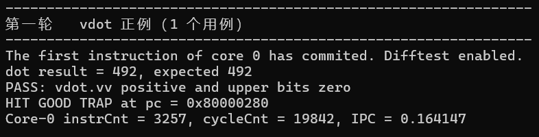
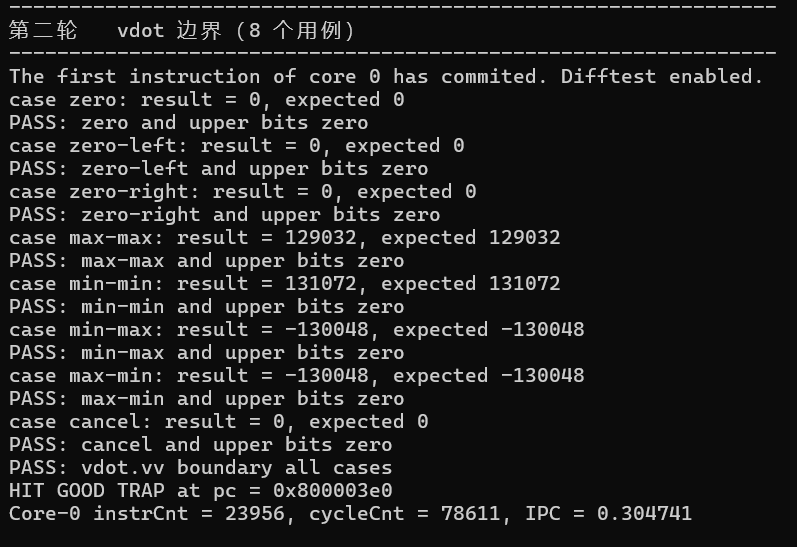

# 香山第三阶段 vdot 协同仿真验证报告

> 任务 3.1.1 NEMU 指令扩展与任务 3.1.2 差分验证

> 团队：一拍即合

# **阅读目录**

点击目录条目跳到对应章节。页脚的“目录”可返回此处。

**[1 RTL 与 NEMU 如何对齐](#rtl-与-nemu-如何对齐) [[1](#rtl-与-nemu-如何对齐)](#rtl-与-nemu-如何对齐)**

> [两项检查分别看什么](#两项检查分别看什么) [[1](#两项检查分别看什么)](#两项检查分别看什么)

**[2 NEMU 指令登记与译码](#nemu-指令登记与译码) [[2](#nemu-指令登记与译码)](#nemu-指令登记与译码)**

**[3 执行入口与八项乘加](#执行入口与八项乘加) [[3](#执行入口与八项乘加)](#执行入口与八项乘加)**

> [读取元素并累加](#读取元素并累加) [[3](#读取元素并累加)](#读取元素并累加)

**[4 写回结果与更新向量状态](#写回结果与更新向量状态) [[4](#写回结果与更新向量状态)](#写回结果与更新向量状态)**

**[5 测试程序与差分结果](#测试程序与差分结果) [[4](#测试程序与差分结果)](#测试程序与差分结果)**

> [5.1 输入数组与汇编接口](#输入数组与汇编接口) [[4](#输入数组与汇编接口)](#输入数组与汇编接口)
>
> [5.2 计算期望值并检查向量长度](#计算期望值并检查向量长度) [[5](#计算期望值并检查向量长度)](#计算期望值并检查向量长度)
>
> [5.3 检查低 32 位和高 96 位](#检查低-32-位和高-96-位) [[6](#检查低-32-位和高-96-位)](#检查低-32-位和高-96-位)
>
> [5.4 边界测试](#边界测试) [[7](#边界测试)](#边界测试)

**[6 复现协同仿真](#复现协同仿真) [[8](#复现协同仿真)](#复现协同仿真)**

## 报告概要

本阶段在 NEMU 中实现自定义 vdot.vv 指令，并用 Difftest 对照香山 RTL 的执行结果。正例算得 492，八个边界用例也全部通过自检。两轮运行均启用差分检查，并以 GOOD TRAP 结束。

# **1 RTL 与 NEMU 如何对齐**

启动 emu 时，-i 指定测试镜像，--diff 指定 NEMU 参考库。香山 RTL 执行镜像。收到指令提交事件后，Difftest 推进参考模型，再比较双方的架构状态。

表 1 协同仿真的组成与分工

| 参与项   | 实际对象                    | 本次实验中的作用                       |
|----------|-----------------------------|----------------------------------------|
| DUT      | 香山 RTL 仿真器 build/emu   | 执行测试镜像，提供提交事件和架构状态。 |
| REF      | riscv64-nemu-interpreter-so | 执行对应指令，给出参考架构状态。       |
| Difftest | 仿真器中的差分检查          | 推进参考模型，报告双方状态的差异。     |
| 程序自检 | 测试程序的 main.c           | 用标量 C 计算期望值，再检查完整输出。  |

## **两项检查分别看什么**

Difftest 检查 RTL 和参考模型的状态是否一致。测试程序用标量 C 独立计算期望值，再核对写回的 16 字节，检查低 32 位的点积和高 96 位的零值。

NEMU 和正例的源码行号取自录屏包中的源码快照。边界测试代码取自项目源码包。第 5 节的两张终端截图已与录屏包内的差分日志核对。

# **2 NEMU 指令登记与译码**

测试汇编用 .word 0x3a1121d7 执行 vdot.vv v3, v1, v2。汇编操作数按 vd、vs2、vs1 排列，v3 是目的寄存器，v1、v2 分别是 vs2 和 vs1。

表 2 vdot.vv 指令的编码字段

| funct6 | vm  | vs2   | vs1   | funct3 | vd    | opcode  |
|--------|-----|-------|-------|--------|-------|---------|
| 001110 | 1   | 00001 | 00010 | 010    | 00011 | 1010111 |

源码 1 NEMU/src/isa/riscv64/include/isa-all-instr.h 第 102–105 行

> 102 \#ifdef CONFIG_RVV  
> 103 \#define VECTOR_INSTR_TERNARY(f) \\  
> 104 f(cie_vdot)\\  
> 105 f(vadd) f(vsub) f(vrsub) f(vminu) f(vmin) \\

第 104 行在 CONFIG_RVV 下登记 cie_vdot。译码选中这个执行项后，NEMU 调用同名的 def_EHelper。

源码 2 NEMU/src/isa/riscv64/instr/rvv/decode.h 第 553–556、331–335 行

> 553 def_THelper(OP_V) { // 10_101  
> 554 def_INSTR_TAB("??????? ????? ????? 000 ????? ????? ??", vopivv);  
> 555 def_INSTR_TAB("??????? ????? ????? 001 ????? ????? ??", vopfvv);  
> 556 def_INSTR_TAB("??????? ????? ????? 010 ????? ????? ??", vopmvv);  
> // 中间行省略  
> 331 def_THelper(vopmvv) {  
> 332 if (!vp_enable()) {  
> 333 return EXEC_ID_inv;  
> 334 }  
> 335 def_INSTR_TAB("001110 ? ????? ????? ??? ????? ????? ??", cie_vdot);

OP_V 按 funct3=010 把指令送入 vopmvv 子表。子表检查向量是否启用，再在第 335 行匹配 funct6=001110，选中 cie_vdot。问号表示本条规则忽略对应位。主操作码和 funct3 已在上层匹配，操作数译码读取寄存器号，执行函数检查 vm。

源码 3 同一 decode.h 第 25–32、39–40 行

> 25 static inline def_DHelper(OP_V) { // 10_101, same to R  
> 26 decode_op_r(s, id_src1, s-\>isa.instr.v_opv.v_vs1, true);  
> 27 decode_op_r(s, id_src2, s-\>isa.instr.v_opv.v_vs2, true);  
> 28 decode_op_r(s, id_dest, s-\>isa.instr.v_opv.v_vd, false);  
> 29 switch (s-\>isa.instr.v_opv.v_funct3) {  
> 30 case 0 : s-\>src_vmode = SRC_VV; break;  
> 31 case 1 : s-\>src_vmode = SRC_VV; break;  
> 32 case 2 : s-\>src_vmode = SRC_VV; break;  
> // 中间行省略  
> 39 s-\>v_width = 1 \<\< vtype-\>vsew;  
> 40 s-\>vm = s-\>isa.instr.v_opv.v_vm; //1 for without mask; 0 for with mask

操作数译码从指令字取出 vs1、vs2 和 vd。funct3=010 对应 SRC_VV，两个源操作数都来自向量寄存器。第 40 行读出 vm，执行函数据此判断指令是否使用掩码。

# **3 执行入口与八项乘加**

源码 4 NEMU/src/isa/riscv64/instr/rvv/vcompute.h 第 21–33 行，省略注释及空行

> 21 def_EHelper(cie_vdot){  
> 22 require_vector(true);;  
> 26 if (vtype-\>vsew != 0 \|\|  
> 27 vtype-\>vlmul != 0 \|\|  
> 28 vl-\>val != 8 \|\|  
> 29 vstart-\>val != 0 \|\|  
> 30 s-\>vm != 1 \|\|  
> 31 s-\>src_vmode != SRC_VV) {  
> 32 longjmp_exception(EX_II);  
> 33 }

require_vector(true) 检查向量状态是否启用，并要求 vtype 的 vill 位为 0。执行函数随后检查表中的指令配置。只要有一项不符，就在读取源元素、写入目标寄存器之前触发 EX_II。

表 3 NEMU 执行前的配置检查

| 检查字段      | 通过条件         | 含义                          |
|---------------|------------------|-------------------------------|
| vsew、vlmul   | 均为 0           | 元素为 8 位，LMUL 为 1。      |
| vl、vstart    | 分别为 8、0      | 从第 0 项开始，一共计算八项。 |
| vm、src_vmode | 分别为 1、SRC_VV | 不使用掩码，使用两个向量源。  |

## **读取元素并累加**

源码 5 同一 vcompute.h 第 35–53 行的计算语句

> 35 int32_t vdot_sum = 0;  
> 38 rtlreg_t src1 = 0;  
> 39 rtlreg_t src2 = 0;  
> 42 for (int i = 0; i \< 8; i++) {  
> 44 get_vreg(id_src-\>reg, i, &src1,  
> 45 vtype-\>vsew, vtype-\>vlmul, SIGNED, 1);  
> 47 get_vreg(id_src2-\>reg, i, &src2,  
> 48 vtype-\>vsew, vtype-\>vlmul, SIGNED, 1);  
> 52 vdot_sum += (int8_t)src1 \* (int8_t)src2;  
> 53 }

每次执行都将 vdot_sum 清零。i 从 0 到 7，每次调用两次 get_vreg，读取两个源寄存器中下标为 i 的元素。&src1 和 &src2 是接收读取结果的地址。vsew 指定元素宽度，vlmul 指定寄存器组，SIGNED 指定有符号读取。

第 52 行把两个元素转换为 int8_t。C 在相乘前做整数提升，再把乘积加到 int32_t 累加器中。八项点积的范围是 −130048 至 131072，32 位足以保存。

# **4 写回结果与更新向量状态**

源码 6 NEMU/src/isa/riscv64/instr/rvv/vcompute.h 第 58–70 行的写回语句

> 58 set_vreg(id_dest-\>reg, 0, vdot_sum,  
> 59 2, vtype-\>vlmul, 1);  
> 62 for (int part = 1; part \< 4; part++) {  
> 63 set_vreg(id_dest-\>reg, part, 0,  
> 64 2, vtype-\>vlmul, 1);  
> 65 }  
> 68 vstart-\>val = 0;  
> 69 vp_set_dirty();  
> 70 }

set_vreg 的前三个参数分别是目的寄存器号、元素索引和写入值。第 4 个参数的编码值 2 表示 32 位。在 VLEN=128、LMUL=1 时，目的寄存器分成四个 32 位块。第 58 行把点积写入第 0 块，后面的循环清零第 1 至第 3 块。

表 4 正例的目的寄存器写回内容

| 索引 | 目标位段     | 正数用例写入值 |
|------|--------------|----------------|
| 0    | vd\[31:0\]   | 0x000001ec     |
| 1    | vd\[63:32\]  | 0x00000000     |
| 2    | vd\[95:64\]  | 0x00000000     |
| 3    | vd\[127:96\] | 0x00000000     |

正例的两组输入低八项分别为 1 至 8 和 9 至 16。第一项是 1×9=9，加上第二项 2×10 后得到 29，累加完八项得到 492。低 32 位写入 0x000001ec。边界用例得到 −130048 时，低 32 位写入补码 0xfffe0400，高 96 位同样清零。

循环读完所有源元素才写入 vd。即使 vd 和某个源寄存器编号相同，本次计算所需的数据也已取完。这个顺序可从代码确认，现有日志的用例未单独覆盖寄存器重叠。

指令成功执行时，代码把 vstart 清零，并调用 vp_set_dirty() 标记向量状态已修改。

# **5 测试程序与差分结果**

## **5.1 输入数组与汇编接口**

正例入口是 nexus-am/apps/stage2-vdot-positive/main.c。C 代码准备输入、计算期望值并检查输出。同目录的 vdot.S 实现 run_vdot，接收两个输入地址和一个输出地址。源码摘录保留原行号，省略空行。

源码 7 stage2-vdot-positive/main.c 第 5–19 行

> 5 extern unsigned long run_vdot(const int8_t \*a, const int8_t \*b,  
> 6 uint8_t \*out);  
> 8 // 只计算低八个元素，高八个非零元素用于检查是否错误地多算。  
> 9 static const int8_t a\[16\] \_\_attribute\_\_((aligned(16))) = {  
> 10 1, 2, 3, 4, 5, 6, 7, 8,  
> 11 127, 127, 127, 127, 127, 127, 127, 127  
> 12 };  
> 14 static const int8_t b\[16\] \_\_attribute\_\_((aligned(16))) = {  
> 15 9, 10, 11, 12, 13, 14, 15, 16,  
> 16 127, 127, 127, 127, 127, 127, 127, 127  
> 17 };  
> 19 static uint8_t out\[16\] \_\_attribute\_\_((aligned(16)));

a 和 b 各存 16 个有符号字节，out 保存 16 字节输出，三个数组均按 16 字节对齐。a 的低八项为 1 至 8，b 的低八项为 9 至 16，两组的高八项均为 127。高八项一旦误参与计算，低 32 位的结果就会偏离期望值。

## **5.2 计算期望值并检查向量长度**

源码 8 stage2-vdot-positive/main.c 第 21–38 行

> 21 int main(const char \*args) {  
> 22 (void)args;  
> 23 printf("stage2 positive vdot test start\n");  
> 25 // 用普通 C 运算计算期望结果。  
> 26 int32_t expected = 0;  
> 27 for (int i = 0; i \< 8; i++) {  
> 28 expected += (int32_t)a\[i\] \* (int32_t)b\[i\];  
> 29 }  
> 31 // 预填非零值，防止未写入的位置原本就是零。  
> 32 for (int i = 0; i \< 16; i++) out\[i\] = 0xa5;  
> 34 unsigned long vl = run_vdot(a, b, out);  
> 35 if (vl != 8) {  
> 36 printf("FAIL: actual vl = %d, expected 8\n", (int)vl);  
> 37 return 1;  
> 38 }

C 循环只对前八对元素求积累加，算出 expected=492。out 预填 0xa5，漏写的字节会留下原值。汇编把旧 v3 设为全 1，用于检查指令是否清零高位。前者检查内存存回，后者检查寄存器写回。

vdot.S 第 20–28 行以 vl=16 加载，随后将 vl 设为 8。第 34 行执行点积。第 37–40 行切回 vl=16，把 16 字节结果存回内存，并返回 t0 中保存的计算长度。main.c 检查返回值是否为 8。

## **5.3 检查低 32 位和高 96 位**

源码 9 stage2-vdot-positive/main.c 第 40–52 行

> 40 // 按小端顺序，将低四个字节还原成 32 位结果。  
> 41 uint32_t actual = (uint32_t)out\[0\] \|  
> 42 ((uint32_t)out\[1\] \<\< 8) \|  
> 43 ((uint32_t)out\[2\] \<\< 16) \|  
> 44 ((uint32_t)out\[3\] \<\< 24);  
> 46 printf("dot result = %d, expected %d\n",  
> 47 (int)actual, (int)expected);  
> 49 if (actual != (uint32_t)expected) {  
> 50 printf("FAIL: dot result mismatch\n");  
> 51 return 1;  
> 52 }

按小端顺序，out\[0\] 是最低字节，out\[1\] 至 out\[3\] 分别左移 8、16、24 位，再通过按位或拼成 actual。正例的 ec 01 00 00 还原后为 0x000001ec，即 492。将 expected 转为 uint32_t 后，正负结果都按同一套 32 位位模式比较。

源码 10 stage2-vdot-positive/main.c 第 54–65 行

> 54 // 点积结果之外的十二个字节必须全部为零。  
> 55 for (int i = 4; i \< 16; i++) {  
> 56 if (out\[i\] != 0) {  
> 57 printf("FAIL: out byte %d = %d, expected 0\n",  
> 58 i, (int)out\[i\]);  
> 59 return 1;  
> 60 }  
> 61 }  
> 63 printf("PASS: vdot.vv positive and upper bits zero\n");  
> 64 return 0;  
> 65 }

第 55–61 行依次检查 out\[4\] 至 out\[15\]，也就是目的寄存器的高 96 位。遇到非零字节，程序打印位置并返回 1。向量长度、点积结果和高位清零都符合预期时，程序打印 PASS 并返回 0。

图 5-1 中的 Difftest enabled 表明差分检查已启动。正例算得 492，与期望值一致，高 96 位也通过了清零检查。仿真在 PC=0x80000280 以 GOOD TRAP 结束。

图 5-1 第一轮 vdot 正例协同仿真结果

日志位置 logs/stage2-vdot-clock.log 第 6–11 行。

## **5.4 边界测试**

边界测试由 main 逐组调用 run_case。每组先生成前八个输入元素，用标量 C 重算参考值，再核对预先给定的期望值。接着调用同一汇编接口，检查 vl、低 32 位点积和高 96 位。任一组失败，main 都会返回 1。

源码 11 stage2-vdot-boundary/main.c 第 71–78 行

> 71 if (run_case("zero", 0, 0, 0, 0)) return 1;  
> 72 if (run_case("zero-left", 0, -128, 0, 0)) return 1;  
> 73 if (run_case("zero-right",127, 0, 0, 0)) return 1;  
> 74 if (run_case("max-max", 127, 127, 0, 129032)) return 1;  
> 75 if (run_case("min-min", -128, -128, 0, 131072)) return 1;  
> 76 if (run_case("min-max", -128, 127, 0, -130048)) return 1;  
> 77 if (run_case("max-min", 127, -128, 0, -130048)) return 1;  
> 78 if (run_case("cancel", 127, 127, 1, 0)) return 1;

最后一组把 alternate 设为 1。run_case 第 18 行让第一个源的低八项交替取 127 和 −127，第二个源的相应元素均为 127。相邻的两个乘积互相抵消，期望和为 0。

图 5-2 中，zero、zero-left、zero-right 和 cancel 的结果均为 0。极值组合得到 129032、131072 和 −130048。八组用例的低 32 位均与期望值一致，高 96 位均为零。

图 5-2 第二轮 vdot 边界协同仿真结果

# **6 复现协同仿真**

复现前，工程需应用第三阶段补丁，NEMU 配置需启用 CONFIG_RVV=y 和 CONFIG_SHARE=y，build/emu 需包含当前 vdot 译码。修改 NEMU 源码后重建参考库，修改测试代码后重建镜像。

复现命令 在 Bash 中构建参考库和镜像并运行差分

> export NOOP_HOME=/home/pz/xiangshan/xs-env/XiangShan  
> export NEMU_HOME=/home/pz/xiangshan/xs-env/NEMU  
> export AM_HOME=/home/pz/xiangshan/xs-env/nexus-am  
> app=stage2-vdot-positive  
> ref="\$NEMU_HOME/build/riscv64-nemu-interpreter-so"  
> emu="\$NOOP_HOME/build/emu"  
> img="\$AM_HOME/apps/\$app/build/\$app-riscv64-xs.bin"  
> log="\$NOOP_HOME/build/stage3-vdot/\$app-\$(date +%Y%m%d-%H%M%S).log"  
>   
> (  
> set -e -o pipefail  
> mkdir -p "\$(dirname "\$log")"  
> make -C "\$NEMU_HOME" -j2  
> make -C "\$AM_HOME/apps/\$app" ARCH=riscv64-xs \\  
> CROSS_COMPILE=riscv64-linux-gnu-  
> test -x "\$emu"  
> sha256sum "\$emu" "\$ref" "\$img" \| tee "\$log.sha256"  
>   
> set +e  
> "\$emu" -i "\$img" --diff="\$ref" 2\>&1 \| tee "\$log"  
> status=\$?  
> printf 'run_exit_status=%s\n' "\$status" \| tee -a "\$log"  
> exit "\$status"  
> )

运行后，先核对日志中的参考库路径，再检查 Difftest enabled、程序 PASS、GOOD TRAP 和退出状态。将 app 改为 stage2-vdot-boundary 可复核八个边界用例。
