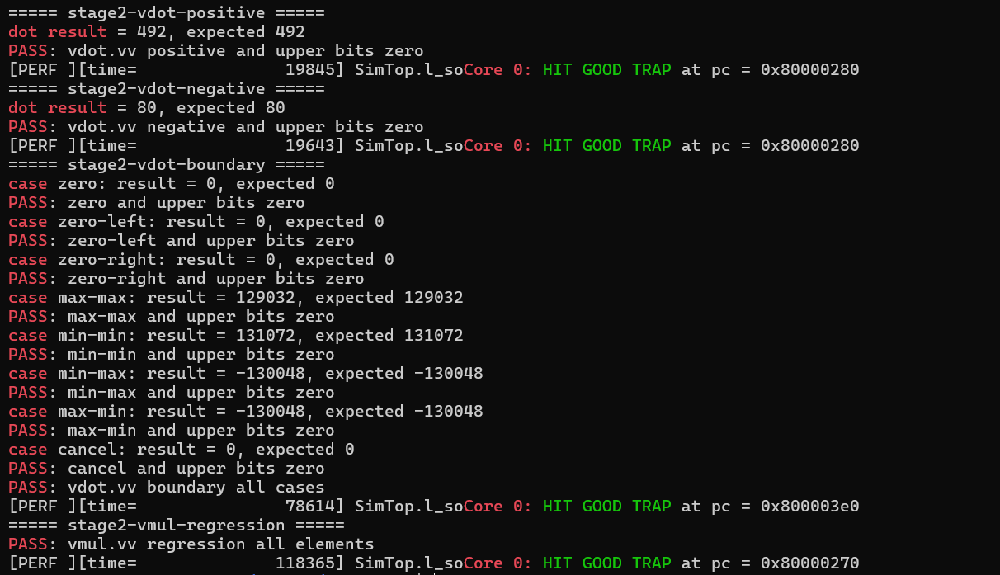
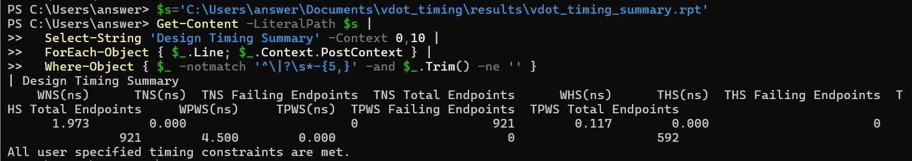
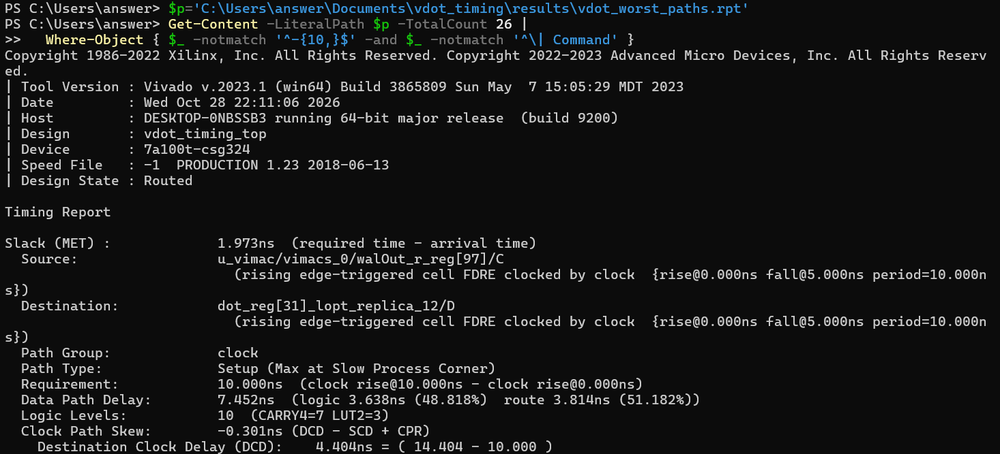

# vdot.vv 自定义点积指令基础测试报告

> CIE 香山赛道第二阶段  RTL 功能回归与 Vivado 时序

团队：一拍即合

# **阅读目录**

点击目录条目跳到对应章节。页脚的“目录”可返回此处。

**[第 1 章 结论](#第-1-章-结论) [[2](#第-1-章-结论)](#第-1-章-结论)**

> [1.1 主要结果](#主要结果) [[2](#主要结果)](#主要结果)
>
> [1.2 测试与设计文档分工](#测试与设计文档分工) [[2](#测试与设计文档分工)](#测试与设计文档分工)

**[第 2 章 测试对象与验收标准](#第-2-章-测试对象与验收标准) [[2](#第-2-章-测试对象与验收标准)](#第-2-章-测试对象与验收标准)**

> [2.1 指令约定](#指令约定) [[2](#指令约定)](#指令约定)
>
> [2.2 验收标准](#验收标准) [[3](#验收标准)](#验收标准)

**[第 3 章 测试环境与构建](#第-3-章-测试环境与构建) [[3](#第-3-章-测试环境与构建)](#第-3-章-测试环境与构建)**

> [3.1 源码与基线](#源码与基线) [[3](#源码与基线)](#源码与基线)
>
> [3.2 仿真构建](#仿真构建) [[3](#仿真构建)](#仿真构建)
>
> [3.3 测试程序构建](#测试程序构建) [[3](#测试程序构建)](#测试程序构建)

**[第 4 章 测试用例与汇编接口](#第-4-章-测试用例与汇编接口) [[4](#第-4-章-测试用例与汇编接口)](#第-4-章-测试用例与汇编接口)**

> [4.1 测试汇编接口](#测试汇编接口) [[4](#测试汇编接口)](#测试汇编接口)
>
> [4.2 正数与负数用例](#正数与负数用例) [[4](#正数与负数用例)](#正数与负数用例)
>
> [4.3 边界用例](#边界用例) [[5](#边界用例)](#边界用例)
>
> [4.4 原有 vmul 测试](#原有-vmul-测试) [[5](#原有-vmul-测试)](#原有-vmul-测试)

**[第 5 章 功能测试结果](#第-5-章-功能测试结果) [[5](#第-5-章-功能测试结果)](#第-5-章-功能测试结果)**

> [5.1 正数与负数](#正数与负数) [[5](#正数与负数)](#正数与负数)
>
> [5.2 边界测试](#边界测试) [[6](#边界测试)](#边界测试)
>
> [5.3 回归测试](#回归测试) [[6](#回归测试)](#回归测试)

**[第 6 章 Vivado 时序测试](#第-6-章-vivado-时序测试) [[6](#第-6-章-vivado-时序测试)](#第-6-章-vivado-时序测试)**

> [6.1 测试范围](#测试范围) [[6](#测试范围)](#测试范围)
>
> [6.2 时序汇总](#时序汇总) [[7](#时序汇总)](#时序汇总)
>
> [6.3 最差路径](#最差路径) [[7](#最差路径)](#最差路径)

**[第 7 章 结果边界](#第-7-章-结果边界) [[7](#第-7-章-结果边界)](#第-7-章-结果边界)**

> [7.1 已经覆盖](#已经覆盖) [[7](#已经覆盖)](#已经覆盖)
>
> [7.2 结论边界](#结论边界) [[7](#结论边界)](#结论边界)

**[第 8 章 复现命令与截图记录](#第-8-章-复现命令与截图记录) [[8](#第-8-章-复现命令与截图记录)](#第-8-章-复现命令与截图记录)**

> [8.1 运行功能测试](#运行功能测试) [[8](#运行功能测试)](#运行功能测试)
>
> [8.2 查看 Vivado 时序](#查看-vivado-时序) [[9](#查看-vivado-时序)](#查看-vivado-时序)

**[附录 A 术语与符号](#附录-a-术语与符号) [[9](#附录-a-术语与符号)](#附录-a-术语与符号)**

# **第 1 章 结论**

第二阶段 RTL 测试通过了正数、混合符号、八个边界用例和 vmul.vv 回归。Vivado 对 vdot 单元完成实现后，在 10 ns 时钟约束下报告 WNS 为 +1.973 ns。

## **1.1 主要结果**

表 1 基础测试与单元级时序结果

| 检查项           | 实测结果                 | 结论         |
|------------------|--------------------------|--------------|
| 正数点积         | 492，脚本期望 492        | PASS         |
| 负数点积         | 80，脚本期望 80          | PASS         |
| 边界测试         | 8 个用例全部一致         | PASS         |
| 已有 vmul 回归   | 16 个元素全部一致        | PASS         |
| vdot Vivado 时序 | 100 MHz 下 WNS +1.973 ns | 时序约束满足 |

在 e8、m1、vl=8、vstart=0、无掩码配置下，所测用例的低 32 位与 C 参考值一致，高 96 位均为零。极值组合也通过了有符号结果检查。

Vivado 使用 Artix-7 xc7a100tcsg324-1，在 10 ns 时钟约束下报告建立时间和保持时间均无违例。该结果适用于测试顶层 vdot_timing_top。

## **1.2 测试与设计文档分工**

本报告记录 RTL 功能、vmul.vv 回归和 Vivado 单元级时序。指令编码和数据通路见第二阶段设计说明，NEMU 扩展、协同仿真、RVV 基线和周期对比见第三阶段材料。

# **第 2 章 测试对象与验收标准**

## **2.1 指令约定**

vdot.vv 对两个源向量的低八个有符号 8 位元素逐项相乘并求和。结果以 32 位补码写入 vd\[31:0\]，vd\[127:32\] 清零。点积从零累加，旧 vd 不参与计算。适用配置为 e8、m1、vl=8、vstart=0、vm=1。

表 2 vdot.vv 的指令编码字段

| 字段       | 取值              | 说明                       |
|------------|-------------------|----------------------------|
| opcode     | 1010111           | OP-V                       |
| funct3     | 010               | OPMVV                      |
| funct6     | 001110            | 当前自定义功能码           |
| vm         | 1                 | 无掩码                     |
| vd/vs1/vs2 | ?????/?????/????? | 支持任意合法向量寄存器编号 |
| 机器码示例 | 0x3a1121d7        | vdot.vv v3, v1, v2         |

## **2.2 验收标准**

表 3 第二阶段测试的验收条件

| 编号 | 检查内容       | 通过条件                             |
|------|----------------|--------------------------------------|
| T1   | 正数结果       | 软件期望为 492，硬件低 32 位等于 492 |
| T2   | 负数与混合符号 | 软件期望为 80，硬件结果相等          |
| T3   | 边界算术       | 8 个边界用例逐项一致                 |
| T4   | 高位清零       | 输出字节 4-15 全部为 0               |
| T5   | 配置返回值     | run_vdot 返回 vl=8                   |
| T6   | 原 vmul 回归   | 16 个字节均等于软件计算值            |
| T7   | 单元时序       | 10 ns 时钟约束下 WNS \>= 0，TNS=0    |

# **第 3 章 测试环境与构建**

## **3.1 源码与基线**

下表记录 XiangShan、YunSuan 和 nexus-am 的基线提交。源码行号需结合相应提交和第二阶段改动核对。Vivado 版本和 FPGA 型号用于复现单元级综合、实现与时序分析。

表 4 工程基线与 Vivado 配置

| 项目      | 基线版本                                 | 用途                 |
|-----------|------------------------------------------|----------------------|
| XiangShan | 16ae9ddcda54fc9a2fddffad73174cf793ac7814 | RTL 与译码           |
| YunSuan   | cadd3c2f43096e253d61296b33ac697be8354e29 | VIMac 数据通路       |
| nexus-am  | 086a238062fdfb3281b745a537b361983d0154b5 | 裸机测试框架         |
| Vivado    | 2023.1                                   | 综合、实现与时序报告 |
| 目标器件  | xc7a100tcsg324-1                         | 单元级时序分析       |

## **3.2 仿真构建**

香山仿真器使用 128 位向量数据宽度，生成 build/emu。构建时用 EMU_TRACE=fst 启用波形支持。功能测试用 --no-diff 运行，测试程序将 RTL 输出与 C 参考值逐项比对。

## **3.3 测试程序构建**

源码 1 测试程序构建命令

> make -C \$AM_HOME/apps/stage2-vdot-positive \\  
> ARCH=riscv64-xs CROSS_COMPILE=riscv64-linux-gnu-  
> make -C \$AM_HOME/apps/stage2-vdot-negative \\  
> ARCH=riscv64-xs CROSS_COMPILE=riscv64-linux-gnu-  
> make -C \$AM_HOME/apps/stage2-vdot-boundary \\  
> ARCH=riscv64-xs CROSS_COMPILE=riscv64-linux-gnu-  
> make -C \$AM_HOME/apps/stage2-vmul-regression \\  
> ARCH=riscv64-xs CROSS_COMPILE=riscv64-linux-gnu-

# **第 4 章 测试用例与汇编接口**

测试程序通过 run_vdot 设置向量状态、执行指令并取回完整的目标寄存器。各组用例沿用这一接口。

## **4.1 测试汇编接口**

源码 2 vdot.S 第 13–41 行

> 13 run_vdot:  
> 14 li t0, 0x600  
> 15 csrs mstatus, t0  
> 16 csrw vstart, zero  
> 20 vsetivli t0, 16, e8, m1, tu, mu  
> 21 vle8.v v1, (a0)  
> 22 vle8.v v2, (a1)  
> 25 vmv.v.i v3, -1  
> 28 vsetivli t0, 8, e8, m1, tu, mu  
> 34 .word 0x3a1121d7  
> 37 vsetivli t1, 16, e8, m1, tu, mu  
> 38 vse8.v v3, (a2)  
> 40 mv a0, t0  
> 41 ret

汇编先用 vl=16 装载两个完整向量，把高八个位置的非零干扰值也送进寄存器，再将 v3 预置为全 1。切到 vl=8 执行点积后，恢复 vl=16 读回全部 16 字节，分别核对低八项的点积和高 96 位清零。

## **4.2 正数与负数用例**

用例摘录 正数与混合符号输入

> 正数 A: {1,2,3,4,5,6,7,8, 127,...}  
> 正数 B: {9,10,11,12,13,14,15,16, 127,...}  
> 期望: 1\*9 + 2\*10 + ... + 8\*16 = 492  
>   
> 负数 A: {-1,2,-3,4,-5,6,-7,8, 127,...}  
> 负数 B: {9,10,-11,-12,13,-14,-15,16, 127,...}  
> 期望: (-1)\*9 + 2\*10 + ... + 8\*16 = 80

main.c 用 int32 循环计算期望值。输出缓冲区预填 0xa5，便于检查存回是否覆盖了全部应写字节。旧 v3 预填全 1，用于检查指令是否清除了目标高位。

## **4.3 边界用例**

表 5 八个边界用例与期望值

| 用例       | 输入 A        | 输入 B | 期望值  |
|------------|---------------|--------|---------|
| zero       | 0             | 0      | 0       |
| zero-left  | 0             | -128   | 0       |
| zero-right | 127           | 0      | 0       |
| max-max    | 127           | 127    | 129032  |
| min-min    | -128          | -128   | 131072  |
| min-max    | -128          | 127    | -130048 |
| max-min    | 127           | -128   | -130048 |
| cancel     | 127,-127 交替 | 127    | 0       |

八个边界用例复用 run_vdot。run_case 生成低八个元素并计算参考值，高八项填 127，输出缓冲区预填 0xa5。每组用例都检查 32 位计算结果及高位清零。

## **4.4 原有 vmul 测试**

vmul.vv 回归用来检查接入点积后的普通逐元素乘法。

测试选择 16 对 int8 输入，包含最大值、最小值和混合符号。执行普通 vmul.vv 后，将每个硬件输出字节与 C 中乘积的低 8 位比较。

所测 16 个字节全部一致。这个结果覆盖本组 vmul.vv 激励。

# **第 5 章 功能测试结果**

## **5.1 正数与负数**

测试输出 1 正数 vdot.vv

> dot result = 492, expected 492  
> PASS: vdot.vv positive and upper bits zero  
> Core 0: HIT GOOD TRAP at pc = 0x80000280

测试输出 2 负数 vdot.vv

> dot result = 80, expected 80  
> PASS: vdot.vv negative and upper bits zero  
> Core 0: HIT GOOD TRAP at pc = 0x80000280

## **5.2 边界测试**

测试输出 3 边界结果

> zero result = 0, expected 0  
> zero-left result = 0, expected 0  
> zero-right result = 0, expected 0  
> max-max result = 129032, expected 129032  
> min-min result = 131072, expected 131072  
> min-max result = -130048, expected -130048  
> max-min result = -130048, expected -130048  
> cancel result = 0, expected 0  
> PASS: vdot.vv boundary all cases  
> Core 0: HIT GOOD TRAP at pc = 0x800003e0

## **5.3 回归测试**

测试输出 4 vmul.vv 回归

> PASS: vmul.vv regression all elements  
> Core 0: HIT GOOD TRAP at pc = 0x80000270

表 6 RTL 功能与回归测试汇总

| 测试      | 覆盖重点                     | 结果     |
|-----------|------------------------------|----------|
| 正数      | 常规正数、和值 492、高位清零 | PASS     |
| 负数      | 混合符号、和值 80、高位清零  | PASS     |
| 边界      | 零、最大值、最小值、抵消     | 8/8 PASS |
| vmul 回归 | 原有逐元素乘法不受影响       | PASS     |

# **第 6 章 Vivado 时序测试**

## **6.1 测试范围**

测试顶层直接例化 VIMacU，并将 VimacType.vdot 送到输入级和输出级控制。Vivado 分析完整乘积、归约和结果寄存器之间的路径。测试顶层的范围止于 VIMacU 及其外围连接。

表 7 Vivado 单元级时序设置

| 项目     | 配置                        |
|----------|-----------------------------|
| Vivado   | 2023.1                      |
| 器件     | xc7a100tcsg324-1            |
| 时钟约束 | create_clock -period 10.000 |
| 实现状态 | Routed                      |
| 顶层     | vdot_timing_top             |
| 操作类型 | VimacType.vdot = 0x067      |

## **6.2 时序汇总**

表 8 实现后建立时间裕量

| 设计      | WNS/ns | TNS/ns | 失败端点 | 结论     |
|-----------|--------|--------|----------|----------|
| vdot 单元 | 1.973  | 0.000  | 0        | 约束满足 |
| vmul 对照 | 5.581  | 0.000  | 0        | 约束满足 |

两份报告均显示 “All user specified timing constraints are met”。vdot 在 10 ns（100 MHz）约束下的最差建立时间裕量为 1.973 ns。

## **6.3 最差路径**

表 9 vdot 与 vmul 的最差路径

| 属性         | vdot 单元            | vmul 对照            |
|--------------|----------------------|----------------------|
| Slack        | 1.973 ns             | 5.581 ns             |
| 起点         | walOut_r_reg\[97\]/C | vs1_q_reg\[1\]/C     |
| 终点         | dot_reg\[31\]/D      | wallaceOut_mid_reg/D |
| 数据路径延迟 | 7.452 ns             | 4.373 ns             |
| 逻辑级数     | 10                   | 3                    |
| 路径类型     | Setup / Max          | Setup / Max          |

vdot 的最差路径从 walOut 对应的寄存器出发，经加法树和结果整理到达 dot 寄存器。该路径为 10 级逻辑，数据路径延迟 7.452 ns。vmul 对照路径为 3 级逻辑、4.373 ns。两组均满足本次单元级时序约束。

# **第 7 章 结果边界**

## **7.1 已经覆盖**

> • 有符号 int8 正数、负数和混合符号运算。
>
> • 最大正和、最大绝对负和及正负抵消。
>
> • 低 32 位结果、高 96 位清零和 vl=8 返回值。
>
> • 高八输入不会错误参与点积。
>
> • 已有 vmul.vv 基础回归和 vdot 单元级时序。

## **7.2 结论边界**

PASS 的适用范围是当前固定向量配置和所列激励。时序结论的适用范围是 xc7a100tcsg324-1 上的单元级 100 MHz 约束。板级验证、整芯片时序和加速比需用各自的实验衡量。

# **第 8 章 复现命令与截图记录**

## **8.1 运行功能测试**

命令 1 运行四组功能测试并筛选日志

> cd /home/answer/xs-env/XiangShan  
> export AM_HOME=/home/answer/xs-env/nexus-am  
> export NOOP_HOME=\$PWD  
>   
> for app in stage2-vdot-positive stage2-vdot-negative \\  
> stage2-vdot-boundary stage2-vmul-regression; do  
> IMG=\$AM_HOME/apps/\$app/build/\$app-riscv64-xs.bin  
> echo "===== \$app ====="  
> ./build/emu -i "\$IMG" --no-diff 2\>&1 \\  
> \| grep --line-buffered -a -E \\  
> "dot result\|case \|PASS\|FAIL\|Core 0:.\*HIT GOOD TRAP"  
> done

图 1 四组 RTL 功能与回归测试输出

图 1 中，正数、混合符号、边界和 vmul.vv 回归四组均打印 PASS 并运行到 HIT GOOD TRAP。边界组逐项列出八个用例的结果与期望值。本次用 --no-diff 运行，第三阶段协同仿真用 --diff 加载参考库。

## **8.2 查看 Vivado 时序**

vdot_timing/results 中的 .rpt 文件记录工具版本、设计顶层、器件与实现状态。图 2 摘录时序汇总，图 3 摘录最差路径。

图 2 vdot 单元的 Vivado 时序汇总

图 3 vdot 单元的 Vivado 最差路径

# **附录 A 术语与符号**

表 10 术语与信号说明

| 术语         | 含义                                           |
|--------------|------------------------------------------------|
| vdot.vv      | 两个向量寄存器的低八组有符号 int8 点积         |
| OPMVV        | RISC-V OP-V 中 funct3=010 的乘加类向量指令格式 |
| SEW / LMUL   | 向量元素宽度 / 寄存器分组倍率                  |
| vl / vstart  | 实际有效元素数 / 起始元素索引                  |
| fullProducts | VIMac64b 引出的八份完整 16 位乘积              |
