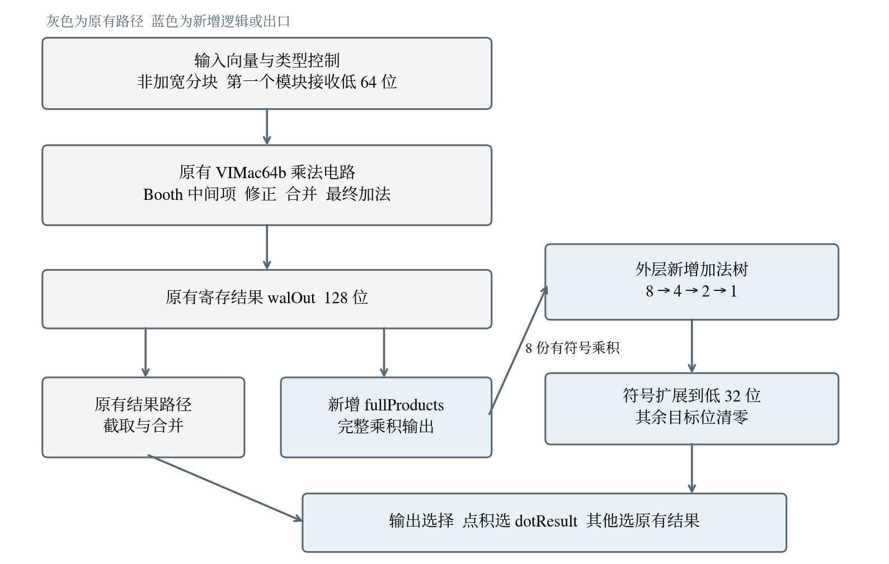

# vdot.vv 自定义点积指令设计说明

> CIE 香山赛道第二阶段  指令语义 微架构与数据通路

团队：一拍即合

# **阅读目录**

点击目录条目跳到对应章节。页脚的“目录”可返回此处。

**[第 1 章 设计决策摘要](#第-1-章-设计决策摘要) [[3](#第-1-章-设计决策摘要)](#第-1-章-设计决策摘要)**

**[第 2 章 指令语义](#第-2-章-指令语义) [[3](#第-2-章-指令语义)](#第-2-章-指令语义)**

> [2.1 计算定义](#计算定义) [[3](#计算定义)](#计算定义)
>
> [2.2 目标寄存器格式](#目标寄存器格式) [[3](#目标寄存器格式)](#目标寄存器格式)
>
> [2.3 支持的配置范围](#支持的配置范围) [[4](#支持的配置范围)](#支持的配置范围)
>
> [2.4 与标准向量归约指令的区别](#与标准向量归约指令的区别) [[4](#与标准向量归约指令的区别)](#与标准向量归约指令的区别)
>
> [2.5 对外指令编码](#对外指令编码) [[4](#对外指令编码)](#对外指令编码)

**[第 3 章 微架构设计](#第-3-章-微架构设计) [[5](#第-3-章-微架构设计)](#第-3-章-微架构设计)**

> [3.1 复用 VIMac 的方案](#复用-vimac-的方案) [[5](#复用-vimac-的方案)](#复用-vimac-的方案)
>
> [3.2 译码接入](#译码接入) [[5](#译码接入)](#译码接入)
>
> [3.3 内部操作编码与原有控制开关](#内部操作编码与原有控制开关) [[5](#内部操作编码与原有控制开关)](#内部操作编码与原有控制开关)
>
> [3.4 流水线落点](#流水线落点) [[6](#流水线落点)](#流水线落点)
>
> [3.5 外层归约的放置位置](#外层归约的放置位置) [[6](#外层归约的放置位置)](#外层归约的放置位置)
>
> [3.6 与 MGU 的关系](#与-mgu-的关系) [[7](#与-mgu-的关系)](#与-mgu-的关系)

**[第 4 章 数据通路](#第-4-章-数据通路) [[7](#第-4-章-数据通路)](#第-4-章-数据通路)**

> [4.1 完整乘积的来源](#完整乘积的来源) [[7](#完整乘积的来源)](#完整乘积的来源)
>
> [4.2 乘积引出端口](#乘积引出端口) [[7](#乘积引出端口)](#乘积引出端口)
>
> [4.3 八份乘积的有符号解释](#八份乘积的有符号解释) [[8](#八份乘积的有符号解释)](#八份乘积的有符号解释)
>
> [4.4 三层加法树与位宽](#三层加法树与位宽) [[8](#三层加法树与位宽)](#三层加法树与位宽)
>
> [4.5 结果构造与写回](#结果构造与写回) [[8](#结果构造与写回)](#结果构造与写回)
>
> [4.6 控制同步与输出选择](#控制同步与输出选择) [[9](#控制同步与输出选择)](#控制同步与输出选择)
>
> [4.7 异常与饱和标志](#异常与饱和标志) [[9](#异常与饱和标志)](#异常与饱和标志)
>
> [4.8 数据通路总图](#数据通路总图) [[10](#数据通路总图)](#数据通路总图)

# **阅读目录（续）**

**[第 5 章 源码改动](#第-5-章-源码改动) [[10](#第-5-章-源码改动)](#第-5-章-源码改动)**

> [5.1 内部类型常量](#内部类型常量) [[10](#内部类型常量)](#内部类型常量)
>
> [5.2 乘法模块端口](#乘法模块端口) [[11](#乘法模块端口)](#乘法模块端口)
>
> [5.3 外层归约与出口](#外层归约与出口) [[11](#外层归约与出口)](#外层归约与出口)
>
> [5.4 测试汇编接口](#测试汇编接口) [[11](#测试汇编接口)](#测试汇编接口)

**[第 6 章 设计过程中遇到的问题](#第-6-章-设计过程中遇到的问题) [[11](#第-6-章-设计过程中遇到的问题)](#第-6-章-设计过程中遇到的问题)**

> [6.1 如何确定一条未被占用的机器码](#如何确定一条未被占用的机器码) [[11](#如何确定一条未被占用的机器码)](#如何确定一条未被占用的机器码)
>
> [6.2 外部机器码与内部操作码为什么可以不同](#外部机器码与内部操作码为什么可以不同) [[12](#外部机器码与内部操作码为什么可以不同)](#外部机器码与内部操作码为什么可以不同)
>
> [6.3 点积判定放在出口](#点积判定放在出口) [[12](#点积判定放在出口)](#点积判定放在出口)
>
> [6.4 选择完整乘积的原因](#选择完整乘积的原因) [[12](#选择完整乘积的原因)](#选择完整乘积的原因)
>
> [6.5 归约位置与实例数量](#归约位置与实例数量) [[12](#归约位置与实例数量)](#归约位置与实例数量)
>
> [6.6 尾部策略与旧目标值](#尾部策略与旧目标值) [[13](#尾部策略与旧目标值)](#尾部策略与旧目标值)

**[第 7 章 设计取舍与验证边界](#第-7-章-设计取舍与验证边界) [[13](#第-7-章-设计取舍与验证边界)](#第-7-章-设计取舍与验证边界)**

> [7.1 收益与代价](#收益与代价) [[13](#收益与代价)](#收益与代价)
>
> [7.2 设计结论](#设计结论) [[13](#设计结论)](#设计结论)
>
> [7.3 验证要求与分工](#验证要求与分工) [[13](#验证要求与分工)](#验证要求与分工)

**[参考资料与定位索引](#参考资料与定位索引) [[14](#参考资料与定位索引)](#参考资料与定位索引)**

vdot.vv 接入香山昆明湖 V2 的向量整数乘法路径。指令读取两路向量低八个有符号 int8 元素，逐项相乘并求和，将结果写入目标寄存器低 32 位，高 96 位清零。

源码摘录标注了文件与行号，定位时请结合封面列出的基线和第二阶段补丁。

# **第 1 章 设计决策摘要**

下表汇总编码、乘积取数、归约和写回的实现选择。

表 1 vdot.vv 的主要设计选择

| 设计项     | 本版选择                                         |
|------------|--------------------------------------------------|
| 外部编码   | OP-V，funct3=010（OPMVV），funct6=001110         |
| 机器码示例 | 0x3a1121d7，即 vdot.vv v3, v1, v2                |
| 内部操作码 | VimacOpcode.vdot = 111，复用 VIMac 乘法路径      |
| 功能单元   | FuType.vimac，不新增功能单元与发射端口           |
| 乘积来源   | VIMac64b 新增 fullProducts 端口，直接引出 walOut |
| 求和结构   | 外层三层有符号加法树 8→4→2→1，纯组合             |
| 结果格式   | 低 32 位补码，高 96 位清零，绕过 MGU 掩码合并    |
| 支持配置   | e8、m1、vl=8、vstart=0、vm=1，其余报非法指令     |

点积复用 VIMac 的乘法流水，从已有的 walOut 寄存结果取数。归约和结果选择落在输出端的组合路径，因此沿用普通向量乘法的流水级数。

# **第 2 章 指令语义**

## **2.1 计算定义**

Aᵢ 和 Bᵢ 分别表示两路源向量的第 i 个字节，按 8 位有符号补码解释。求和范围为 i=0 至 i=7。

dot = Σ(i=0…7) signed8(Aᵢ) × signed8(Bᵢ)

> — 低八个字节参与计算，第 8 个元素及以上的数据不影响结果。
>
> — 累加从零开始，旧 vd 不作为源操作数。
>
> — vd\[31:0\] 写入 32 位补码，vd\[127:32\] 清零。

## **2.2 目标寄存器格式**

当前 VimacCfg.destDataBits 给出的目标宽度为 128 位。八个有符号 int8 乘积的和介于 −130048 和 131072 之间，可用 32 位补码表示。按指令约定，高 96 位固定写零。

标准归约在尾部不变策略下保留未写入的目标部分。本项目的 vdot.vv 固定清零高 96 位，即使 vta 选择尾部不变。测试把旧 vd 置为全 1，便于观察该写入是否生效。

## **2.3 支持的配置范围**

本实现支持固定八元素的有符号字节点积。配置检查拒绝表中范围之外的指令。

表 2 vdot.vv 的配置检查

| 配置项       | 本版要求    | 不满足时 |
|--------------|-------------|----------|
| vtype 合法性 | vill = 0    | 非法指令 |
| SEW          | e8          | 非法指令 |
| LMUL         | m1          | 非法指令 |
| vl           | 8           | 非法指令 |
| vstart       | 0           | 非法指令 |
| vm           | 1（无掩码） | 非法指令 |

例如 e16 或 vl=4 仍可能在固定算术通路上产生一个数值。配置检查把这类请求标记为非法指令，避免按有效点积提交结果。

## **2.4 与标准向量归约指令的区别**

两条指令的区别在参与元素、运算和结果格式，见下表。

表 3 vredsum.vs 与 vdot.vv 的运算和结果格式

| 对比项   | vredsum.vs            | vdot.vv                            |
|----------|-----------------------|------------------------------------|
| 参与元素 | vl 个，随 vtype 变化  | 固定 8 个，与 vl 无关（要求 vl=8） |
| 运算     | 逐元素相加            | 先逐项相乘，再相加                 |
| 结果位置 | vd\[0\]，宽度等于 SEW | vd\[31:0\]，固定 32 位             |

vredsum.vs 的结果宽度随 SEW 变化。vdot.vv 的源元素和结果宽度固定，可以在原有乘法输出上接一条专用归约路径。

## **2.5 对外指令编码**

vdot.vv 使用 OP-V 的 OPMVV 格式，固定 funct3=010、funct6=001110 和 vm=1，三个寄存器编号字段可变。

表 4 vdot.vv 的外部编码

| 字段           | 位位置               | 本版取值        |
|----------------|----------------------|-----------------|
| opcode         | 6:0                  | 1010111（OP-V） |
| funct3         | 14:12                | 010（OPMVV）    |
| funct6         | 31:26                | 001110          |
| vm             | 25                   | 1（无掩码）     |
| vs2 / vs1 / vd | 24:20 / 19:15 / 11:7 | 可变            |

BitPat 为 b0011101??????????010?????1010111。第 25 位为 1，对应 vm=1。示例机器码 0x3a1121d7 对应 vdot.vv v3, v1, v2，编码筛选过程见第 6.1 节。

# **第 3 章 微架构设计**

译码把 vdot.vv 发往 FuType.vimac，乘法仍走原流水，点积归约接在乘积寄存结果之后。

## **3.1 复用 VIMac 的方案**

VIMac 已经实现 Booth 编码、部分积压缩和最终加法，也已接入向量寄存器堆、旁路网络和发射端口。把点积挂到这个单元，可以复用计算和接口。

VIMac64b 通过 fullProducts 引出完整乘积，外层 VIMacU 完成归约、配置检查和结果选择。译码表增加对应条目，沿用现有流水级。

表 5 按层次划分的 RTL 改动

| 层次         | 改动内容                             | 是否改动原有逻辑   |
|--------------|--------------------------------------|--------------------|
| 译码         | 新增一条 BitPat 匹配与 OPMVV 条目    | 否，仅追加         |
| 功能单元外层 | 新增归约树、结果选择、异常判定       | 否，仅替换出口赋值 |
| 乘法模块     | 新增 fullProducts 输出端口与一条连线 | 否                 |
| 乘法内部算法 | 无改动                               | 否                 |

## **3.2 译码接入**

Instructions.scala 定义指令的 BitPat。VecDecoder 在 OPMVV 表中把该模式映射到 FuType.vimac 和 VimacType.vdot。

源码 1 Instructions.scala 第 5–7 行

> 5 object Xvdot {  
> 6 def VDOT_VV = BitPat("b0011101??????????010?????1010111")  
> 7 }

源码 2 VecDecoder.scala 第 371–372 行

> 371 val opmvv: Array\[(BitPat, XSDecodeBase)\] = Array(  
> 372 VDOT_VV -\> OPMVV(F, FuType.vimac, VimacType.vdot, F, T, F, UopSplitType.VEC_VVV),

OPMVV 的七个参数依次控制旧 vd 读取、功能单元、内部操作类型、整数寄存器写入、向量寄存器写入、掩码寄存器写入和微操作拆分。第一项 F 关闭旧 vd 读取，对应点积从零累加的约定。

## **3.3 内部操作编码与原有控制开关**

VimacOpcode 为 3 位。原有 vmul、vmulh、vmacc、vnmsac、vmadd、vnmsub 和 vsmul 使用七种取值，剩余的 111 用于点积。该编号由译码结果传入功能单元，与软件看到的 funct6 分属两层。

源码 3 VimacOpcode.scala 第 13–15 行

> 13 def vsmul = "b110".U(width.W)  
> 14 // 自定义有符号点积；在香山 VIMacU 中使用独立计算分支。  
> 15 def vdot = "b111".U(width.W)

VIMacU 先根据操作编号生成乘法控制，再将这些控制送到两个 VIMac64b 实例。下段代码还传递了 widen 控制。

源码 4 VIMacU.scala 第 118–122 行

> 118 mod.io.highHalf := VimacOpcode.highHalf(opcode)  
> 119 mod.io.isMacc := VimacOpcode.isMacc(opcode)  
> 120 mod.io.isSub := VimacOpcode.isSub(opcode)  
> 121 mod.io.widen := widen  
> 122 mod.io.isFixP := VimacOpcode.isFixP(opcode)

下表列出的五个谓词对 111 均返回 false。乘法器据此执行普通乘法所需的控制组合。

表 6 内部操作编号 111 的乘法控制

| 谓词                  | 对 111 的取值 | 在乘法器内部的作用                   |
|-----------------------|---------------|--------------------------------------|
| highHalf              | false         | 取乘积低半部分；点积不使用这个输出   |
| isMacc                | false         | partProd 的额外加数为 0，不累加旧 vd |
| isSub                 | false         | 不做补码取反，按 vs1×vs2 计算        |
| isFixP                | false         | 不做 vsmul 的定点舍入与饱和          |
| overWriteMultiplicand | false         | 不交换 vs2 与 oldVd                  |

点积复用普通 vmul 的乘法计算。分支发生在输出端，点积使用 walOut 的完整乘积，普通 vmul 继续使用逐元素截取后的结果。出口判定见第 6.3 节。

## **3.4 流水线落点**

点积沿用 VIMac 的两级流水。乘积寄存后，归约和结果选择在第二级组合路径上完成。

表 7 乘法与点积归约的流水级

| 阶段         | 设计动作                                          | 新增寄存器   |
|--------------|---------------------------------------------------|--------------|
| S0　源选择   | 类型拆分、非加宽分块，第一个模块接收低 64 位      | 无           |
| S1　乘法     | Booth 编码、部分积、压缩、最终加法得到 sum_wo     | 无（原有）   |
| S2　结果寄存 | walOut = RegEnable(sum_wo)，同时引出 fullProducts | 无（原有）   |
| S2　归约     | 八份乘积经三层加法树得到 19 位有符号和            | 无（纯组合） |
| 出口　选择   | Mux(outIsVdot, dotResult, mgu.io.out.vd)          | 无           |

VimacCfg 声明的延迟为 2 拍。归约与原有结果整理并行，沿用同一流水级，第二级增加了组合逻辑。

## **3.5 外层归约的放置位置**

VIMacU 用两个 VIMac64b 实例处理 128 位向量。在非加宽配置下，每个实例接收两路源各 64 位。

表 8 两个 VIMac64b 实例的数据分工

| 实例        | 接入的数据                       | 点积是否使用 |
|-------------|----------------------------------|--------------|
| vimacs.head | 两路源的低 64 位（第 0-7 字节）  | 使用         |
| vimacs(1)   | 两路源的高 64 位（第 8-15 字节） | 不使用       |

点积只使用 vimacs.head 的八份低半向量乘积。把归约写进 VIMac64b 的定义会在两个实例中都展开加法树，未使用的一份是否保留到门级取决于综合裁剪。

把归约放到 VIMacU 后，生成结构中只有一套加法树，输入直接来自 vimacs.head。

## **3.6 与 MGU 的关系**

普通向量乘法通过 MGU 做掩码筛选、尾部合并和旧值保留。点积要求无掩码且高位固定清零，因此出口直接选 dotResult。

其他乘法指令仍选择 mgu.io.out.vd，原有 MGU 输入连接继续服务这些指令。

# **第 4 章 数据通路**

数据从 walOut 分成两路。原有乘法结果走逐元素截取与合并，点积使用完整乘积做有符号归约，再按自定义格式构造写回值。

## **4.1 完整乘积的来源**

对于普通 e8 vmul，第二级先把 walOut 分成 16 位乘积，再按控制选择每份的高 8 位或低 8 位。

源码 5 VIMac64b.scala 第 226 行

> 226 sewS2.is8 -\> VecInit(UIntSplit(walOut, 16).map(x =\> Mux(highHalfS2, x(15, 8), x(7, 0)))).asUInt

以 127×127 为例，完整乘积为 16129，截取低八位后只剩 1。归约需要保留每份乘积的完整值，因此在这一行截取前从 walOut 取数。

最终 vd 还可能经过 MGU 的掩码与尾部合并。它适合作为普通乘法的写回值，点积需要的是前一级完整乘积。

## **4.2 乘积引出端口**

VIMac64b 增加 128 位 fullProducts 输出，直接连到 walOut 的寄存结果。

源码 6 VIMac64b.scala 第 30–32 行

> 30 // 引出截取前的乘法/乘加中间结果，与原有 vd 使用相同的流水线时刻。  
> 31 // 点积配置下（有符号 e8、非乘加），包含八份完整的 16 位乘积，低索引在低位。  
> 32 val fullProducts = Output(UInt(128.W))

源码 7 VIMac64b.scala 第 210–213 行

> 210 val walOut = Wire(UInt(128.W))  
> 211 walOut := RegEnable(sum_wo.asUInt, fireS1)  
> 212 // 仅增加连线，复用已有寄存器输出，不新增乘法器或流水级。  
> 213 io.fullProducts := walOut

fullProducts 和普通乘法的结果整理都从同一个 walOut 取数。两路数据在已有寄存边界对齐。

## **4.3 八份乘积的有符号解释**

128 位 fullProducts 切成八个 16 位段，每段是一份 int8×int8 完整乘积，按有符号补码解释。

源码 8 VIMacU.scala 第 133–135 行

> 133 private val dotProducts = Seq.tabulate(8) { i =\>  
> 134 vimacs.head.io.fullProducts(16 \* i + 15, 16 \* i).asSInt  
> 135 }

asSInt 保留原有位模式，只改变加法对这些位的解释。例如 −1×1 得到 16 位全一，按有符号数参与求和为 −1，按无符号数读取则为 65535。

非加宽分块时，vimacs.head 接收两路源的低 64 位，正好包含第 0 至第 7 个字节。点积固定使用这一分块方式。

## **4.4 三层加法树与位宽**

加法树逐层把八份乘积归约成四份、两份和一份结果。

源码 9 VIMacU.scala 第 138–144 行

> 138 private val dotSumL1 = Seq.tabulate(4) { i =\>  
> 139 dotProducts(2 \* i) +& dotProducts(2 \* i + 1)  
> 140 }  
> 141 private val dotSumL2 = Seq.tabulate(2) { i =\>  
> 142 dotSumL1(2 \* i) +& dotSumL1(2 \* i + 1)  
> 143 }  
> 144 private val dotSum = dotSumL2(0) +& dotSumL2(1)

表 9 三层加法树的位宽变化

| 层级           | 数量 | 每份位宽    |
|----------------|------|-------------|
| 输入（乘积）   | 8 份 | 16 位有符号 |
| 第一层         | 4 份 | 17 位       |
| 第二层         | 2 份 | 18 位       |
| 第三层（结果） | 1 份 | 19 位       |

+& 让每层和比输入多一位。单项有符号 int8 乘积范围为 −16256 至 16384，八项和范围为 −130048 至 131072。18 位有符号数的上限为 131071，因此末层需要 19 位。

逐项串接需经过七层加法。平衡树同样用七个加法器，把依赖深度压到三层。

## **4.5 结果构造与写回**

19 位有符号和先扩展成 32 位，再与高 96 位的零拼成完整写回数据。

源码 10 VIMacU.scala 第 146–147 行

> 146 private val dotResult32 = dotSum.pad(32).asUInt  
> 147 private val dotResult = Cat(0.U((dataWidth - 32).W), dotResult32)

dotSum.pad(32) 在有符号类型上做符号扩展，随后 asUInt 保留这 32 位的位模式。Cat 再把高 96 位填零。

顺序会影响负数。如果先转成 UInt，pad 会按无符号数补零，低 32 位便无法保留原来的负数补码。

## **4.6 控制同步与输出选择**

乘积到达输出时，输入端可能已在处理下一条指令。Mux 用随结果到达输出级的 fuOpType，保证数据与控制属于同一条指令。

源码 11 VIMacU.scala 第 130 行

> 130 private val outIsVdot = outCtrl.fuOpType === VimacType.vdot

源码 12 VIMacU.scala 第 179 行

> 179 io.out.bits.res.data := Mux(outIsVdot, dotResult, mgu.io.out.vd)

outCtrl 引用原流水线中已对齐的输出控制。outIsVdot 用完整的 VimacType.vdot 匹配符号、格式和低三位操作码。只比较低三位的局限见第 6.3 节。

## **4.7 异常与饱和标志**

配置检查使用与结果对齐的 outVecCtrl、outVlmul、outVl、outVstart 和 outVm。

源码 13 VIMacU.scala 第 171–185 行

> 171 private val dotConfigIllegal = outVecCtrl.vill \|\|  
> 172 (outVecCtrl.vsew =/= VSew.e8) \|\|  
> 173 (outVlmul =/= VLmul.m1) \|\|  
> 174 (outVl =/= 8.U) \|\|  
> 175 (outVstart =/= 0.U) \|\|  
> 176 !outVm  
> 177  
> 178 // 点积使用完整的自定义结果格式；其他指令沿用原有掩码/尾部合并结果。  
> 179 io.out.bits.res.data := Mux(outIsVdot, dotResult, mgu.io.out.vd)  
> 180  
> 181 // 点积保留完整结果，不发生饱和；原有指令的饱和标志逻辑保持不变。  
> 182 io.out.bits.res.vxsat.get := Mux(outIsVdot, false.B, (outVxsat & mgu.io.out.active).orR)  
> 183 // 点积检查自定义配置限制；其他指令保留原来的异常输出。  
> 184 io.out.bits.ctrl.exceptionVec.get(ExceptionNO.illegalInstr) :=  
> 185 Mux(outIsVdot, dotConfigIllegal, mgu.io.out.illegal)

非法配置会设置 exceptionVec 的非法指令位，交给已有的提交与异常机制处理。即使组合通路算出了数据，也不会按一条正常指令更新架构结果。

点积保存完整乘积并用足够位宽求和，无饱和裁剪，因此该条指令的 vxsat 输出为 false。软件可见的历史饱和状态由原有状态更新机制处理。

## **4.8 数据通路总图**

图 1 中，灰色表示原乘法路径，蓝色表示从 walOut 引出的点积路径。两路在输出 Mux 汇合。

图 1 点积数据通路及其与原有乘法路径的关系

# **第 5 章 源码改动**

六处改动分布在 XiangShan 和 YunSuan 中。下表用短路径定位文件，YunSuan 是 XiangShan 工程的 yunsuan 子模块。

表 10 修改文件及其职责

| 文件                              | 仓库      | 改动                       |
|-----------------------------------|-----------|----------------------------|
| decode/Instructions.scala         | XiangShan | 新增 Xvdot 匹配模式        |
| decode/VecDecoder.scala           | XiangShan | OPMVV 表新增一条译码规则   |
| fu/wrapper/VIMacU.scala           | XiangShan | 归约树、结果选择、异常判定 |
| encoding/Opcode/VimacOpcode.scala | YunSuan   | 新增 vdot = 111            |
| package.scala                     | YunSuan   | 新增 VimacType.vdot 常量   |
| vectorIMAC/VIMac64b.scala         | YunSuan   | 新增 fullProducts 端口     |

## **5.1 内部类型常量**

VimacType.vdot 是 9 位内部类型。字段依次为两位保留位、vs2 类型、vs1 类型、vd 类型、格式和三位操作码。两路源按有符号数解释，vd 类型为 INT.X，格式为非加宽 VVV。

源码 14 package.scala 第 400–402 行

> 400 // 自定义点积：两路源按有符号数解释，不累加旧 vd，使用非加宽格式标记。  
> 401 // 低八个 int8 求点积、低 32 位写回及其余位清零，由 VIMacU 的独立分支实现。  
> 402 def vdot = LiteralCat(0.U(2.W), INT.S, INT.S, INT.X, FMT.VVV, VimacOpcode.vdot)

类型展开为 00_110_0_111。INT.X 描述 vd 类型，译码中的 vdRen=false 关闭旧 vd 读取。

## **5.2 乘法模块端口**

源码 6 和源码 7 分别给出端口声明和连线。一个 VIMac64b 实例形成八份 16 位乘积，128 位端口可以直接引出全部乘积，无需在模块内另加选择逻辑。

## **5.3 外层归约与出口**

源码 8 至源码 10 对应取乘积、归约和结果拼接。源码 11 至源码 13 对应指令选择、异常和饱和输出。

## **5.4 测试汇编接口**

汇编器没有本项目的 vdot.vv 助记符，测试通过 .word 写入机器码。下面节选展示向量状态启用、vstart 清零和 e8、m1、vl=8 配置。完整测试还会以 vl=16 加载干扰数据并读回全部 16 字节，见第二阶段基础测试报告。

源码 15 测试汇编节选

> li t0, 0x600  
> csrs mstatus, t0 \# 打开向量状态  
> csrw vstart, zero  
> vsetivli t0, 8, e8, m1, tu, mu  
> vle8.v v1, (a0)  
> vle8.v v2, (a1)  
> vmv.v.i v3, -1 \# 旧目标置全一，用于观察高位清零  
> .word 0x3a1121d7 \# vdot.vv v3, v1, v2  
> vse8.v v3, (a2)

软件的 .word 与 RTL 的 BitPat 必须一致。本实现使用 0x3a1121d7，切换编码时需要同时更新匹配模式和测试机器码。

# **第 6 章 设计过程中遇到的问题**

## **6.1 如何确定一条未被占用的机器码**

编码筛选分别检查标准指令与本工程译码表，避免候选匹配到已使用的指令。

标准侧使用 RISC-V ISA Explorer 的 Encoder Validator，输入由 0、1 和通配符组成的 32 位模式，查看工具数据库报告的重叠项。

工程侧逐项比对香山 decode_table 中的 BitPat。只要某一位被双方固定且要求相反，两组匹配范围就不相交。若共同固定位全部一致，两组匹配范围存在交集。

源码 16 相交判定

> ((a.value ^ b.value) & a.mask & b.mask) == BigInt(0)

ISA Explorer 的结果对应工具数据库，decode_table 的结果对应所查香山提交。两处检查各有范围。

原筛选记录中，000000 与 VREDSUM.VS 重叠，001100 与 VCLMUL.VV（Zvbc/Zvkns）重叠。001110 在当时两侧的检查中均未发现重叠。

本方案在 OP-V 中使用 001110 作为实验性分配。候选在所查表中空闲，只说明上述检查结果。

## **6.2 外部机器码与内部操作码为什么可以不同**

funct6=001110 是外部机器码字段，111 是 VIMac 内部操作编号。VecDecoder 将两者关联，可以独立调整各自的取值。

若以后需要更换 funct6，需同步修改 Instructions.scala 中的 BitPat 和测试汇编中的机器码。内部操作编号、归约树和出口选择可继续复用。

## **6.3 点积判定放在出口**

点积的类型判定放在 VIMacU 出口，乘法模块仍接收已有的布尔控制。

对操作编号 111，乘法器不累加旧值、不取反、不饱和，也不交换操作数。第 3.3 节列出的五个谓词已经给出了点积所需的控制组合。

出口要区分的是 9 位 VimacType。低三位相同的类型还可能有不同的符号或格式，outIsVdot 因此比较完整值。

isMacc 等控制用于两个乘法实例及其内部运算。outIsVdot 只在 VIMacU 的出口逻辑中定义一次，数据、异常和饱和选择共用这项判定。

## **6.4 选择完整乘积的原因**

普通 vd 已经完成逐元素截取，取数点与点积要求不同。

第 4.1 节中的 127×127 例子说明，低八位为 1 时已经无法从 vd 恢复完整乘积 16129。掩码和尾部合并还可能进一步改变写回字节。

fullProducts 从截取前的 walOut 引出完整乘积，供 VIMacU 归约。

## **6.5 归约位置与实例数量**

设计时也考虑过将求和放进 VIMac64b，只对外提供和。实际使用点积数据的只有低半向量实例。

Seq.fill(2)(Module(new VIMac64b)) 会展开两个乘法模块。如果把加法树写进模块定义，两份实例都会生成该逻辑，高半实例的归约结果没有使用者。

也可以用生成参数只为低半实例生成加法树。这样两个实例会采用不同结构，波形和综合报告需要按实例配置分别解读。

本实现把唯一一套归约放在 VIMacU 外层，只接 vimacs.head。

## **6.6 尾部策略与旧目标值**

INT.X 是旧目标的类型字段。关闭第三源读取依赖译码模板的 vdRen=false。

即使测试把尾部策略设为 tu，点积仍按自定义格式清零高 96 位。测试把旧 vd 置为全 1。如果高位被错误保留，读回值会出现 0xFF。

# **第 7 章 设计取舍与验证边界**

## **7.1 收益与代价**

设计复用已有乘法器和流水级。原有指令保留 MGU 结果分支，点积指令使用新增的归约和写回分支。

主要代价落在第二级组合路径上。从 walOut 经 128 位连线进入加法树，三层分别为 4 个 17 位和、2 个 18 位和、1 个 19 位和，之后接结果整理和 Mux。门级面积与裕量需从综合和时序报告读取。

平衡树缩短了加法依赖链。归约放置位置对关键路径的影响取决于实现与布线结果。

## **7.2 设计结论**

本设计在 VIMac 外层用三层有符号加法归约八份完整乘积，构造低 32 位补码、高 96 位清零的写回结果。第五章给出编码、译码、数据通路和配置检查的源码位置。

本说明记录设计和源码位置。第二阶段基础测试用 C 参考值核对 RTL 输出。NEMU 协同仿真与性能测量分别见第三阶段材料。

## **7.3 验证要求与分工**

验证计划包括正数、混合符号和边界用例。高八个源字节置为非零，旧 vd 置为全 1，以便同时检查取数范围和结果高位。

> — 正数与负数：常规输入与混合符号，核对点积值与高位清零。
>
> — 边界值：零、最大值、最小值、正负抵消。
>
> — 非法配置：不支持的 SEW、LMUL、vl、vstart，以及 vm=0。
>
> — 回归：普通 vmul 与乘加指令结果不受影响。

第三阶段用标准 RVV 指令组合作为基线，结合时钟与周期测量评估延迟、吞吐和加速效果。

# **参考资料与定位索引**

对外语义可查向量规范，模块职责可查香山文档。实际实现以固定提交及项目第二阶段补丁为准。

表 11 规范与源码定位索引

| 对象                              | 用途                                         |
|-----------------------------------|----------------------------------------------|
| RISC-V 向量规范 1.0               | 整数乘法、加宽乘法、乘加、向量配置与状态语义 |
| RISC-V ISA Explorer               | Encoder Validator 的输入形式与重叠分类       |
| 香山文档 V2R2 vimac 页            | vimac 支持指令表；不直接替代目标提交源码     |
| XiangShan decode/\*.scala         | BitPat 定义、OPIVV/OPMVV 分类与译码表        |
| XiangShan fu/wrapper/VIMacU.scala | 归约树、出口选择、配置检查                   |
| YunSuan VimacOpcode.scala         | 三位内部编号与五个控制谓词                   |
| YunSuan package.scala             | VimacType 常量与字段取位函数                 |
| YunSuan VIMac64b.scala            | walOut、结果截取与 fullProducts 端口         |
